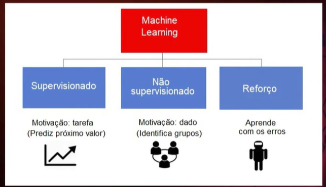

aprendizado de máquina

tópicos

O que é o aprendizado de máquina, a gente aprende com a experiência aprende com a experiência também. 

Então são modelos que faz com que o usuário consiga aprender atividades. 

Alan turing, teste de turing a gente tem uma pessoa que conversa com outros dois objetos que um é um computador e outro não 

e o computador precisa entender quem é o computador e quem não é 

aprendizado de máquina tá ligado a aprender com experiencia

a gente tem um aprendizado de máquina quando um modelo consegue aprender com a experiência que ele já teve. 

as aplicações para aprendizado de máquina são diversos, para reconhecimento facial por exmeplo ou coisas assim

Então temos uma área que expandiu bastante

o algoritmo consegue identificar padrões

a gente tem algo parecido com aprendizado de máquina

tipos de aprendizado de máuqina

a gente tem o supervisonado 

que precisa de supervisão humana para que ele possa ficar eficiente 

um humano vai fazer a classificação inicial para que o algortimo consiga prever

a gente tem aprendizado não supervisionado

nao tem supervisão humana, então a gente tem que ter dados para agrupar

e tem aprendizado por reforço 

não tem supervisão humana. mas a gente tem sempre um aprendizado quando o modelo erra alguma coisa.

podemos dizer também que o aprendizado supervisionado é quando a gente tem todos os dados rotulados

a gente tem um aprendizado semi-supervisionado quando a gente tem alguns dados rotunados e muitos dados que ainda não estão rotulados

e por fim o aprendizado que é não superviosionado que é o que não tem nada rotulado desde o inicio

vies indutivo

a gente tem primeiro a indução 

a gente tem algo que passa do particular para o universal é uma indução 

quando a gente passa de poucos para muito a gente consegue fazer uma indução para fazer uma regra universal

quando a gente tem um conjunto de atributos e valores a gente consegue fazer uma arvore de decisão

aprendizado de máquina: área multidisciplinar

a primeira figura a gente pode ver

a gente tem a inteligencia artificial é  uma ciencia como a matematica ou a biologia, estuda formas de construir programs e máqiuinas inteligentes que possam resolver problemas de forma criativa o qe sempre foi considerado prerrogativa homana

aprendizado de ma´quina é um subconjunto da inteligencia artificial que fornece aos sistema a capacidade de aprender e melhorar automaticamente com a experiencia sem serem explicitamente programados

em aAM existem diferentes algoritmos por exmeplos redes neurais que ajudama a resolver problemas

aprendizado profundo é um subconjunto 

a gente tem os principais tipos de aprendizado de máquina a gente tem o aprendizado supervisionado
não supervisionado
e semi supervisionado ou por reforço

no aprendizado supervisonado é forneciddo um conjunto de dados entrada/siada para etrienamento em que previamente é sabido qual deve ser o resultado correto uma saida para uma dada entrada

a gente tem o aprendizado supervisionado com probelmas de regressão e de classificiação 

problemas de regressão normalmente tentam mapear as entradas em alguma função continua ( tenta-se prever uma função continua a partir do conjunto de dados de entrada/saida fornecidos.)

nos problemas de classificação a gent etem predizer as saidas de forma discreta

tenta-se mapear as entradas em categorias discretas rotulos

exemplo de regressão 

a gente tem varios pontos e a gente pega esses pontos para tentar predizer onde que vai estar o valor de determinado ponto em determinada área 

a gente tem também problemas de classificação 

a gente tem um montem de rotulosprendizado não supervisionado 

o prlbmea é tratado com pouca ou nenhuma ideia de quais resultados serão alcaçados sendo que o algoritmo tentará indeitifcar alguma possível estruutra no conjunto de dados. As tarefas podem ser categorizados como de agrupamento associação e sumarização 

pode ser algo como posição agrupamento espacial, pocomportamento ou tamanho

a gente tem a procura por caracteristicas que aparecem muito que são frequentes

e por fim sumarização busca uma descrição simples e comapctada para um conjunto de dados

exemplo de dados não supervisionado usando agrupamento software que vai ajudar a buscar dados

a gente tem não supervisionado como o de associação para ver itens que são comprados quasse sempre sendo associados a outros

a gente tem outra coisa que pode ser usado é a sumarização 

a gente vai ter um software fazendo resumo de outro texto maior

aprendizado de reforço a gente tem muita semelhança com seres humanos

a gente tem algo para pegar o que foi feito e fazer algo com recompensas

aprendizado de máqinas arvóres de decisão 

a gente tem árvores de decisão 

metodos simbóticos

arvores de decisão e regressão é dividir para conquistar para conseguir classificar masi facil 

a gente tem um algoritmo para contruir a arvore que um dos mais usados é o id3 
a 

o algoritmos mais famoso que existe de arvnore de descisão

basicamente ele funciona todos os exemplos separados para o nosso treinamento 

a gente vai separa 20% para treinamento de 80% para testar

a gente vai escolerh primeiro a renda ou patrimonio

o atributo que melhor divide minha arvore de decisão

então quanto mais exata a divisão é melhor

para que fique mais facil classificar os itens

a entropia é um valor que varia de 0 a 1

a gnete precisa pegar um valor que vai tá dividio de e vai melhorar

Então a gente precisa fazer uma lógica para melhorar a busca

regras de classificação

a gente tem uma serie de dados de treino

e vai ter valores sobre meus dados

então a gente precisa ter varios dados que vão mandar para uma determinada direção 

a gente vai ter vários dados que vão nos ajudar a entender o contexto

entãoa gente vai ter um ganho o valor esperado com o valor da entropia

então a gente vai ter um atributo que vai melhorar a entropia

então a gente vai ter uma arvore que vai ser dividida por 2 

então a gnete vai ter um entropia menor é melhor para que os dados sejam treinaods

mas a gente pode ter mais dados, além de duas, para não dividir, e sim fazer outro caso para melhroar a entropia

então a gente precisa ter uma logica para saber se é poss´viel jogar 

a gente precisa fazer mexer com regras de divisão por entropia

então a 

a gente vai ter dados que são de valores desconehcidos que a gente vai conseguir mexer neles para melhorar o que acontece com algoritmo

a gente tem como fazer estrataegia de poda

a gente tem como fazer overfitting e underffint

a gente pode fazer estrategias de poda, então a gente pode fazer uma estrategia para fazer poda

a ideia é que a gente possa reduzir nossa arvore

então a gente pode fazer somente depois de um primeiro experiemento 

a gente consegue interpretar a arvore

a gente vai ter formatos d ereescritas da árvore para entender o que tá acontecendo 

a gente vai ter regras de decisão 

a gente vai ter arvore de decisão otima para conseguir aprendizagem com valores discretos

a gente vai ter um modelo de caixa branca porque a gente consegue entender o que tá acontecendo 

a gente vai ter um aprendizado de máquina quando a gente vai conseguir fazer mais coisas com o algoritmo 

a gente tem umfoco inicial em tarefas de classificação 

entãoa g ente tem um dados e quer pegar as clsses desses valores

a gente vai ter um trablaho que vai nos ajudar a entender

a gente vai ter aprendizadoo de regras

regras de decisão e árvores de decisão

algo ritmo de cobertura

estratégias top

regra é uma implicação de forma

se A então B 

então age tem ter alguma relação que uma coisa vai implicar outra
