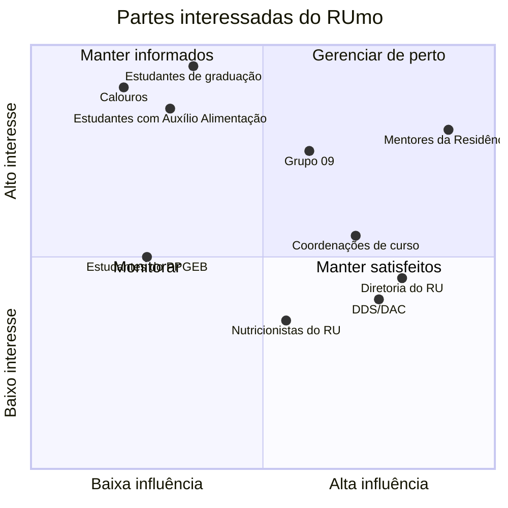

# Partes interessadas

## Mapa de interesse e influência

Figura 1. Interesse × influência, estimados pelo grupo.

## Quem são e o que esperam

| Parte interessada | Papel | O que espera do RUmo | Como entra no projeto |
|---|---|---|---|
| Estudantes de graduação da FCTE | Usuários principais | Respostas rápidas e certas sobre RU e disciplinas, com link para conferir | Perguntas reais na base de testes; validação na Semana 7 |
| Calouros | Usuários com mais dúvidas | Entender ABI, primeiro semestre, carteirinha e RU | Perguntas de ingresso e acesso ao RU |
| Estudantes em vulnerabilidade | Usuários que dependem do RU | Saber se têm direito à gratuidade e como pedir | Fontes do Auxílio Alimentação (Edital 24/2026, Resolução CAD 37/2025) |
| Estudantes com restrição alimentar | Usuários | Opções vegetarianas, alergênicos | Cardápio por dia e guia da ANVISA sobre alergênicos |
| Estudantes do PPGEB e graduandos interessados | Usuários | Regras do mestrado e como cursar disciplina de pós | Páginas do PPGEB |
| Mentores da Residência (ex.: Jefferson) | Avaliadores | Entregas completas, decisões justificadas, métricas | Cada entrega desta GitPage |
| Grupo 09 | Parceiro de integração | Contrato de API estável e mesma identidade visual | [Divisão com o Grupo 09](../visao/escopo-grupos.md) |
| Diretoria do RU (DRU/DAC) | Dona das informações do RU | Informação correta e atualizada, sem substituir os canais oficiais | Fonte dos cardápios, preços e regimento |
| DDS/DAC | Dona dos programas de assistência | Divulgação correta dos editais | Fonte dos editais |
| Coordenações de curso, SAA e DEG | Donas das regras acadêmicas | Que o sistema aponte para o SIGAA como fonte final | Fonte dos PPCs, fluxos, calendário e normas |

Tabela 1. Partes interessadas e expectativas.

## Persona principal

!!! quote "Ana, 19 anos, 3º semestre, ABI Engenharia"
    Mora em Santa Maria e passa o dia no campus. Almoça e janta no RU quase todo dia e quer saber o cardápio antes de sair de casa, porque não come carne vermelha. Vai escolher o curso no fim do semestre e está entre Energia e Software. Quer saber o que muda na grade de cada um e se já pode adiantar alguma disciplina. Ouviu que entrou por cota de escola pública e talvez pague menos no RU, mas não sabe quanto.

Perguntas da Ana que o RUmo responde hoje, com fonte: preço do Grupo IV (R$ 2,50 no almoço, CAD 37/2025), cardápio de cada dia da semana (RU Gama), grades de Energia (251 créditos) e Software (235 créditos) e as regras de escolha de curso na ABI.
