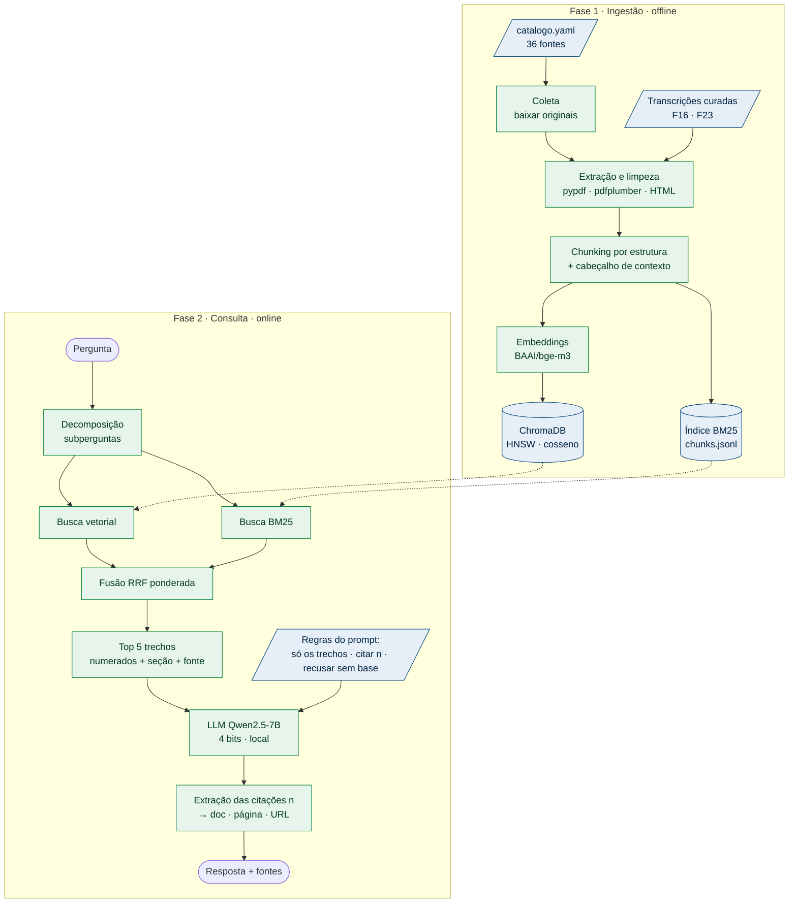

# Diagrama de arquitetura

O RUmo tem duas fases: a **ingestão** (offline, monta a base e o índice) e a **consulta** (online, responde a cada pergunta). O [diagrama animado](../visao/como-funciona.md) mostra as duas, passo a passo, e a conversa com o Grupo 09. A [esteira animada do RAG](../visao/esteira-rag.md) mostra por dentro o caminho de um documento até o banco vetorial e de uma pergunta até a resposta.

## Visão de componentes

Figura 1. Componentes do RUmo. Azul: dados e configuração. Verde: processamento.

## Componentes

| Componente | Tecnologia | Arquivo |
|---|---|---|
| Catálogo das fontes | YAML | `rag/catalogo.yaml` |
| Coleta e extração | urllib, pypdf, pdfplumber, regex | `rag/rumo_rag/extracao.py` |
| Chunking | Python puro | `rag/rumo_rag/chunking.py` |
| Embeddings | sentence-transformers + BAAI/bge-m3 | `rag/rumo_rag/indice.py` |
| Banco vetorial | ChromaDB persistente | `rag/dados/chroma_bge-m3/` |
| Busca lexical | rank_bm25 (Okapi BM25) | `rag/rumo_rag/indice.py` |
| Geração | transformers + bitsandbytes (Qwen2.5-7B-Instruct, NF4); alternativas: Ollama, API compatível com OpenAI, modo extrativo sem LLM | `rag/rumo_rag/geracao.py` |
| Interface | Linha de comando (`perguntar`, `demo`, `avaliar`) | `rag/rumo_rag/__main__.py` |
| Configuração | Variáveis `RUMO_*` | `rag/rumo_rag/config.py` |

Tabela 1. Componentes e onde estão.

## Como a resposta fica fundamentada

1. O LLM **não vê a pergunta sozinha**: recebe os trechos numerados `[1]…[5]`, cada um com documento, órgão, página e seção.
2. As **regras do prompt** mandam responder só com os trechos, citar cada afirmação com `[n]`, não inventar valores, datas, códigos ou pré-requisitos, e dizer "Não encontrei essa informação nas fontes da base." quando faltar base.
3. A geração é **determinística** (sem amostragem), para a mesma pergunta dar a mesma resposta.
4. Depois da geração, o código lê os `[n]` da resposta e devolve a **lista das fontes citadas**, com URL. Citação de número inexistente é descartada.

## Por que um LLM local

| Critério | Local (Qwen2.5-7B, 4 bits) | API paga |
|---|---|---|
| Custo por pergunta | Zero | Por token |
| Privacidade | Pergunta não sai da máquina | Sai |
| Qualidade | Suficiente com RAG; o 1,5B alucinava, o 7B não, nas perguntas da demo | Maior |
| Requisito | GPU de 8 GB (cerca de 5,5 GB usados) | Chave de API |

Tabela 2. Escolha do LLM. A troca é só configuração: <code>--backend ollama</code> ou <code>--backend openai</code>.

