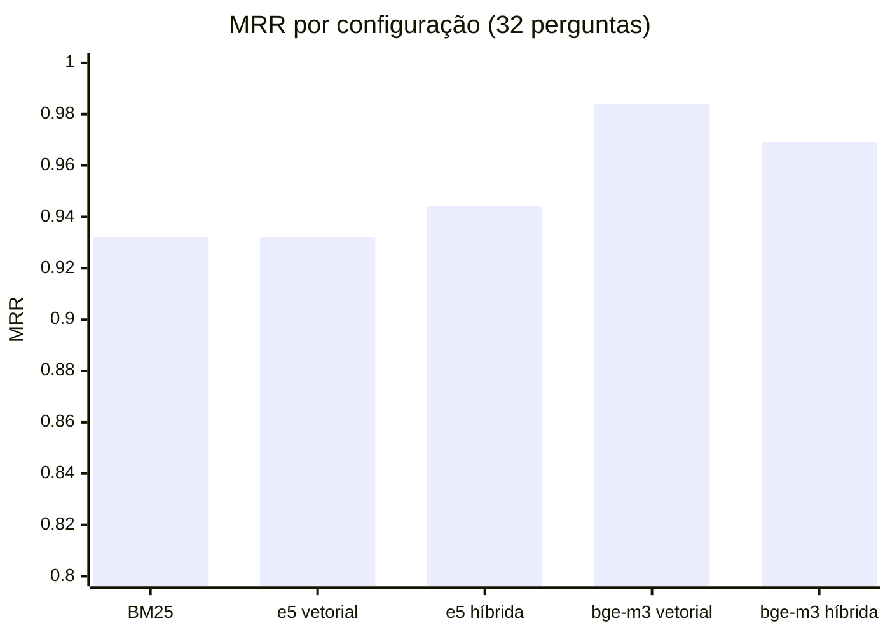

# Avaliação da recuperação

O foco da Entrega 2 é a **qualidade da recuperação**. Para medir isso com objetividade, o grupo montou um **conjunto de teste com 32 perguntas** de estudantes e, para cada uma, os documentos que contêm a resposta.

- Perguntas: `rag/avaliacao/perguntas_ouro.jsonl` (11 do RU, 2 de apoio, 19 do fluxo; todas as engenharias e o PPGEB)
- Comando: `python -m rumo_rag avaliar`
- Resultados: `rag/avaliacao/resultado_recuperacao*.json`

## Métricas

A avaliação da recuperação utiliza três métricas complementares, definidas na **Tabela 1**.

| Métrica | O que mede |
|---|---|
| **Hit@1** | O 1º trecho recuperado é de um documento certo? |
| **Hit@5** | Algum dos 5 trechos entregues ao LLM é de um documento certo? |
| **MRR** | Média de 1/posição do primeiro trecho certo (1 = sempre em 1º; 0,5 = em média em 2º) |

Tabela 1. Métricas. Acerto medido no nível do documento.

## Resultados

A **Tabela 2** compara o desempenho das cinco configurações testadas frente às metas estipuladas na Entrega 1, e a **Figura 1** destaca a evolução do MRR entre cada abordagem.

| Configuração | Hit@1 | Hit@5 | MRR |
|---|---|---|---|
| BM25 (lexical, pós-normalização) | 0,906 | 0,969 | 0,932 |
| Vetorial · multilingual-e5-base | 0,875 | 1,000 | 0,932 |
| Híbrida · multilingual-e5-base | 0,906 | 1,000 | 0,944 |
| Vetorial · **BAAI/bge-m3** | **0,969** | **1,000** | **0,984** |
| Híbrida · **BAAI/bge-m3** (configuração final) | 0,938 | **1,000** | 0,969 |
| *Meta da Entrega 1* | *≥ 0,80* | *≥ 0,90* | *≥ 0,85* |

Tabela 2. Recuperação nas 32 perguntas. Todas as configurações passaram das metas.

!!! note "Fonte dos números desta página"
    Todos os valores das Tabelas 2 e 3 são lidos de `rag/avaliacao/resultado_recuperacao.json`
    e `..._multilingual-e5-base.json`, gerados por `python -m rumo_rag avaliar`. As 32 perguntas
    estão em `rag/avaliacao/perguntas_ouro.jsonl`. Mexeu em chunking, embedding ou fusão? Rode a
    avaliação de novo e atualize estas tabelas no mesmo PR.

Figura 1. MRR por configuração.

## Leitura dos resultados

- **Em 100% das perguntas, o LLM recebeu pelo menos um trecho do documento certo** (Hit@5 = 1,000) em qualquer configuração com vetores. Isso é o que mais importa para a resposta sair fundamentada.
- **O bge-m3 é claramente melhor que o e5-base** em português: errou o 1º lugar em 1 pergunta, contra 4.
- **Por que a configuração final é a híbrida**, se a vetorial pura teve MRR maior: as 32 perguntas quase não têm datas e códigos, e é exatamente nesses identificadores que o vetor falha (ver o [caso do cardápio](embeddings.md#por-que-manter-a-busca-hibrida-se-o-bge-m3-sozinho-foi-melhor-na-media)). O grupo preferiu perder 0,025 de MRR médio a errar o dia do cardápio. Na Semana 3, o conjunto vai ganhar perguntas com datas e códigos, para medir essa troca.

## Onde a busca híbrida não pôs o documento certo em 1º

Das 32 perguntas avaliadas, apenas duas não trouxeram o documento esperado na primeira posição na configuração híbrida final; o diagnóstico de ambas está detalhado na **Tabela 3**.

| Pergunta | Esperado | Veio em 1º | Posição do certo | Causa provável |
|---|---|---|---|---|
| Q01 · "Quanto custa o almoço no RU para um estudante de graduação sem auxílio?" | F01 / F04 (preços) | F06 (Auxílio Alimentação) | 2º | "sem auxílio" puxa os documentos do auxílio; após normalização de sinônimos no BM25 subiu de 5º para 2º no híbrido |
| Q28 · "Qual o período de matrícula do 2026.2?" | F29 (calendário 2026.2) | F30 (calendário 2026.1) | 2º | "2026.2" é quebrado em "2026" e "2", e os dois calendários ficam parecidos |

Tabela 3. Falhas de 1º lugar e próximos ajustes: tratar o semestre ("2026.2") como termo único e reescrever a consulta para tirar negações como "sem auxílio". 

## Modo BM25 em produção (Render) × Híbrido (Issue #51)

A API publicada no Render (`render.yaml`) roda com `RUMO_BUSCA=bm25` porque o plano gratuito limita a memória a **512 MB** (inviabilizando carregar PyTorch, `BAAI/bge-m3` e ChromaDB em produção).

Antes da correção, perguntas como *"qual o preço da refeição no RU para estudantes de graduação?"* falhavam no `bm25` puro: o chunk `F04-0002` (Grupo II, R$ 4,50) usa *"Valores das refeições"* e *"valores atuais"*, enquanto a consulta usa *"preço"* e *"refeição"* (no singular). Nas 32 perguntas-ouro, 5 casos regrediam no `bm25` em relação ao híbrido, com `Q01` (preço do almoço) e `Q24` (vagas de Engenharia de Software) saindo do top-5.

**Decisão tomada:** aplicar **normalização léxica em `tokenizar` (`rag/rumo_rag/indice.py`)** (`SINONIMOS_BM25`, mapeando *"preço"*, *"custa"*, *"tarifa"*, *"valores"* → *"valor"*, além de *"refeições"* → *"refeição"* e *"estudantes"* → *"estudante"*), sem alterar o texto oficial exibido nem aumentar o uso de RAM:

| Configuração | Hit@1 | Hit@5 | MRR | Caso *"preço da refeição... graduação"* |
|---|---|---|---|---|
| BM25 antes da correção | 0,844 | 0,938 | 0,885 | `F04-0002` fora do top-5 |
| **BM25 após normalização (Render)** | **0,906** | **0,969** | **0,932** | **`F04-0002` em 1º lugar** |
| Híbrida após normalização (local) | 0,938 | 1,000 | 0,969 | `F04-0002` no top-3 |

Tabela 4. Impacto da normalização léxica para o modo BM25 em produção (<code>rag/avaliacao/resultado_recuperacao.json</code>).

**Limitação residual documentada:** mesmo após a correção, o `bm25` puro ainda deixa `Q24` (*"Quantas vagas a FCTE oferta para Engenharia de Software?"*) fora do top-5 por ausência de sobreposição léxica direta, mantendo o modo **híbrido** como referência de qualidade sempre que houver memória para embeddings.

## Alergênicos por prato (Issue #55)

A Issue #55 acrescentou ao texto dos cardápios (F08 e F09) a etiqueta de alergênicos de cada opção de prato, lida dos ícones, e incluiu a F37, página "Serviço alimentação" do RU. Nas 32 perguntas-ouro, o BM25 ficou **idêntico**: mesmos documentos nas mesmas posições, com Hit@1 0,906, Hit@5 0,969 e MRR 0,932. Fora dos dois cardápios e da F37, nenhum chunk mudou.

As perguntas novas não fazem parte do conjunto-ouro. Elas foram verificadas no BM25 e respondidas com o Qwen2.5-7B local (Ollama):

| Pergunta | 1º trecho recuperado | Resposta |
|---|---|---|
| *"A lasanha de frango do dia 10/11 tem glúten?"* | `F09-0006`, com *"Lasanha de frango [Alergênicos: Trigo/Glúten, Leite e derivados]"* | Sim, citando o cardápio. Antes da #55, recusava |
| *"O strogonoff de frango do jantar de 11/11 tem leite?"* | `F09-0012`, com leite, glúten e cogumelo | Sim, citando o cardápio |
| *"O mix de doces do almoço de 10/11 tem amendoim?"* | `F09-0006` | Sim, citando o cardápio |
| *"Quantas calorias tem o almoço do RU?"* | Nenhum trecho com calorias | Recusa |
| *"O RU tem opção para quem tem doença celíaca?"* | Trechos do guia da ANVISA (F12), **sem a F37** | — |
| *"O RU atende dieta para celíaco?"* | F37 em 3º lugar | Recusa |

Tabela 5. Perguntas de alergênicos no modo BM25.

As duas últimas linhas mostram uma limitação de vocabulário. A F37 fala em *"dietas especializadas"*, e não em *celíaca*: a fonte só aparece quando a pergunta usa a palavra "dieta", e mesmo assim o modelo recusa, porque a página não fala de doença celíaca. A busca densa deve aproximar os termos pelo significado, mas isso só pode ser confirmado rodando `python -m rumo_rag avaliar` com o BGE-M3. A proposta é incluir perguntas de alergênicos no conjunto-ouro numa próxima revisão.

## Limitações da avaliação

- 32 perguntas é pouco para diferenças pequenas: 1 pergunta vale 0,031 no Hit@1.
- O acerto é por **documento**, não por trecho. Um trecho do documento certo pode não ter a frase exata (por exemplo, Q20 aceita F19 ou F20).
- As perguntas foram escritas pelo grupo. Na Semana 7, entram perguntas reais coletadas com estudantes.
- Esta página mede a **recuperação**. A qualidade da **resposta** (citação e fidelidade) está na [demonstração](demonstracao.md) e será medida em escala na Semana 3 (LLM × RAG).

??? abstract "Histórico de revisão"

    | Data | Versão | Descrição | Autor |
    | :---: | :---: | --- | --- |
    | 09/11/2026 | 1.0 | Avaliação inicial da recuperação (32 perguntas-ouro) | Grupo 04 |
    | 16/11/2026 | 1.1 | Medição BM25 × híbrido e normalização léxica para preços do RU (Issue #51) | Grupo 04 |
    | 18/11/2026 | 1.2 | Alergênicos por prato: BM25 idêntico nas 32 perguntas-ouro e perguntas novas de alergênicos; medição híbrida pendente (Issue #55) | Grupo 04 |
