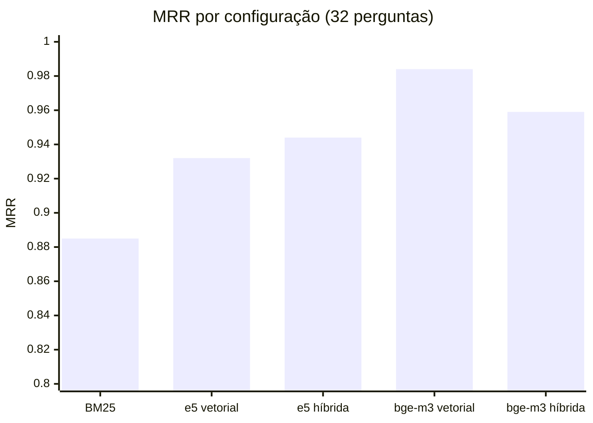

# Avaliação da recuperação

O foco da Entrega 2 é a **qualidade da recuperação**. Para medir isso com objetividade, o grupo montou um **conjunto de teste com 32 perguntas** de estudantes e, para cada uma, os documentos que contêm a resposta.

- Perguntas: `rag/avaliacao/perguntas_ouro.jsonl` (11 do RU, 2 de apoio, 19 do fluxo; todas as engenharias e o PPGEB)
- Comando: `python -m rumo_rag avaliar`
- Resultados: `rag/avaliacao/resultado_recuperacao*.json`

## Métricas

| Métrica | O que mede |
|---|---|
| **Hit@1** | O 1º trecho recuperado é de um documento certo? |
| **Hit@5** | Algum dos 5 trechos entregues ao LLM é de um documento certo? |
| **MRR** | Média de 1/posição do primeiro trecho certo (1 = sempre em 1º; 0,5 = em média em 2º) |

Tabela 1. Métricas. Acerto medido no nível do documento.

## Resultados

| Configuração | Hit@1 | Hit@5 | MRR |
|---|---|---|---|
| BM25 (lexical) | 0,844 | 0,938 | 0,885 |
| Vetorial · multilingual-e5-base | 0,875 | 1,000 | 0,932 |
| Híbrida · multilingual-e5-base | 0,906 | 1,000 | 0,944 |
| Vetorial · **BAAI/bge-m3** | **0,969** | **1,000** | **0,984** |
| Híbrida · **BAAI/bge-m3** (configuração final) | 0,938 | **1,000** | 0,959 |
| *Meta da Entrega 1* | *≥ 0,80* | *≥ 0,90* | *≥ 0,85* |

Tabela 2. Recuperação nas 32 perguntas. Todas as configurações vetoriais e híbridas passaram das metas.

Figura 1. MRR por configuração.

## Leitura dos resultados

- **Em 100% das perguntas, o LLM recebeu pelo menos um trecho do documento certo** (Hit@5 = 1,000) em qualquer configuração com vetores. Isso é o que mais importa para a resposta sair fundamentada.
- **O bge-m3 é claramente melhor que o e5-base** em português: errou o 1º lugar em 1 pergunta, contra 4.
- **Por que a configuração final é a híbrida**, se a vetorial pura teve MRR maior: as 32 perguntas quase não têm datas e códigos, e é exatamente nesses identificadores que o vetor falha (ver o [caso do cardápio](embeddings.md#por-que-manter-a-busca-hibrida-se-o-bge-m3-sozinho-foi-melhor-na-media)). O grupo preferiu perder 0,025 de MRR médio a errar o dia do cardápio. Na Semana 3, o conjunto vai ganhar perguntas com datas e códigos, para medir essa troca.

## Onde a busca híbrida não pôs o documento certo em 1º

| Pergunta | Esperado | Veio em 1º | Posição do certo | Causa provável |
|---|---|---|---|---|
| Q01 · "Quanto custa o almoço no RU para um estudante de graduação sem auxílio?" | F01 / F04 (preços) | F06 (Auxílio Alimentação) | 5º | "sem auxílio" puxa os documentos do auxílio; os chunks de preço são curtos |
| Q28 · "Qual o período de matrícula do 2026.2?" | F29 (calendário 2026.2) | F30 (calendário 2026.1) | 2º | "2026.2" é quebrado em "2026" e "2", e os dois calendários ficam parecidos |

Tabela 3. Falhas de 1º lugar e próximos ajustes: tratar o semestre ("2026.2") como termo único e reescrever a consulta para tirar negações como "sem auxílio" (Semana 3).

## Limitações da avaliação

- 32 perguntas é pouco para diferenças pequenas: 1 pergunta vale 0,031 no Hit@1.
- O acerto é por **documento**, não por trecho. Um trecho do documento certo pode não ter a frase exata (por exemplo, Q20 aceita F19 ou F20).
- As perguntas foram escritas pelo grupo. Na Semana 7, entram perguntas reais coletadas com estudantes.
- Esta página mede a **recuperação**. A qualidade da **resposta** (citação e fidelidade) está na [demonstração](demonstracao.md) e será medida em escala na Semana 3 (LLM × RAG).
