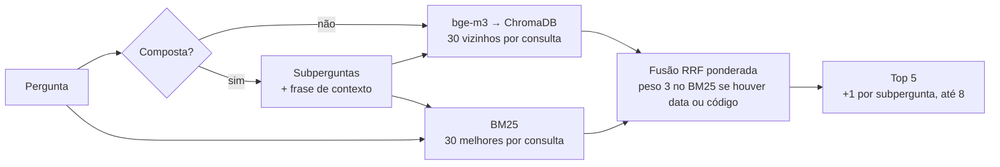

# Banco vetorial

**Resumo:** **ChromaDB** em modo persistente (arquivos locais), coleção `rumo_fcte`, índice **HNSW** com distância de **cosseno**, 1.738 vetores de 1.024 dimensões e metadados completos de cada chunk. Ao lado dele, um índice **BM25** sobre os mesmos chunks, para a busca híbrida.

Código: [`rag/rumo_rag/indice.py`](https://github.com/maykonjuso/residencia-grupo-4/blob/main/rag/rumo_rag/indice.py).

## Por que ChromaDB

| Opção | Prós | Contras | Decisão |
|---|---|---|---|
| **ChromaDB** | Embutido em Python, sem servidor; persistente em disco; filtro por metadado; HNSW | Menos recursos de escala que os bancos-servidor | **Escolhido**: ideal para protótipo e para rodar em qualquer notebook do grupo |
| FAISS | Muito rápido | Só índice; metadados e persistência por nossa conta | Descartado |
| Qdrant / Weaviate / Milvus | Escaláveis, busca híbrida nativa | Exigem servidor (Docker) | Ficam para a Semana 6, se a integração pedir um serviço |
| pgvector | SQL + vetores | Exige PostgreSQL | Descartado nesta fase |

<p class="legenda">Tabela 1. Alternativas consideradas.</p>

## O que fica guardado em cada registro

```json
{
  "id": "F09-0007",
  "embedding": [0.0123, -0.0441, "... 1.024 valores"],
  "document": "Cardápio do RU Gama (FCTE) — Almoço de quarta-feira, 11/11/2026:\n- Salada 1: Alface com mostarda\n...",
  "metadata": {
    "doc_id": "F09",
    "titulo": "Cardápio semanal do RU Gama — 09/11 a 15/11/2026",
    "orgao": "UnB · Diretoria do RU",
    "eixo": "ru",
    "curso": "",
    "tipo": "cardapio",
    "url": "https://ru.unb.br/wp-content/uploads/2026/11/Gama-Semana-04-09-11-a-15-11.pdf",
    "data": "2026-11-09",
    "pagina": 2,
    "secao": "Almoço · quarta-feira 11/11/2026"
  }
}
```

Os metadados servem a três coisas:

1. **Rastreabilidade:** a resposta mostra documento, página e URL de cada citação.
2. **Filtro:** `--eixo ru` ou `--eixo fluxo` restringe a busca (`where={"eixo": "ru"}`).
3. **Contexto para o LLM:** a seção vai junto do trecho ("seção: Almoço · quarta-feira 11/11/2026").

## Busca híbrida



<p class="legenda">Figura 1. Busca híbrida.</p>

**Reciprocal Rank Fusion:** cada chunk recebe `Σ peso / (60 + posição)` em cada ranking em que aparece. A fusão usa a posição, não a nota bruta, então combina rankings com escalas diferentes (cosseno × BM25) sem calibração.

## Tamanho e desempenho

| | |
|---|---|
| Vetores | 1.738 × 1.024 dimensões |
| Diretório | `rag/dados/chroma_bge-m3/` (recriado por `ingerir`, fora do git) |
| Tempo de busca híbrida | ≈ 0,03 a 0,05 s por pergunta (após carregar o modelo) |

<p class="legenda">Tabela 2. Números do índice.</p>
