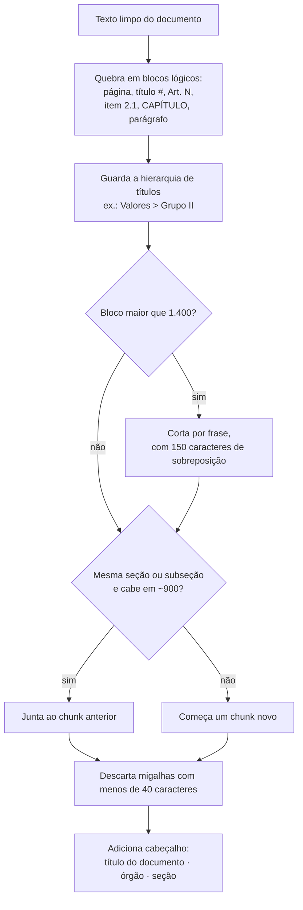

# Estratégia de chunking

**Resumo:** os chunks seguem a **estrutura do documento** (página, títulos, artigos, itens de edital), com alvo de ~900 caracteres (≈ 220 tokens), limite de 1.400 e sobreposição de 150 só quando um bloco precisa ser cortado. Cardápios e grades curriculares têm regras próprias. Cada chunk leva um **cabeçalho de contexto** com o documento e a seção.

Código: [`rag/rumo_rag/chunking.py`](https://github.com/maykonjuso/residencia-grupo-4/blob/main/rag/rumo_rag/chunking.py) e, para os formatos especiais, [`rag/rumo_rag/extracao.py`](https://github.com/maykonjuso/residencia-grupo-4/blob/main/rag/rumo_rag/extracao.py).

## Por que não cortar o texto em pedaços fixos

Os documentos da base são muito diferentes entre si. Um corte cego a cada N caracteres separaria:

- o número do artigo do seu conteúdo ("Art. 2º … II. Grupo II … Almoço: R$ 4,50");
- o dia da semana do prato do cardápio;
- o nível da grade ("5º Nível") das disciplinas daquele nível.

Esses são exatamente os dados que o estudante pergunta. Por isso o corte respeita a estrutura.

## Algoritmo

O processo de divisão em blocos lógicos, controle de tamanho e adição de cabeçalho segue o fluxo ilustrado na **Figura 1**.



<p class="legenda">Figura 1. Fluxo do chunking.</p>

## Parâmetros

Os limites de tamanho e as regras de corte utilizados no pipeline estão resumidos na **Tabela 1**.

| Parâmetro | Valor | Justificativa |
|---|---|---|
| Tamanho-alvo | 900 caracteres | Cabe um artigo de norma ou um item de edital inteiro; 5 chunks somam ~4,5 mil caracteres, confortável para o contexto do LLM |
| Máximo | 1.400 caracteres | Evita chunks que misturam vários assuntos e diluem o embedding |
| Sobreposição | 150 caracteres | Só nos cortes forçados, para não perder a frase que liga dois pedaços |
| Mínimo | 40 caracteres | Remove números de página e rótulos soltos |
| Cardápio | 1 chunk por refeição e por dia | A pergunta é sempre "o que tem no almoço de tal dia" |

<p class="legenda">Tabela 1. Parâmetros e justificativas (em <code>rag/rumo_rag/config.py</code>).</p>

## Casos especiais

=== "Cardápio do RU (PDF em tabela)"

    O PDF tem linhas = componentes e colunas = dias. A extração de texto comum achata as colunas:

    ```text
    PRATO PRINCIPAL VEGETARIANO ESTRITO
    Soja refogada com legumes  Yakissoba
    Abobrinha recheada com lentilha ao sugo Quinoa com legumes refogados ...
    ```

    Não dá para saber qual prato é de qual dia. O RUmo lê a **tabela célula a célula** (pdfplumber) e gera um registro por dia:

    ```text
    ## Almoço · quarta-feira 11/11/2026
    Cardápio do RU Gama (FCTE) — Almoço de quarta-feira, 11/11/2026:
    - Prato principal padrão: Suíno ao molho de bacon
    - Prato principal ovolactovegetariano: Omelete de forno com manjericão e queijo gratinada
    - Prato principal vegetariano estrito: Abobrinha recheada com lentilha ao sugo
    - Guarnição: Mix de batatas assadas
    ...
    ```

    Células mescladas (ex.: "Leite integral OU bebida de soja" para a semana toda) são copiadas para todos os dias.

=== "Grades em abas (Automotiva)"

    A página da Automotiva mostra cada nível em uma aba. Sem tratamento, as disciplinas saem numa lista única, sem nível. A extração converte cada aba em título (`## 1º Nível`) e o rótulo da versão vira título acima dele (`# Para ingressantes a partir de 2027`). O chunk fica com a seção `Para ingressantes a partir de 2027 > 1º Nível`.

=== "Preços do RU (títulos aninhados)"

    Na página de preços, "Grupo II" é um título e "Café da manhã: R$ 2,00" é um subtítulo. A primeira versão do chunking separava os dois, e o chunk de preço ficava sem dizer de qual grupo era. Agora, subseções são unidas à seção-mãe:

    ```text
    Valores das refeições e grupos > Grupo II
    Fazem parte desse grupo: estudantes de graduação e de pós-graduação stricto sensu ...
    Café da manhã: R$ 2,00
    Almoço e jantar: R$ 4,50
    ```

=== "PDFs do SEI (ligadura perdida)"

    Resoluções geradas pelo SEI perdem a ligadura "ti" na extração: "a\x00vidades", "Jus\x00ficado". A limpeza troca o caractere nulo por "ti" antes do chunking.

## Cabeçalho de contexto

O texto que vira embedding (`texto_indexado`) começa com o título do documento, o órgão e a seção:

```text
Cardápio semanal do RU Gama — 09/11 a 15/11/2026 (UnB · Diretoria do RU) · Almoço · quarta-feira 11/11/2026
Cardápio do RU Gama (FCTE) — Almoço de quarta-feira, 11/11/2026:
- Prato principal vegetariano estrito: Abobrinha recheada com lentilha ao sugo
```

Isso resolve chunks que, sozinhos, não dizem de onde são. A página do PPGEB sobre aluno de graduação, por exemplo, nunca escreve "Engenharia Biomédica"; com o cabeçalho, a pergunta "posso cursar disciplina do mestrado em Engenharia Biomédica?" passou a recuperar a página certa em 1º lugar.

## Resultado

A **Tabela 2** apresenta o volume total e a distribuição de tamanho dos chunks gerados após a aplicação dessas regras sobre os 36 documentos.

| | |
|---|---|
| Chunks | 1.738 |
| Tamanho (mín · p25 · mediana · p75 · máx) | 42 · 653 · 847 · 1.213 · 1.983 caracteres |
| Maiores documentos | PPC Aeroespacial (518 chunks), PPC Eletrônica (294), Guia Alimentar (242) |

<p class="legenda">Tabela 2. Distribuição dos chunks.</p>
