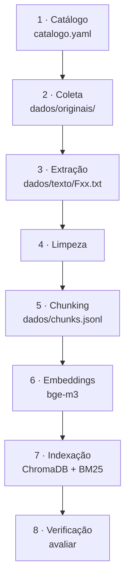

# Pipeline de ingestão de dados

Um único comando refaz tudo, do download ao índice:

```bash
cd rag && python -m rumo_rag ingerir
```

Na RTX 4060, a ingestão completa leva de 45 a 125 s, conforme o modelo de embedding.

## Etapas

O pipeline é dividido em oito passos sequenciais, cujo encadeamento é ilustrado na **Figura 1** e detalhado, com suas respectivas entradas e saídas em disco, na **Tabela 1**.



<p class="legenda">Figura 1. Etapas da ingestão. Cada etapa grava sua saída em disco, para inspeção.</p>

| # | Etapa | O que faz | Saída |
|---|---|---|---|
| 1 | Catálogo | Lista as fontes com ID, título, órgão, eixo, curso, tipo, data e URL. É a única coisa que se edita à mão | `rag/catalogo.yaml` |
| 2 | Coleta | Baixa os originais que ainda não existem localmente (`User-Agent` identificado, timeout de 120 s) | `rag/dados/originais/Fxx.pdf` ou `.html` |
| 3 | Extração | PDF comum → pypdf, com marcador de página. Cardápio → pdfplumber, tabela célula a célula. HTML → conteúdo principal, títulos viram `#`, abas viram seções. Transcrições curadas (`.md`) entram como estão | `rag/dados/texto/Fxx.txt` |
| 4 | Limpeza | Ligadura "ti" do SEI, hífen de quebra de linha, espaços, linhas de navegação ("Read More »"), rótulo de versão da grade vira título | idem |
| 5 | Chunking | Blocos por estrutura, hierarquia de títulos, regras de cardápio ([detalhes](chunking.md)) | `rag/dados/chunks.jsonl` |
| 6 | Embeddings | `texto_indexado` (cabeçalho + conteúdo) → vetor normalizado de 1.024 dimensões | em memória |
| 7 | Indexação | Recria a coleção `rumo_fcte` no ChromaDB, em lotes de 500; o BM25 é montado a partir do `chunks.jsonl` | `rag/dados/chroma_bge-m3/` |
| 8 | Verificação | Roda o conjunto de teste e grava as métricas | `rag/avaliacao/resultado_recuperacao.json` |

<p class="legenda">Tabela 1. Etapas, ferramentas e saídas.</p>

## Saída real da ingestão

```text
$ python -m rumo_rag ingerir
F01:    6221 caracteres · Resolução do CAD nº 0037/2025 — grupos de usuários e valores das refei
F02:   20344 caracteres · Resolução DAC nº 002/2024 — Regimento de funcionamento do Restaurante
...
F08:    9086 caracteres · Cardápio semanal do RU Gama — 02/11 a 08/11/2026
F09:    9131 caracteres · Cardápio semanal do RU Gama — 09/11 a 15/11/2026
...
F17:  459127 caracteres · Projeto Pedagógico do Curso de Engenharia Aeroespacial (PPC 2025)
...
F36:   65079 caracteres · Regimento Interno da Faculdade UnB Gama (FCTE)
36 documentos → 1738 chunks · mediana 847 caracteres
1738 chunks indexados em rag/dados/chroma_bge-m3
ingestão concluída em 100s
```

## Atualização da base

- **Novo documento:** acrescentar uma entrada no `catalogo.yaml` e rodar `ingerir`.
- **Cardápio da semana:** trocar a URL de F08/F09 (ou acrescentar F37, F38…) e rodar `ingerir`. Na Semana 6, um script vai ler a página `ru.unb.br/cardapio-gama/` e fazer isso sozinho.
- **Reprodutibilidade:** os textos extraídos (`dados/texto/`) ficam no repositório, para qualquer pessoa conferir o que o sistema leu. Os originais e o índice são gerados de novo pelo comando.
