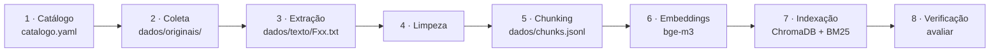

# Pipeline de ingestão de dados

Um único comando refaz tudo, do download ao índice:

```bash
cd rag && python -m rumo_rag ingerir
```

Na RTX 4060, a ingestão completa leva de 45 a 125 s, conforme o modelo de embedding.

## Etapas

O pipeline é dividido em oito passos sequenciais, cujo encadeamento é ilustrado na **Figura 1** e detalhado, com suas respectivas entradas e saídas em disco, na **Tabela 1**.



<p class="legenda">Figura 1. Etapas da ingestão. Cada etapa grava sua saída em disco, para inspeção.</p>

| # | Etapa | O que faz | Saída |
|---|---|---|---|
| 1 | Catálogo | Lista as fontes com ID, título, órgão, eixo, curso, tipo, data e URL. É a única coisa que se edita à mão | `rag/catalogo.yaml` |
| 2 | Coleta | Baixa os originais que ainda não existem localmente (`User-Agent` identificado, timeout de 120 s) | `rag/dados/originais/Fxx.pdf` ou `.html` |
| 3 | Extração | PDF comum → pypdf, com marcador de página. Cardápio → pdfplumber, tabela célula a célula. HTML → conteúdo principal, títulos viram `#`, abas viram seções. Transcrições curadas (`.md`) entram como estão | `rag/dados/texto/Fxx.txt` |
| 4 | Limpeza | Ligadura "ti" do SEI, hífen de quebra de linha, espaços, linhas de navegação ("Read More »"), rótulo de versão da grade vira título | idem |
| 5 | Chunking | Blocos por estrutura, hierarquia de títulos, regras de cardápio ([detalhes](chunking.md)) | `rag/dados/chunks.jsonl` |
| 6 | Embeddings | `texto_indexado` (cabeçalho + conteúdo) → vetor normalizado de 1.024 dimensões | em memória |
| 7 | Indexação | Recria a coleção `rumo_fcte` no ChromaDB, em lotes de 500; o BM25 é montado a partir do `chunks.jsonl` | `rag/dados/chroma_bge-m3/` |
| 8 | Verificação | Roda o conjunto de teste e grava as métricas | `rag/avaliacao/resultado_recuperacao.json` |

<p class="legenda">Tabela 1. Etapas, ferramentas e saídas.</p>

## Saída real da ingestão

```text
$ python -m rumo_rag ingerir
F01:    6221 caracteres · Resolução do CAD nº 0037/2025 — grupos de usuários e valores das refei
F02:   20344 caracteres · Resolução DAC nº 002/2024 — Regimento de funcionamento do Restaurante
...
F08:    9086 caracteres · Cardápio semanal do RU Gama — 02/11 a 08/11/2026
F09:    9131 caracteres · Cardápio semanal do RU Gama — 09/11 a 15/11/2026
...
F17:  459127 caracteres · Projeto Pedagógico do Curso de Engenharia Aeroespacial (PPC 2025)
...
F36:   65079 caracteres · Regimento Interno da Faculdade UnB Gama (FCTE)
36 documentos → 1738 chunks · mediana 847 caracteres
1738 chunks indexados em rag/dados/chroma_bge-m3
ingestão concluída em 100s
```

## Atualização da base

- **Novo documento:** acrescentar uma entrada no `catalogo.yaml` e rodar `ingerir`.
- **Cardápio da semana:** o scraper (abaixo) lê a página do RU Gama e acrescenta a semana nova ao `catalogo.yaml`; depois é só rodar `ingerir`.
- **Reprodutibilidade:** os textos extraídos (`dados/texto/`) ficam no repositório, para qualquer pessoa conferir o que o sistema leu. Os originais e o índice são gerados de novo pelo comando.

## Coleta automatizada do cardápio

O cardápio muda toda semana, e trocar a URL à mão era o passo que mais esquecíamos. O scraper
(`rag/rumo_rag/coleta/scraper.py`, issue #50) faz isso a partir da fonte oficial.

| | |
|---|---|
| **Fonte** | [`ru.unb.br/cardapio-gama/`](https://ru.unb.br/cardapio-gama/) · UnB · Diretoria do RU, registrada em `fontes_de_coleta` no `catalogo.yaml` |
| **Formato** | página HTML com um link por semana ("ISM – 31/08/2026 A 06/09/2026") para um PDF com a tabela do cardápio. Não é imagem: a tabela é lida pela mesma função da ingestão (`extracao._ler_cardapio`) |
| **Saída** | dias da semana com as refeições, no formato do chunking (`## Almoço · terça-feira 01/09/2026`), o que mantém o `api.com_data()` funcionando |

```bash
cd rag
python -m rumo_rag.coleta cardapio --dry-run                     # semana atual: imprime, não grava
python -m rumo_rag.coleta cardapio --dry-run --semana 2026-11-16 # outra semana publicada
python -m rumo_rag.coleta cardapio                               # grava e registra no catálogo
python -m rumo_rag ingerir                                       # indexa a semana nova
```

**O que a gravação faz.** Guarda o HTML bruto da página em `rag/dados/brutos/cardapio-gama/`
(fora do git), o PDF em `rag/dados/originais/F<nn>.pdf` e acrescenta a entrada `F<nn>` no fim
do `catalogo.yaml`, com órgão, URL, data da semana e data da coleta. Rodar de novo na mesma
semana não duplica a entrada.

**Decisões.**

- **Educado com o site institucional:** uma requisição por recurso (a página e o PDF da
  semana), em sequência, sem paralelismo e sem nova tentativa automática, com `User-Agent`
  identificando o projeto
- **Datas pelo texto do link, não pelo nome do arquivo:** os nomes têm número de semana fora
  de ordem (`Gama-Semana-04-12-10-a-18-10.pdf` antes de `Gama-Semana-01-19-10-…`). O nome só é
  usado quando o texto do link não tem datas
- **Datas normalizadas:** os PDFs a partir de ago/2026 escrevem `31/8/2026` e `1º/9/2026`. A
  leitura passou a aceitar esses formatos e sempre produz `dd/mm/aaaa`; seção sem data recebe
  a data pelo dia da semana, com aviso
- **Nada pela metade:** tudo é baixado e lido em memória antes de gravar, e cada arquivo é
  escrito num temporário e renomeado. Sem rede, o comando sai com código 3, explica o motivo
  e não cria nenhum arquivo
- **Se o cardápio virar imagem:** o scraper para com mensagem e não força OCR. A semana passa a
  ser fonte curada à mão, como o fluxograma em `dados/curados/F16_*.md`

Os testes (`rag/testes/test_scraper_cardapio.py`) não acessam a internet: usam uma cópia da
estrutura da página e um PDF com o mesmo layout, em `rag/testes/fixtures/cardapio_gama/`.

---

## Coleta no SIGAA público

A oferta de turmas do semestre e as fichas das disciplinas, com os pré-requisitos, são
coletadas das consultas públicas do SIGAA por `python -m rumo_rag.coleta turmas` e
`python -m rumo_rag.coleta prerequisitos`. A oferta vira a fonte F59 e entra no índice como
as demais. O passo a passo, as limitações e a medição estão em
[Coleta no SIGAA público](coleta-sigaa.md).

??? abstract "Histórico de revisão"

    | Data | Versão | Descrição | Autor |
    | :---: | :---: | --- | --- |
    | 18/11/2026 | 1.1 | Coleta automatizada do cardápio do RU Gama: fonte, formato, comandos e decisões (#50) | Kyara Esteves |
    | 26/11/2026 | 1.2 | Coleta no SIGAA público: oferta de turmas (F59) e pré-requisitos (#52, #56) | Maykon Soares |
