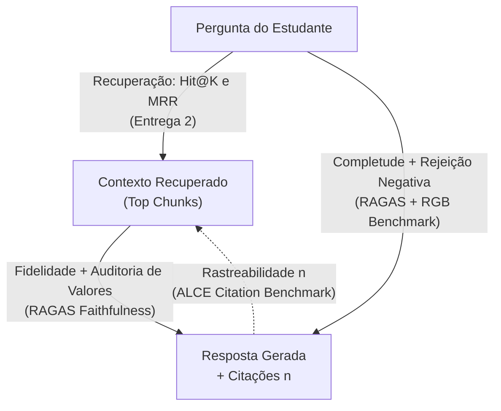
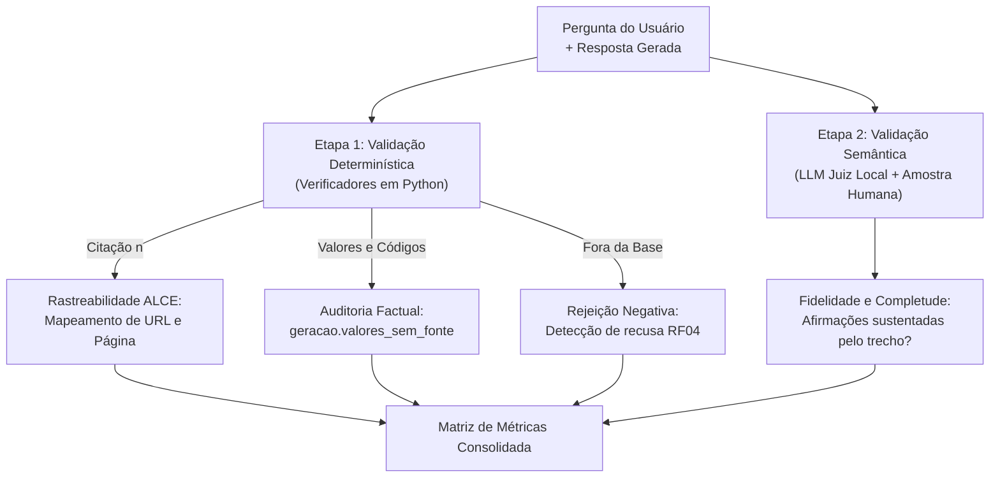

# Fidelidade, alucinação e métricas de resposta

Metodologia de avaliação e matriz de métricas para aferição de **fidelidade factual**, **taxa de alucinação**, **precisão de citações**, **rejeição negativa** e **eficiência operacional** da geração do RUmo.

---

## 1. Fundamentação: o que projetos reais de RAG medem

Na literatura recente e em sistemas de RAG em produção, a avaliação de qualidade deixou de usar métricas léxicas antigas de tradução (como BLEU ou ROUGE, que falham ao avaliar respostas abertas) e consolidou-se em três referências principais que guiam esta entrega:

1. **Tríade do RAG e Framework RAGAS (Es et al., EACL 2024):** Avalia o sistema nos três vértices que ligam **Pergunta**, **Contexto Recuperado** e **Resposta Gerada**:
    - *Context Relevance / Recall* (Pergunta ↔ Contexto): medido no RUmo via **Hit@1, Hit@5 e MRR** na Entrega 2.
    - *Faithfulness / Groundedness* (Contexto ↔ Resposta): mede se a resposta se atém exclusivamente aos trechos recuperados, sem inventar fatos extrínsecos.
    - *Answer Relevance / Completeness* (Pergunta ↔ Resposta): mede se a resposta atende a todas as partes da pergunta do usuário.
2. **Qualidade de Citações — Benchmark ALCE (Gao et al., EMNLP 2023):** Em domínios normativos e institucionais (como resoluções da UnB e editais de assistência estudantil), não basta a resposta estar correta: cada afirmação precisa apontar para o documento oficial que a comprova (*Citation Recall* e *Citation Precision*).
3. **Robustez Comportamental — Benchmark RGB (Chen et al., AAAI 2024):** Avalia capacidades críticas de sistemas RAG reais diante de falhas de contexto:
    - *Negative Rejection* (Rejeição Negativa / Abstenção): capacidade de recusar responder quando os documentos não contêm a informação, em vez de chutar (*cumprimento do RF04*).
    - *Information Integration* (Integração Multi-hop): capacidade de fundir informações de dois ou mais trechos em perguntas compostas.

A **Figura 1** ilustra como a Tríade do RAG e os benchmarks ALCE e RGB são mapeados nas métricas do RUmo.

Figura 1. Adaptação da Tríade do RAG (RAGAS, ALCE e RGB) para as métricas do RUmo.

---

## 2. Metodologia de medição local

Para mensurar essas dimensões sem violar a regra de privacidade local (**RNF02**) nem estourar os limites de hardware da GPU de 8 GB (**R07**), o grupo adotou um pipeline de avaliação próprio e reprodutível em duas etapas complementares. A **Figura 2** ilustra o fluxo de processamento da avaliação de cada resposta.

Figura 2. Pipeline de validação em duas etapas para fidelidade, citação e alucinação.

### Por que não adotar o pacote `deepeval` ou `ragas` diretamente?

Embora o desenho das métricas siga a formulação do RAGAS, do ALCE e do RGB, a execução via biblioteca externa (`deepeval` / `ragas`) foi descartada após análise de viabilidade pelos seguintes motivos de engenharia:

1. **Dependência de APIs pagas por padrão:** Os pacotes usam `gpt-4o` como juiz padrão, violando o requisito **RNF02** (*execução local sem envio de dados a serviços externos*).
2. **Fragilidade de JSON em modelos 7B quantizados:** Quando configurados com modelos locais em 4 bits, os prompts internos em inglês do DeepEval exigem esquemas JSON complexos que sofrem falhas de parsing e risco de *Out of Memory (OOM)* na GPU de 8 GB.
3. **Verificador determinístico de domínio:** No domínio da UnB, o erro mais grave é errar números (preço em R$, data de cardápio, horário, código de disciplina, número de créditos). O verificador determinístico `geracao.valores_sem_fonte` audita 100% desses tokens com precisão exata em milissegundos, algo que um LLM juiz genérico frequentemente deixa passar.

### Camada dupla de segurança e o contraste com o RAG Extrativo

A arquitetura adotada na Entrega 3 combina geração neural local com auditoria simbólica determinística, formando uma camada dupla de proteção contra alucinações:

1. **Geração condicionada ao contexto e citações:** O modelo local (`qwen2.5:7b` via `config.OLLAMA_URL`) recebe os 5 melhores trechos (`k=5`) e é instruído a sintetizar a resposta apenas com base neles, referenciando as fontes com marcadores `[1]`–`[5]` (auditados por `geracao.citacoes_usadas`) ou declarando explicitamente ausência na base (**RF04**).
2. **Pós-validação numérica determinística:** Antes de entregar a resposta ao estudante, `geracao.valores_sem_fonte` utiliza a expressão regular `geracao.PADRAO_VALOR` para extrair números, preços em `R$`, datas, horários, créditos e códigos presentes na resposta gerada e verificar se constam literalmente nos chunks recuperados. Valores sem lastro são flagrados automaticamente em milissegundos.

O estudo comparativo das 4 configurações (ver [LLM Pura vs. RAG](llm-vs-rag.md)) evidenciou por que essa camada dupla é superior ao modo puramente extrativo (`geracao._gerar_extrativo`): embora o **RAG Extrativo** execute em `< 0,1 s` e possua alucinação numérica zero por apenas recortar trechos literais, ele devolve fragmentos truncados sem síntese de regras e **falha na Rejeição Negativa (RF04)**. Diante de perguntas sem base documental (como o cenário canônico `P3` sobre a senha do Wi-Fi da biblioteca), o modo extrativo sempre retorna os trechos mais próximos por similaridade léxica em vez de informar que a informação não existe nos documentos indexados.

---

## 3. Definição das métricas avaliadas

A **Tabela 1** apresenta as definições operacionais de cada métrica monitorada na Entrega 3, sua referência na literatura e a meta estabelecida para o projeto.

| Métrica no RUmo | Equivalente na Literatura | O que mede | Fórmula / Procedimento | Meta |
|---|---|---|---|---|
| **Taxa de Citação Válida** | *Citation Recall & Precision* (ALCE) | Proporção de respostas com marcadores `[n]` que apontam para documentos existentes no contexto recuperado. | `respostas com citação [n] válida / perguntas com base documental` | ≥ 0,95 |
| **Fidelidade Factual** | *Faithfulness / Groundedness* (RAGAS) | Grau em que as afirmações da resposta são comprovadas pelos chunks recuperados, sem extrapolações. | `afirmações comprovadas pelo contexto / total de afirmações da resposta` | ≥ 0,90 |
| **Taxa de Alucinação Numérica/Entidade** | *Extrinsic Hallucination Rate* | Frequência de respostas que contêm preços, datas, horários, códigos ou quantidades ausentes nos chunks (`valores_sem_fonte`). | `respostas com valor sem fonte / total de respostas avaliadas` | 0,00 |
| **Rejeição Negativa (Recusa Correta)** | *Negative Rejection* (RGB) | Capacidade de declarar *"Não encontrei essa informação nas fontes da base"* quando a pergunta extrapola a base. | `recusas corretas (RF04) / total de perguntas sem base` | 1,00 |
| **Completude Multi-hop** | *Information Integration* (RGB) | Proporção de subperguntas respondidas corretamente em consultas compostas (com dois ou mais tópicos). | `subperguntas atendidas / total de subperguntas da consulta` | ≥ 0,85 |
| **Latência Fim a Fim (p50 / p95)** | *End-to-End Latency* (LLMOps) | Tempo decorrido na busca híbrida (`tempo_busca`) somado à inferência do modelo local (`tempo_geracao`). | Medição em segundos via `time.perf_counter()` na GPU de 8 GB. | < 30 s |

Tabela 1. Métricas de avaliação de resposta do RUmo alinhadas à literatura de RAG e LLMOps.

---

## 4. Matriz comparativa de resultados

A **Tabela 2** consolida a estrutura de comparação direta entre o comportamento do modelo isolado (Sem RAG) e o pipeline do RUmo (Com RAG) sobre o conjunto de avaliação, a ser preenchida após as rodadas de teste da semana.

| Métrica de Resposta | Sem RAG (Qwen 7B puro) | Com RAG (RUmo Híbrido) | Meta do Projeto | Status |
|---|:---:|:---:|:---:|:---:|
| **Taxa de citação válida (ALCE)** | 0,00 | *A medir* | ≥ 0,95 | *Pendente* |
| **Fidelidade factual (RAGAS)** | *A medir* | *A medir* | ≥ 0,90 | *Pendente* |
| **Taxa de alucinação (`valores_sem_fonte`)** | *A medir* | *A medir* | 0,00 | *Pendente* |
| **Rejeição negativa / Recusa (RGB)** | *A medir* | *A medir* | 1,00 | *Pendente* |
| **Completude em perguntas compostas (RGB)** | *A medir* | *A medir* | ≥ 0,85 | *Pendente* |
| **Latência média / p95 (LLMOps)** | *A medir* | *A medir* | < 30 s | *Pendente* |

Tabela 2. Comparativo empírico de métricas de fundamentação, robustez e eficiência.

---

??? abstract "Histórico de revisão"

    | Data | Versão | Descrição | Autor |
    | :---: | :---: | --- | --- |
    | 11/11/2026 | 1.0 | Especificação do método de medição, justificativa técnica contra frameworks externos e matriz de métricas | Grupo 04 |
    | 11/11/2026 | 1.1 | Fundamentação das métricas com base na Tríade do RAG (RAGAS), benchmark de citações ALCE e robustez RGB | Grupo 04 |
    | 13/11/2026 | 1.2 | Documentação da camada dupla de segurança (`valores_sem_fonte`) e do trade-off do RAG Extrativo em RF04 | Grupo 04 |
