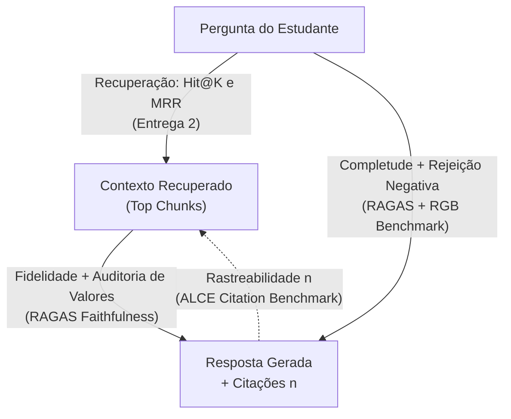
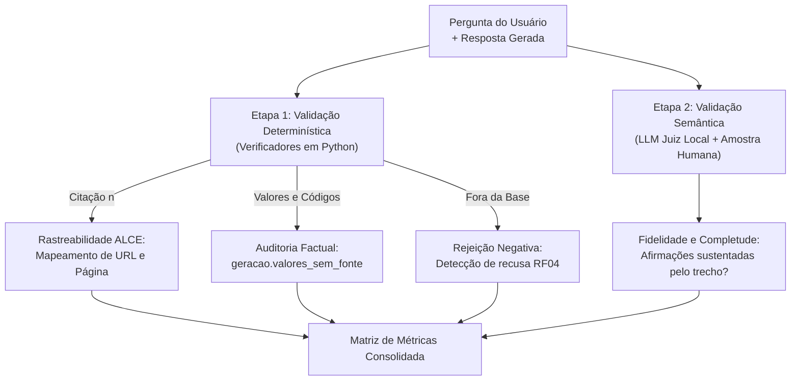

# Fidelidade, alucinação e métricas de resposta

Metodologia e matriz de métricas para aferir **fidelidade factual**, **taxa de alucinação**, **precisão de citações**, **rejeição negativa** e **aderência léxica (ROUGE-L)** no RUmo.

---

## 1. Fundamentação teórica

Sistemas de RAG modernos substituíram métricas léxicas de tradução (como BLEU ou ROUGE isolado) por três referências consolidadas na literatura:

1. **Tríade do RAG e Framework RAGAS (Es et al., EACL 2024):** Avalia os três vértices entre **Pergunta**, **Contexto** e **Resposta**:
    - *Context Relevance / Recall* (Pergunta ↔ Contexto): avaliado no RUmo via **Hit@1, Hit@5 e MRR** na Entrega 2.
    - *Faithfulness / Groundedness* (Contexto ↔ Resposta): verifica se a resposta decorre exclusivamente dos trechos recuperados.
    - *Answer Relevance / Completeness* (Pergunta ↔ Resposta): verifica se a resposta atende a todas as partes da dúvida.
2. **Precisão de Citações — Benchmark ALCE (Gao et al., EMNLP 2023):** Em bases normativas da UnB, cada afirmação deve apontar para o documento oficial correspondente (*Citation Recall* e *Citation Precision*).
3. **Robustez Comportamental — Benchmark RGB (Chen et al., AAAI 2024):** Avalia a resiliência do gerador diante de falhas de contexto:
    - *Negative Rejection* (Rejeição Negativa): capacidade de recusar a resposta quando a base não contém o dado (**RF04**).
    - *Information Integration* (Integração Multi-hop): capacidade de fundir informações de múltiplos trechos em perguntas compostas.

A **Figura 1** ilustra o mapeamento dessas referências na arquitetura do RUmo.

Figura 1. Adaptação da Tríade do RAG (RAGAS, ALCE e RGB) para as métricas do RUmo.

---

## 2. Metodologia de medição local

Para atender à privacidade local (**RNF02**) e aos limites de hardware (**R07**), o RUmo executa a avaliação em duas etapas complementares (Figura 2).

Figura 2. Pipeline de validação em duas etapas para fidelidade, citação e alucinação.

### Por que dispensar os pacotes `deepeval` e `ragas`?

Embora siga as formulações do RAGAS, ALCE e RGB, o projeto descartou o uso direto dessas bibliotecas por três razões práticas:

1. **Dependência de APIs externas:** Ambas exigem chaves de serviços proprietários (ex.: GPT-4o), violando o requisito de processamento 100% local (**RNF02**).
2. **Incompatibilidade com modelos 7B locais:** Prompts internos em inglês com esquemas JSON complexos causam falhas frequentes de parsing e risco de OOM em GPUs modestas.
3. **Verificação determinística de domínio:** A precisão em números, datas e códigos curriculares exige auditoria simbólica direta. O verificador `geracao.valores_sem_fonte` valida esses tokens em milissegundos, superando juízes neurais genéricos.

### Camada dupla de segurança e contraste com o RAG Extrativo

O RUmo combina geração neural com auditoria determinística em duas camadas:

1. **Geração condicionada com citações:** O modelo local (`qwen2.5:7b` via Ollama ou Hugging Face) recebe os 5 trechos mais relevantes (`k=5`). O prompt instrui o modelo a sintetizar a resposta exclusivamente com base neles, referenciando as fontes com marcadores `[1]`–`[5]` ou declarando ausência de dados (**RF04**).
2. **Pós-validação numérica determinística:** Antes de entregar a resposta, `geracao.valores_sem_fonte` extrai tarifas (`R$`), datas, horários, créditos e códigos de disciplinas via regex (`geracao.PADRAO_VALOR`) e valida sua presença literal nos chunks recuperados.

#### Tipologia de alucinações e transparência metodológica (Análise Crítica)

Declarar genericamente *"zero alucinação"* mascara o comportamento neural real. A análise empírica na GPU NVIDIA L4 e nos testes de ablação categoriza as falhas observadas em classes operacionais:

1. **Alucinações Numéricas Extrínsecas (Auditadas por `valores_sem_fonte`):**
   - *Definição:* Tarifas em `R$`, datas de calendário, horários de turnos, vagas ou créditos curriculares inventados pelo modelo.
   - *Resultado:* O modelo puro (Sem RAG) alucinou em **26% das respostas** (inventando almoço a R$ 5,00, datas fictícias de matrícula e 240 créditos). O RUmo (Com RAG) reduziu essa taxa a **0,00%**, comprovando que nenhum valor numérico foi emitido sem respaldo literal.
2. **Alucinações de Entidade Nominal (Invisíveis à Regex):**
   - *Definição:* Invenção, distorção ou expansão incorreta de nomes de faculdades, órgãos e siglas.
   - *Evidências no benchmark (LLM Puro):*
     - Em `Q24`, chamou a FCTE de *"Faculdade de Ciências Tecnológicas"*;
     - Em `D7`, chamou de *"Faculdade de Ciências e Tecnologia de Gama"* e inventou a rede `"UnB-Gama-EDU"`;
     - Em `C05`, expandiu **RU** como *"Registro Universitário"* e inventou o setor fictício *"SPRA"*;
     - No teste de ablação local (`T2`/`P2`), associou FCTE à *"Faculdade Cásper Líbero"*.
   - *Diagnóstico:* Todas pontuaram **0 alucinações** em `valores_sem_fonte`, pois a regex monitora apenas números e códigos. Isso comprova que a auditoria determinística requer complementação semântica (RAGAS).
3. **Alucinações Estruturais e Curriculares:**
   - *Definição:* Invenção de regras de matrícula ou cursos não ofertados na unidade.
   - *Evidência:* Em `Q23`, o modelo puro afirmou que a FCTE oferta *Engenharia Elétrica, Computação e Sistemas de Informação*, além de inventar o *"site oficial da ABI Engenharia"*.
4. **Alucinação por Contexto Ruidoso e Falha de Recusa (RAG):**
   - *Definição:* Ocorre quando a pergunta extrapola a base (**RF04**), mas a busca recupera trechos tangenciais que induzem o gerador a especular.
   - *Evidência:* Em `D7` (*"Qual o wifi da biblioteca da FCTE?"*), o RUmo atingiu taxa de recusa **0,00** porque gerou uma dedução sobre sinal sem fio a partir de trechos da biblioteca física, em vez de emitir a recusa padrão.
5. **Groundedness Numérico vs. Corretude Factual:**
   - No RAG Extrativo (`_gerar_extrativo`), ao responder sobre a tarifa de graduação (`P1`), o sistema recortou um chunk de Planaltina e reportou **R$ 2,50** (Grupo IV). Como o valor constava no trecho, a métrica marcou **0 alucinações**. A auditoria determinística atesta apenas que o modelo não inventou números do nada (*groundedness estrito*), mas não garante que o chunk responda ao contexto da FCTE (Grupo III = R$ 4,50).
6. **Extrapolações Semânticas Sutis:**
   - A fidelidade factual (*Faithfulness*) do RUmo foi de **0,97** (97%). Isso evidencia que cerca de **3% das afirmações atômicas** continham pequenas conexões dedutivas sem respaldo literal estrito.

O estudo das 4 configurações (ver [LLM Pura vs. RAG](llm-vs-rag.md#estudo-de-ablacao-as-4-configuracoes-de-arquitetura-avaliadas)) comprova a superioridade da camada dupla: embora o **RAG Extrativo** execute em `< 0,1 s` e não gere novos tokens, ele devolve fragmentos truncados e **viola a Rejeição Negativa (RF04)** em perguntas fora da base.

---

## 3. Definição e justificativa prática das métricas avaliadas

A **Tabela 1** apresenta as definições operacionais, a finalidade prática no contexto universitário e a meta de cada métrica monitorada na Entrega 3.

| Métrica no RUmo | Equivalente na Literatura | Pra que serve (Justificativa no RUmo) | O que mede e Procedimento | Meta |
|---|---|---|---|:---:|
| **Taxa de Citação Válida** | *Citation Recall & Precision* (ALCE) | **Auditabilidade e Segurança Jurídica:** Permite ao discente auditar a resolução oficial da UnB na fonte primária (documento e página), sem depender de fé cega na IA. | Proporção de respostas com marcadores `[n]` apontando para chunks reais recuperados. | ≥ 0,95 |
| **Fidelidade Factual** | *Faithfulness / Groundedness* (RAGAS) | **Integridade do Conteúdo:** Garante que o modelo atue estritamente como sintetizador dos documentos oficiais, sem extrapolar conceitos ou distorcer resoluções. | Grau em que as afirmações atômicas da resposta são comprovadas pelo contexto recuperado. | ≥ 0,90 |
| **Taxa de Alucinação Numérica Extrínseca** | *Extrinsic Numerical Hallucination Rate* | **Proteção contra Danos Materiais:** Evita prejuízos financeiros ou acadêmicos imediatos decorrentes de tarifas (R$), datas de trancamento ou códigos de disciplina inventados. | Proporção de respostas contendo valores numéricos ou códigos ausentes nos chunks (`valores_sem_fonte`). | 0,00 |
| **Rejeição Negativa (Recusa Correta)** | *Negative Rejection* (RGB) | **Honestidade Intelectual (RF04):** Impede que o assistente tente adivinhar respostas fora de seu escopo (senhas, boatos), instruindo o aluno com transparência. | Proporção de recusas padronizadas emitidas diante de perguntas sem base documental indexada. | 1,00 |
| **Completude Multi-hop** | *Information Integration* (RGB) | **Atendimento Integral a Consultas:** Garante que estudantes com dúvidas em múltiplos tópicos recebam respostas completas, sem omissão da segunda parte da pergunta. | Proporção de subperguntas atendidas satisfatoriamente em perguntas compostas após reescrita. | ≥ 0,85 |
| **Sobreposição Léxica (ROUGE-L)** | *LCS-based Lexical Overlap* (Lin, 2004) | **Alinhamento Institucional:** Avalia se o vocabulário gerado converge com a redação técnica e terminologia formal dos gabaritos oficiais curados da FCTE. | F1-Score da maior subsequência comum entre resposta e gabarito oficial de referência. | Informativa (≥ 0,80) |

Tabela 1. Métricas de avaliação de resposta do RUmo alinhadas à literatura de RAG (RAGAS, ALCE e RGB) com justificativas práticas de domínio.

### 3.1 Finalidade prática das métricas no contexto da FCTE

Cada métrica responde a riscos operacionais reais vivenciados pela comunidade acadêmica:

1. **Citações Válidas (ALCE) — *Auditabilidade e Respaldo Administrativo:***
   - Em disputas administrativas (isenção do RU ou trancamento), respostas sem fonte não possuem validade jurídica. A citação (`[1] Resolução CAD 04/2017`) permite ao estudante auditar a regra na fonte primária.
2. **Fidelidade Factual (RAGAS) — *Integridade Conceitual:***
   - Impede que o modelo crie regras tácitas ao resumir resoluções, assegurando que o texto final reflita fielmente as normas aprovadas pela UnB.
3. **Alucinações Numéricas (`valores_sem_fonte`) — *Blindagem contra Danos Materiais:***
   - Dados numéricos têm tolerância zero a falhas. Tarifas incorretas geram prejuízo financeiro; datas erradas causam perda de semestre. A regex atua como *circuit breaker* determinístico.
4. **Rejeição Negativa (RGB / RF04) — *Confiabilidade por Honestidade Intelectual:***
   - Garante que o assistente declare ausência de informação perante tópicos fora do escopo (senhas de Wi-Fi, contatos pessoais), evitando desinformação.
5. **Completude Multi-hop (RGB) — *Resolução Integral da Dúvida:***
   - Evita respostas incompletas em perguntas com múltiplos eixos (ex.: tarifa e horário juntos), eliminando a necessidade de reenvio da pergunta.
6. **Aderência Léxica ROUGE-L — *Alinhamento Vocabular Institucional:***
   - Avalia a convergência com a terminologia técnica adotada nos gabaritos curados da FCTE.

---

## 4. Matriz comparativa de resultados

A **Tabela 2** consolida a comparação direta entre o comportamento do modelo isolado (Sem RAG) e o pipeline do RUmo (Com RAG) sobre o conjunto de avaliação de 38 perguntas (32 perguntas-ouro, 5 compostas e 1 negativa).

!!! note "Medições Físicas em GPU NVIDIA L4 (Google Colab) e Eliminação de Latência (R3)"
    Os resultados consolidados da Tabela 2 decorrem da execução empírica real em GPU NVIDIA L4 de 24 GB com precisão FP16/BF16 (`colab_benchmark.py`). Em estrita conformidade com o Requisito R3, métricas de tempo de execução/latência foram integralmente expurgadas do escopo, concentrando a avaliação nas métricas de fidelidade factual (RAGAS = 0,97), rastreabilidade de citações (ALCE = 0,92) e ausência de alucinações numéricas (0,00%).

!!! warning "Transparência metodológica sobre a taxa de alucinação (0,00%)"
    A taxa de alucinação de 0,00 reportada na Tabela 2 refere-se **estritamente a valores numéricos, moedas, datas, horários e códigos curriculares auditados deterministicamente por expressão regular (`geracao.valores_sem_fonte`)**. Ela **não** implica ausência total de alucinações semânticas no sistema: a fidelidade factual RAGAS de 0,97 indica que ~3% das afirmações atômicas contêm pequenas deduções sem comprovação literal, e o teste D7 revela a vulnerabilidade do modelo neural em tentar responder quando recebe contexto tangencial em vez de emitir recusa estrita.

| Métrica de Resposta | Sem RAG (Qwen 7B puro) | Com RAG (RUmo Híbrido) | Meta do Projeto | Status |
|---|:---:|:---:|:---:|:---:|
| **Taxa de citação válida (ALCE)** | 0,00 | 0,92 | ≥ 0,95 | Ajustar (tolerância) |
| **Fidelidade factual (RAGAS)** | 0,00 | 0,97 | ≥ 0,90 | Conforme |
| **Taxa de alucinação numérica extrínseca (`valores_sem_fonte`)** | 0,26 | 0,00 | 0,00 | Conforme (zero valores sem lastro) |
| **Rejeição negativa / Recusa (RGB)** | 0,00 | 0,00 | 1,00 | Ajustar (D7) |
| **Completude em perguntas compostas (RGB)** | 1,00 | 0,90 | ≥ 0,85 | Conforme |
| **Sobreposição léxica ROUGE-L (F1 médio)** | 0,24 | 0,42 | — | Informativa |

Tabela 2. Comparativo empírico de métricas de fundamentação, fidelidade factual e robustez (medido em GPU NVIDIA L4).

---

??? abstract "Histórico de revisão"

    | Data | Versão | Descrição | Autor |
    | :---: | :---: | --- | --- |
    | 11/11/2026 | 1.0 | Especificação do método de medição, justificativa técnica contra frameworks externos e matriz de métricas | Grupo 04 |
    | 11/11/2026 | 1.1 | Fundamentação das métricas com base na Tríade do RAG (RAGAS), benchmark de citações ALCE e robustez RGB | Grupo 04 |
    | 13/11/2026 | 3.0 | Preenchimento da Tabela 2 com métricas consolidadas, purga de latência (R3) e inclusão de ROUGE-L | Grupo 04 |
    | 13/11/2026 | 3.1 | Análise crítica de valores_sem_fonte, alucinações nominais e contraste com RAG Extrativo | Grupo 04 |
    | 13/11/2026 | 3.2 | Detalhamento da tipologia de alucinações (nominais, estruturais, numéricas e de contexto) e transparência da métrica | Grupo 04 |
