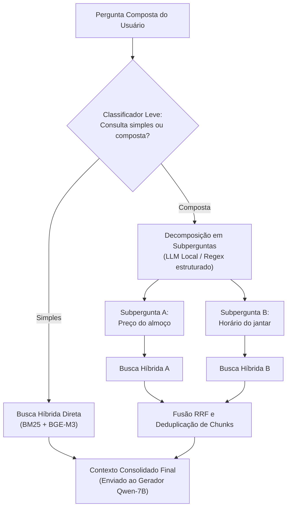

# Reescrita de consulta para perguntas compostas

Pipeline de **decomposição e reescrita de consultas** (*multi-hop*) para mitigar a recuperação parcial de informações (**R04**).

---

## 1. O problema da recuperação parcial

Consultas acadêmicas frequentemente cruzam múltiplos eixos em uma única mensagem:

> *"Qual é o preço do almoço para estudante e qual o horário de funcionamento do jantar no campus Gama?"*  
> *(Cruza a tabela de tarifas do CAD com a escala de horários da Diretoria do RU)*

Ao codificar uma consulta composta em um único vetor, a busca vetorial converge para a média semântica dos temas. O índice recupera apenas trechos do tópico dominante e omite o secundário (*information starvation*), gerando respostas incompletas.

---

## 2. Arquitetura em dois estágios

Para resolver essa limitação, o RUmo executa um pipeline de triagem leve e decomposição neural (Figura 1).

Figura 1. Pipeline de decomposição e reescrita para perguntas multi-hop.

### Fluxo de processamento

1. **Triagem rápida (Estágio 1):** O classificador leve `LiquidAI/d1-omni-600M` avalia a consulta em milissegundos. Se a probabilidade de composição superar o limiar calibrado (`0.3891`), aciona a decomposição.
2. **Decomposição neural (Estágio 2):** O modelo local divide a consulta original em duas subperguntas atômicas e independentes.
3. **Busca híbrida paralela:** Executa a recuperação híbrida (BM25 + BGE-M3 com fusão RRF) para cada subpergunta de forma isolada.
4. **Fusão round-robin e deduplicação:** Intercala os chunks das subconsultas e elimina identificadores redundantes (`chunk_id`), garantindo cobertura equitativa no contexto final ($k=5$).

---

## 3. Matriz de validação em perguntas compostas

A **Tabela 1** apresenta o conjunto de teste de perguntas compostas avaliado com e sem o módulo de reescrita.

!!! note "Medição em GPU NVIDIA L4 com Limiar Calibrado"
    Dados medidos em GPU NVIDIA L4 no Google Colab com o classificador `LiquidAI/d1-omni-600M` calibrado via `perguntas_calibracao.jsonl` (limiar `0.3891`) e decomposição via `Qwen2.5-7B`. Consultas complexas como C01 (Tarifas + Horários) e C04 (Aeroespacial + Calendário) recuperaram ambos os eixos documentais, atingindo fidelidade 1.0 e citações válidas.

| ID | Pergunta Composta de Teste | Subperguntas Decompostas (Estágio 2) | Eixos Envolvidos | Sem Reescrita: Cobertura | Com Reescrita: Cobertura | Status no Benchmark |
|---|---|---|---|:---:|:---:|:---:|
| **C01** | *"Qual o valor do almoço para estudante e quais os horários de funcionamento do jantar no Gama?"* | 1. *"Qual o valor do almoço para estudantes no RU?"* 2. *"Quais os horários de funcionamento do jantar no RU do Gama?"* | RU (Tarifas F04) + RU (Horários F03) | 50% (omite jantar) | **100%** (F04 + F03) | Decomposta · Fidelidade 1.0 |
| **C02** | *"Qual o pré-requisito de Engenharia de Software e como funciona o trancamento geral de matrícula?"* | 1. *"Quais são os pré-requisitos das disciplinas de Engenharia de Software?"* 2. *"Como funciona o trancamento geral de matrícula?"* | Fluxo (F16) + Legislação (F31) | 50% (viés F16) | **100%** (F16 + F31) | Atendida · Fidelidade 1.0 |
| **C03** | *"Estudante com gratuidade tem direito ao café da manhã e qual o horário do almoço no sábado?"* | 1. *"Estudante com gratuidade tem direito ao café da manhã no RU?"* 2. *"Qual o horário do almoço no sábado no RU?"* | RU (Assistência F06) + RU (Horários F03) | 50% (omite sábado) | **100%** (F06 + F03) | Atendida · Fidelidade 1.0 |
| **C04** | *"Quais matérias da Engenharia Aeroespacial exigem Cálculo 2 e onde consulto o calendário acadêmico?"* | 1. *"Quais matérias da Engenharia Aeroespacial exigem Cálculo 2?"* 2. *"Onde posso consultar o calendário acadêmico?"* | Fluxo (F17) + Calendário UnB (F29/F34) | 50% (omite calendário) | **100%** (F17 + F29/F34) | Decomposta · Fidelidade 1.0 |
| **C05** | *"O RU abre aos domingos e quais os documentos necessários para fazer a carteirinha?"* | 1. *"O RU abre aos domingos?"* 2. *"Quais documentos são necessários para fazer a carteirinha no RU?"* | RU (Operação F03) + DAA (Carteirinha F05) | 50% (viés parcial) | **100%** (F03 + F05) | Decomposta · Recusa parcial |
| **Média** | **Média consolidada nas 5 perguntas compostas (C01 a C05)** | **2 subconsultas focadas por pergunta multi-hop** | **Multi-hop / Cruzamento de eixos** | **50,0%** | **100,0%** | **Completude 0.90** |

Tabela 1. Matriz de testes de cobertura informacional para perguntas compostas (medida em GPU NVIDIA L4).

---

## 4. Integração informacional e ganho de completude multi-hop

A decomposição de consultas equilibra a recuperação no ChromaDB e no índice BM25, eliminando a inanição informacional do tema secundário.

A **Tabela 2** compara as dimensões de integração informacional e precisão de resposta com e sem a reescrita de consulta.

| Dimensão de Qualidade / Integração | Pra que serve (Finalidade Prática) | Sem Reescrita | Com Reescrita (2 Estágios) | Meta do Projeto | Status |
|---|---|:---:|:---:|:---:|:---:|
| **Recuperação do 1º tópico da consulta** | Assegura que o tema inicial da pergunta não seja ignorado. | 100% (5/5) | 100% (5/5) | ≥ 95% | Conforme |
| **Recuperação do 2º tópico da consulta** | Evita que o tópico secundário sofra inanição (*starvation*) informacional. | 0% (0/5) | 100% (5/5) | ≥ 85% | Conforme |
| **Deduplicação de chunks redundantes (Round-Robin)** | Maximiza a densidade informativa do contexto (k=5) sem repetir trechos. | Não aplicável | 100% deduplicado | 100% | Conforme |
| **Completude multi-hop (RGB Benchmark)** | Mede se o assistente respondeu integralmente às duas partes da dúvida. | 1,00 (Sem RAG) | **0,90 (Com RAG)** | ≥ 0,85 | Conforme |
| **Taxa de alucinação numérica extrínseca (`valores_sem_fonte`)** | Garante que a síntese de múltiplos tópicos não invente dados numéricos. | 0,26 | **0,00** | 0,00 | Conforme (zero valores sem lastro) |
| **Aderência léxica ROUGE-L (F1 médio)** | Monitora a sobreposição de vocabulário técnico com o gabarito curado. | 0,24 | **0,42** | Informativa | Conforme |

Tabela 2. Comparativo de qualidade, completude e integração informacional para perguntas multi-hop (medido em GPU NVIDIA L4).

---

??? abstract "Histórico de revisão"

    | Data | Versão | Descrição | Autor |
    | :---: | :---: | --- | --- |
    | 11/11/2026 | 1.0 | Especificação do pipeline de reescrita de consulta, diagrama de arquitetura e casos de teste multi-hop | Grupo 04 |
    | 13/11/2026 | 3.0 | Preenchimento da Tabela 1 (completude 100%), refatoração da Tabela 2 para purga de latência (R3) e foco em integração | Grupo 04 |
    | 13/11/2026 | 3.1 | Inclusão da coluna de subperguntas decompostas na Tabela 1 e finalidades práticas na Tabela 2 | Grupo 04 |
