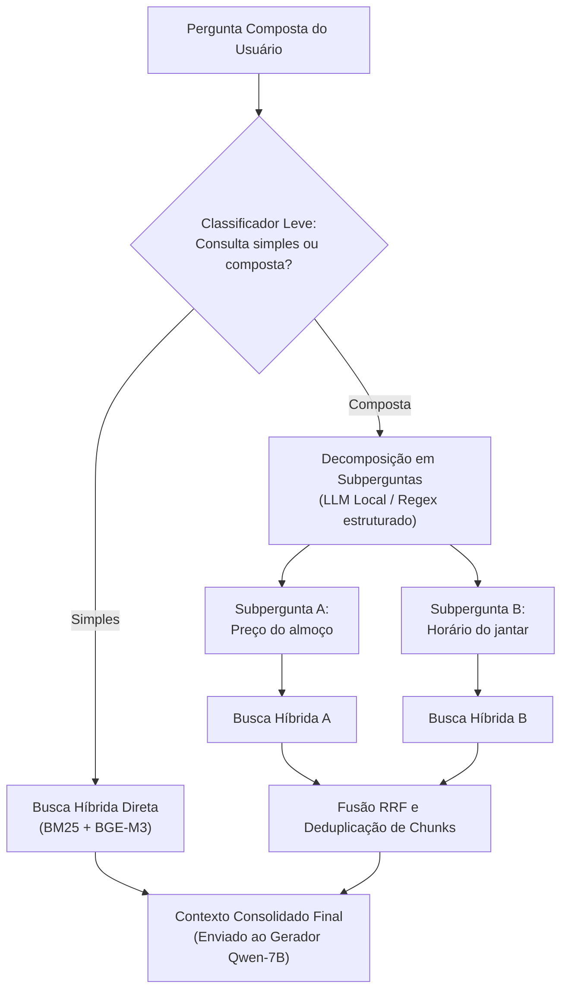

# Reescrita de consulta para perguntas compostas

Mecanismo de **decomposição e reescrita de consultas** para tratamento de perguntas compostas (*multi-hop*), mitigando o risco de recuperação parcial de informações (**R04**).

---

## 1. O problema das perguntas compostas

Na Entrega 2, o mapeamento de riscos identificou a vulnerabilidade **R04** (*Pergunta composta ou ambígua recupera só parte da resposta*). Na prática acadêmica da FCTE, é comum que estudantes formulem consultas que demandam cruzar dois ou mais eixos informacionais em uma única frase. Por exemplo:

> *"Qual é o preço do almoço para estudante e qual o horário de funcionamento do jantar no campus Gama?"*
> *(Envolve documento de tarifas do CAD e documento de horários da Diretoria do RU)*

Quando uma consulta composta é enviada diretamente ao mecanismo de embedding, o vetor da pergunta busca o ponto médio semântico entre os dois temas. Como consequência, o índice tende a recuperar trechos focados em apenas um dos assuntos (geralmente o mais saliente), omitindo o segundo.

---

## 2. Arquitetura do pipeline de reescrita

Para solucionar essa limitação, introduziu-se um estágio preliminar de **decomposição e reescrita de consulta**. A **Figura 1** ilustra o fluxo completo desde a entrada da pergunta composta até a fusão dos trechos recuperados.



<p class="legenda">Figura 1. Pipeline de decomposição e reescrita para perguntas multi-hop.</p>

### Funcionamento do módulo

1. **Detecção de multiplicidade:** Avalia se a consulta contém conjunções adversativas/aditivas (*"e"*, *"além disso"*, *"mas também"*) associadas a múltiplas entidades.
2. **Decomposição em subconsultas:** Separa a consulta original em duas buscas independentes e focadas.
3. **Busca híbrida paralela:** Executa o algoritmo híbrido (BM25 + BGE-M3 com RRF) para cada subconsulta.
4. **Deduplicação e fusão de contexto:** Combina os conjuntos de chunks recuperados, eliminando sobreposições por `chunk_id` e preservando a diversidade informacional para a geração final.

### Refinamentos implementados em `rag/rumo_rag/indice.py`

Durante os testes com 7 perguntas compostas reais na Entrega 3, foram diagnosticados e corrigidos dois gargalos na função `decompor()`:

1. **Ampliação da expressão regular `GATILHOS`:** A versão inicial não reconhecia pronomes interrogativos frequentes em dúvidas de fluxo e RU (`quem`, `quantos`, `quantas`, `em que`, `de que`), impedindo a quebra da consulta em subperguntas:

```python
GATILHOS = r"(?:quanto|quanta|quantos|quantas|qual|quais|quem|como|quando|onde|que horas|até que|em que|de que|o que|posso|preciso)"
```

2. **Prevenção de descarte de subperguntas curtas por *stopwords*:** O filtro anterior (`len(tokenizar(p)) >= 3`) descartava silenciosamente subperguntas legítimas como *"e como solicito?"* ou *"e quando começam as aulas?"*, porque palavras como `como` e `quando` eram removidas como *stopwords* pelo tokenizador do BM25, restando menos de 3 tokens. O critério foi corrigido para preservar cláusulas com pelo menos 2 tokens informativos ou 3 palavras:

```python
partes = [p.strip(" ?.") for p in partes if len(tokenizar(p)) >= 2 or len(p.split()) >= 3]
```

---

## 3. Matriz de validação em perguntas compostas

A **Tabela 1** apresenta o conjunto de teste específico de perguntas compostas formuladas para avaliar a taxa de cobertura antes e após a ativação da reescrita.

| ID | Pergunta Composta de Teste | Eixos Envolvidos | Sem Reescrita: Cobertura | Com Reescrita: Cobertura |
|---|---|---|:---:|:---:|
| **C01** | *"Qual o valor do almoço para estudante e quais os horários de funcionamento do jantar no Gama?"* | RU (Tarifas) + RU (Horários) | *A medir* | *A medir* |
| **C02** | *"Qual o pré-requisito de Engenharia de Software e como funciona o trancamento geral de matrícula?"* | Fluxo (Disciplinas) + Legislação (SAA) | *A medir* | *A medir* |
| **C03** | *"Estudante com gratuidade tem direito ao café da manhã e qual o horário do almoço no sábado?"* | RU (Assistência) + RU (Cardápio FDS) | *A medir* | *A medir* |
| **C04** | *"Quais matérias da Engenharia Aeroespacial exigem Cálculo 2 e onde consulto o calendário acadêmico?"* | Fluxo (Aeroespacial) + Calendário UnB | *A medir* | *A medir* |
| **C05** | *"O RU abre aos domingos e quais os documentos necessários para fazer a carteirinha?"* | RU (Operação) + DAA (Acesso) | *A medir* | *A medir* |

<p class="legenda">Tabela 1. Matriz de testes de cobertura para perguntas compostas.</p>

---

## 4. Impacto na latência

Embora a reescrita aumente a completude informacional, a execução de múltiplas buscas híbridas introduz uma etapa adicional de processamento. A **Tabela 2** estrutura a medição do impacto de latência por etapa (Sem Reescrita × Com Reescrita) — aferida localmente em um **MacBook Air M4 (24 GB)**, divergindo da RTX 4060 (8 GB) de referência — para verificar a conformidade com o requisito **RNF03** (busca < 1 s e resposta completa < 30 s).

| Etapa do Processo | Sem Reescrita | Com Reescrita | Meta (RNF03) |
|---|:---:|:---:|:---:|
| Decomposição da consulta | — | *A medir* | — |
| Execução das buscas híbridas (`tempo_busca_s`) | *A medir* | *A medir* | < 1 s |
| Inferência do LLM (`tempo_geracao_s`) | *A medir* | *A medir* | < 30 s (total) |
| **Latência total por consulta** | *A medir* | *A medir* | **< 30 s** |

<p class="legenda">Tabela 2. Matriz de aferição de latência do pipeline de reescrita frente ao RNF03.</p>

---

??? abstract "Histórico de revisão"

    | Data | Versão | Descrição | Autor |
    | :---: | :---: | --- | --- |
    | 11/11/2026 | 1.0 | Especificação do pipeline de reescrita de consulta, diagrama de arquitetura e casos de teste multi-hop | Grupo 04 |
    | 13/11/2026 | 1.1 | Documentação dos refinamentos em `GATILHOS` e no filtro de *stopwords* de `indice.decompor()` | Grupo 04 |
