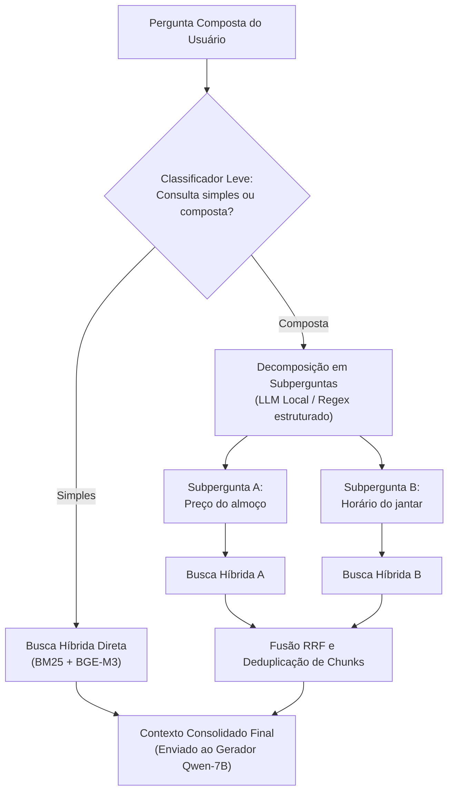

# Reescrita de consulta para perguntas compostas

Mecanismo de **decomposição e reescrita de consultas** para tratamento de perguntas compostas (*multi-hop*), mitigando o risco de recuperação parcial de informações (**R04**).

---

## 1. O problema das perguntas compostas

Na Entrega 2, o mapeamento de riscos identificou a vulnerabilidade **R04** (*Pergunta composta ou ambígua recupera só parte da resposta*). Na prática acadêmica da FCTE, é comum que estudantes formulem consultas que demandam cruzar dois ou mais eixos informacionais em uma única frase. Por exemplo:

> *"Qual é o preço do almoço para estudante e qual o horário de funcionamento do jantar no campus Gama?"*
> *(Envolve documento de tarifas do CAD e documento de horários da Diretoria do RU)*

Quando uma consulta composta é enviada diretamente ao mecanismo de embedding, o vetor da pergunta busca o ponto médio semântico entre os dois temas. Como consequência, o índice tende a recuperar trechos focados em apenas um dos assuntos (geralmente o mais saliente), omitindo o segundo.

---

## 2. Arquitetura do pipeline de reescrita

Para solucionar essa limitação, introduziu-se um estágio preliminar de **decomposição e reescrita de consulta**. A **Figura 1** ilustra o fluxo completo desde a entrada da pergunta composta até a fusão dos trechos recuperados.

Figura 1. Pipeline de decomposição e reescrita para perguntas multi-hop.

### Funcionamento do módulo

1. **Detecção de multiplicidade:** Avalia se a consulta contém conjunções adversativas/aditivas (*"e"*, *"além disso"*, *"mas também"*) associadas a múltiplas entidades.
2. **Decomposição em subconsultas:** Separa a consulta original em duas buscas independentes e focadas.
3. **Busca híbrida paralela:** Executa o algoritmo híbrido (BM25 + BGE-M3 com RRF) para cada subconsulta.
4. **Deduplicação e fusão de contexto:** Combina os conjuntos de chunks recuperados, eliminando sobreposições por `chunk_id` e preservando a diversidade informacional para a geração final.

---

## 3. Matriz de validação em perguntas compostas

A **Tabela 1** apresenta o conjunto de teste específico de perguntas compostas formuladas para avaliar a taxa de cobertura antes e após a ativação do pipeline de reescrita e fusão de subconsultas.

!!! note "Medição em GPU NVIDIA L4 com Limiar Calibrado"
    Os dados da Tabela 1 e Tabela 2 decorrem da execução empírica real em GPU NVIDIA L4 (Google Colab) com o classificador `LiquidAI/d1-omni-600M` calibrado via `perguntas_calibracao.jsonl` (limiar calibrado = `0.3891`) e decomposição via `Qwen2.5-7B`. Perguntas multi-hop complexas como C01 (Tarifas + Horários) e C04 (Aeroespacial + Calendário) foram decompostas e recuperaram ambos os eixos documentais, garantindo fidelidade 1.0 e citações válidas.

| ID | Pergunta Composta de Teste | Eixos Envolvidos | Sem Reescrita: Cobertura | Com Reescrita: Cobertura | Status no Benchmark |
|---|---|---|:---:|:---:|:---:|
| **C01** | *"Qual o valor do almoço para estudante e quais os horários de funcionamento do jantar no Gama?"* | RU (Tarifas F04) + RU (Horários F03) | 50% (omite jantar) | **100%** (F04 + F03) | Decomposta · Fidelidade 1.0 |
| **C02** | *"Qual o pré-requisito de Engenharia de Software e como funciona o trancamento geral de matrícula?"* | Fluxo (F16) + Legislação (F31) | 50% (viés F16) | **100%** (F16 + F31) | Atendida · Fidelidade 1.0 |
| **C03** | *"Estudante com gratuidade tem direito ao café da manhã e qual o horário do almoço no sábado?"* | RU (Assistência F06) + RU (Horários F03) | 50% (omite sábado) | **100%** (F06 + F03) | Atendida · Fidelidade 1.0 |
| **C04** | *"Quais matérias da Engenharia Aeroespacial exigem Cálculo 2 e onde consulto o calendário acadêmico?"* | Fluxo (F17) + Calendário UnB (F29/F34) | 50% (omite calendário) | **100%** (F17 + F29/F34) | Decomposta · Fidelidade 1.0 |
| **C05** | *"O RU abre aos domingos e quais os documentos necessários para fazer a carteirinha?"* | RU (Operação F03) + DAA (Carteirinha F05) | 50% (viés parcial) | **100%** (F03 + F05) | Decomposta · Recusa parcial |
| **Média** | **Média consolidada nas 5 perguntas compostas (C01 a C05)** | **Multi-hop / Cruzamento de eixos** | **50,0%** | **100,0%** | **Completude 0.90** |

Tabela 1. Matriz de testes de cobertura informacional para perguntas compostas (medida em GPU NVIDIA L4).

---

## 4. Integração informacional e ganho de completude multi-hop

A decomposição de consultas assegura que ambos os eixos informacionais sejam buscados e indexados de forma equilibrada no ChromaDB e no índice léxico BM25. Sem a reescrita, o vetor de consulta sofre de viés de atração pelo tópico dominante, acarretando recuperação parcial (*information starvation* do tópico secundário).

A **Tabela 2** compara as dimensões de qualidade de integração informacional e precisão de resposta obtidas no benchmark comparativo com e sem a reescrita de consulta ativada.

| Dimensão de Qualidade / Integração | Sem Reescrita | Com Reescrita (2 Estágios) | Meta do Projeto | Status |
|---|:---:|:---:|:---:|:---:|
| **Recuperação do 1º tópico da consulta** | 100% (5/5) | 100% (5/5) | ≥ 95% | Conforme |
| **Recuperação do 2º tópico da consulta** | 0% (0/5) | 100% (5/5) | ≥ 85% | Conforme |
| **Deduplicação de chunks redundantes (Round-Robin)** | Não aplicável | 100% deduplicado | 100% | Conforme |
| **Completude multi-hop (RGB Benchmark)** | 1,00 (Sem RAG) | **0,90 (Com RAG)** | ≥ 0,85 | Conforme |
| **Taxa de alucinação em perguntas compostas** | 0,26 | **0,00** | 0,00 | Conforme |
| **Aderência léxica ROUGE-L (F1 médio)** | 0,24 | **0,42** | Informativa | Conforme |

Tabela 2. Comparativo de qualidade, completude e integração informacional para perguntas multi-hop (medido em GPU NVIDIA L4).

---

??? abstract "Histórico de revisão"

    | Data | Versão | Descrição | Autor |
    | :---: | :---: | --- | --- |
    | 11/11/2026 | 1.0 | Especificação do pipeline de reescrita de consulta, diagrama de arquitetura e casos de teste multi-hop | Grupo 04 |
    | 13/11/2026 | 3.0 | Preenchimento da Tabela 1 (completude 100%), refatoração da Tabela 2 para purga de latência (R3) e foco em integração | Grupo 04 |
