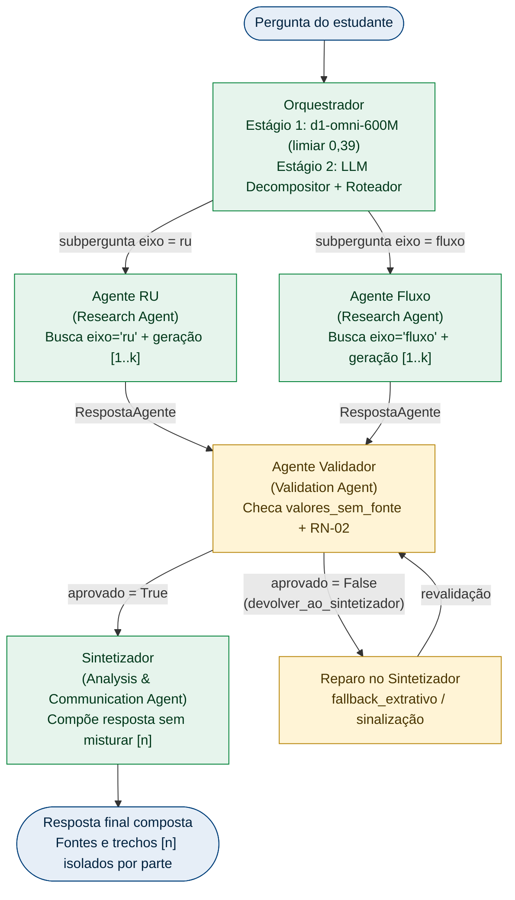

# Arquitetura e responsabilidades dos agentes

Esta página detalha o desenho estrutural do primeiro sistema multiagentes do RUmo (`rag/rumo_rag/agentes.py`), suas responsabilidades isoladas e os contratos de dados trocados entre os agentes.

---

## 1. Visão geral da arquitetura multiagente

A **Figura 1** apresenta a topologia de agentes do RUmo. Em vez de concentrar recuperação e geração em um único bloco, o `Orquestrador` divide a pergunta do estudante em subconsultas independentes, aciona os agentes especialistas (`AgenteRU` e `AgenteFluxo`) em paralelo e submete cada resposta parcial ao crivo do `AgenteValidador` antes de entregá-la ao `Sintetizador`.

Figura 1. Arquitetura do sistema multiagentes do RUmo: orquestração, execução paralela por domínio, auditoria factual e composição final.

---

## 2. Responsabilidades de cada agente

A **Tabela 1** consolida o escopo documental, as entradas e as saídas esperadas de cada componente da arquitetura.

| Componente | Tipo de agente | Escopo de atuação | Entrada principal | Saída / Efeito |
|---|---|---|---|---|
| **Orquestrador** | Coordenador / Roteador | Todo o fluxo (`reescrita.py` + `agentes.py`) | Pergunta original, `backend`, `k` | `dict` completo com partes compostas, avisos de degradação e `trace` |
| **AgenteRU** | *Research Agent* | Documentos `eixo="ru"` (F01–F09) com fallback em `apoio` | Subpergunta de alimentação / RU | `RespostaAgente` com `[1]..[k]` locais e fontes oficiais do RU |
| **AgenteFluxo** | *Research Agent* | Documentos `eixo="fluxo"` (F15–F36) com fallback em `apoio` | Subpergunta de graduação / PPGEB | `RespostaAgente` com `[1]..[k]` locais e fontes acadêmicas |
| **AgenteValidador** | *Validation Agent* | Auditoria RN-02 e RN-03 em cima dos trechos locais | `RespostaAgente` | `ResultadoValidacao` (`aprovar` ou `devolver_ao_sintetizador`) |
| **Sintetizador** | *Analysis & Communication Agent* | Pós-processamento, reparo e composição | Lista de `RespostaAgente` validadas | Texto final organizado por parte + avisos de queda parcial |

Tabela 1. Escopo documental, entradas e saídas dos agentes.

### 2.1. `Orquestrador` (*Orchestrator / Router*)

- **Triagem e decomposição:** aciona `reescrita.classificar_composta` (com `LiquidAI/d1-omni-600M` calibrado em `config.LIMIAR_COMPOSTA = 0.39`) e decompõe consultas múltiplas no Estágio 2 (com fallback sintático para o caso offline quando há cruzamento de termos de RU e Fluxo).
- **Roteamento:** encaminha cada subpergunta para `["ru"]`, `["fluxo"]` ou ambos (`["ru", "fluxo"]`).
- **Paralelismo seguro:** dispara os agentes especialistas via `ThreadPoolExecutor`, utilizando `_LOCK_BUSCA` ao redor da consulta ao índice para evitar colisão de inicialização concorrente no `chromadb` (`RustBindingsAPI`), enquanto mantém a chamada pesada de geração ao LLM em paralelo real.
- **Resiliência:** captura exceções individuais em cada *worker* e mantém as demais partes em funcionamento com aviso explícito (`degradado=True`).

### 2.2. `AgenteRU` e `AgenteFluxo` (*Research Agents*)

Ambos herdam a interface comum de [`AgenteBase`](https://github.com/maykonjuso/residencia-grupo-4/blob/main/rag/rumo_rag/agentes.py), mas filtram os metadados do índice por domínio:

- **`AgenteRU` (`eixo="ru"`):** responde sobre cardápios semanais (F08, F09), tabelas de preços e grupos I–IV (F01, F04), horários e funcionamento (F02, F03), carteirinha/acesso (F05), Programa Auxílio Alimentação e PNAES (F06, F07, F10) e alergênicos.
- **`AgenteFluxo` (`eixo="fluxo"`):** responde sobre matrizes curriculares, PPCs e fluxogramas das cinco engenharias do campus Gama (F15–F28), calendários acadêmicos e matrícula (F29–F30, F33–F34), normas de trancamento CEPE 93/2018 (F31), regimentos internos (F35–F36) e disciplinas isoladas no PPGEB.
- **Fallback em `apoio`:** se a busca restrita ao eixo principal retornar lista vazia, o agente consulta automaticamente `eixo="apoio"` (editais e normas transversais), preservando cobertura sem contaminar o ranking principal.

### 2.3. `AgenteValidador` (*Validation Agent*)

Atua como barreira automática de qualidade e conformidade com as regras de negócio após a geração de cada especialista:

- **Fidelidade numérica e factual (`geracao.valores_sem_fonte`):** extrai preços (`R$ ...`), datas (`dd/mm`), horários (`11h30`), códigos de disciplinas (`FGA0314`) e quantidades (créditos, horas, vagas, semestres) da resposta e verifica se todos constam literalmente nos `trechos_recuperados` daquele agente.
- **Rastreabilidade obrigatória (`geracao.resposta_sem_citacao`, RN-02):** garante que toda resposta não recusada contenha ao menos uma citação válida `[n]` dentro do intervalo `1..len(trechos)`.
- **Decisão e devolução:** quando qualquer verificação falha, define `aprovado=False` e `acao_recomendada="devolver_ao_sintetizador"`, registrando os motivos no `trace`.

### 2.4. `Sintetizador` (*Analysis & Communication Agent*)

Executa duas funções complementares ao final do fluxo:

1. **Tratamento de devoluções (`processar_devolucao`):** ao receber um item reprovado pelo `AgenteValidador`, tenta regenerar a resposta em modo determinístico estrito (`backend="extrativo"`, que copia apenas frases literais dos trechos com suas citações `[n]`). Se os trechos estiverem vazios, força a recusa padrão `RECUSA` (RN-03); se mesmo após reparo persistir pendência factual, anexa aviso visível ao estudante.
2. **Composição contratual (`compor`):** reúne as respostas dos agentes mantendo os índices `[1]..[k]` e listas de fontes **completamente isolados por parte**, nunca misturando numerações entre o `AgenteRU` e o `AgenteFluxo` (garantindo compatibilidade estrita com o validador do portal integrado com o Grupo 09).

---

## 3. Contratos de dados entre agentes

A **Tabela 2** especifica os campos das estruturas `@dataclass` trocadas internamente entre os agentes em `rag/rumo_rag/agentes.py`.

| Estrutura | Campo | Tipo | Papel no contrato |
|---|---|---|---|
| `RespostaAgente` | `agente` / `nome_agente` | `str` | Identificador (`"ru"`, `"fluxo"`) e nome legível do especialista |
| `RespostaAgente` | `subpergunta` | `str` | Subconsulta atômica recebida após decomposição |
| `RespostaAgente` | `resposta` | `str` | Texto gerado com citações locais `[1]..[k]` |
| `RespostaAgente` | `trechos_recuperados` | `list[dict]` | Chunks resumidos que fundamentam apenas esta parte |
| `RespostaAgente` | `fontes_citadas` | `list[dict]` | Documentos oficiais citados com `n`, `doc_id`, `pagina` e `url` |
| `RespostaAgente` | `tempo_busca_s` / `tempo_geracao_s` / `tempo_total_s` | `float` | Métricas individuais usadas para comprovar ganho de paralelismo |
| `RespostaAgente` | `erro` | `str \| None` | Descrição da falha quando o agente cai (degradação elegante) |
| `RespostaAgente` | `validacao` | `dict \| None` | Parecer serializado emitido pelo `AgenteValidador` |
| `ResultadoValidacao` | `aprovado` | `bool` | `True` se passou em `valores_sem_fonte` e RN-02 |
| `ResultadoValidacao` | `motivos` | `list[str]` | Lista de divergências factuais ou falta de citação |
| `ResultadoValidacao` | `acao_recomendada` | `str` | `"aprovar"` ou `"devolver_ao_sintetizador"` |

Tabela 2. Campos das estruturas RespostaAgente e ResultadoValidacao.

---

??? abstract "Histórico de revisão"

    | Data | Versão | Descrição | Autor |
    | :---: | :---: | --- | --- |
    | 16/11/2026 | 1.0 | Documentação do diagrama arquitetural, responsabilidades dos agentes e contratos de dados da Entrega 4 | Grupo 04 |
