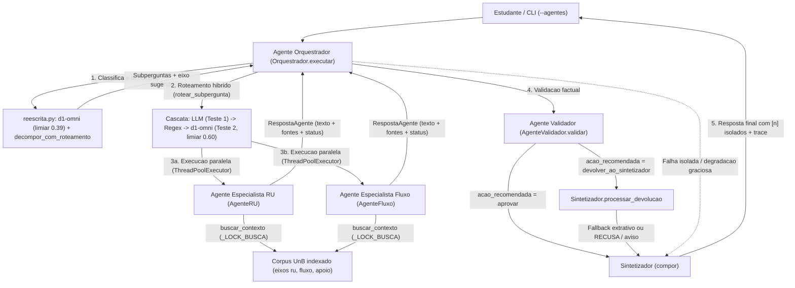

# Arquitetura dos Agentes

A arquitetura multiagente do **RUmo** organiza o processamento em uma malha desacoplada implementada em `rag/rumo_rag/agentes.py` e `rag/rumo_rag/reescrita.py`, com **quatro agentes principais** (`Orquestrador`, `AgenteRU`, `AgenteFluxo` e `AgenteValidador`) apoiados pelo componente `Sintetizador` e pelo módulo de reescrita e classificação em dois estágios.

!!! info "Estado da implementação"
    O esqueleto arquitetural, as interfaces entre classes, o paralelismo, o validador factual e a devolução ao sintetizador estão implementados. Detalhes internos das ferramentas e prompts especializados de domínio dependem das issues **#41**, **#42** e **#43** (`[a detalhar]`).

---

## Diagrama da arquitetura multiagente

A **Figura 1** apresenta a arquitetura verticalizada com os quatro agentes, suas conexões de controle e dados, o acesso serializado ao índice vetorial e o caminho de retorno quando o validador reprova uma resposta.

Figura 1. Arquitetura verticalizada dos quatro agentes do RUmo, conexões com o corpus, validação factual e devolução ao sintetizador.

---

## Conexões e contratos entre componentes

A comunicação interna segue o fluxo unidirecional coordenado pelo `Orquestrador`, com um único ciclo controlado de retorno entre o `AgenteValidador` e o `Sintetizador`. A **Tabela 1** descreve cada conexão da arquitetura.

| Origem | Destino | Payload / Chamada | Regra de execução |
|---|---|---|---|
| CLI (`__main__.py`) | `Orquestrador` | `executar(pergunta, backend, k, falhar_agente)` | Ativado pela flag `--agentes`; `--trace` habilita a coleta detalhada por estágio |
| `Orquestrador` | `reescrita.py` | `classificar_composta` e `decompor_com_roteamento` | Estágio 1 usa `d1-omni-600M` com `LIMIAR_COMPOSTA = 0.39`; Estágio 2 usa LLM conjunto ou fallback sintático (`_decompor_fallback`) |
| `Orquestrador` | `rotear_subpergunta` | `(subpergunta, eixo_sugerido, usar_d1_fallback=True)` | Cascata determinística: `Teste 1 (eixo LLM)` → `Regex` → `Teste 2 (d1-omni)` com `limiar_confianca = 0.60` |
| `Orquestrador` | `AgenteRU` / `AgenteFluxo` | `responder(subpergunta, k=config.TOP_K, backend=config.BACKEND)` | Executado em paralelo via `ThreadPoolExecutor`; acesso ao índice protegido por `_LOCK_BUSCA` |
| `AgenteRU` / `AgenteFluxo` | `Orquestrador` | `RespostaAgente` | Carrega resposta, fontes recuperadas, trechos, tempos e eventuais exceções capturadas |
| `Orquestrador` | `AgenteValidador` | `validar(item: RespostaAgente) -> ResultadoValidacao` | Avalia `geracao.valores_sem_fonte` e `geracao.resposta_sem_citacao`; ignora apenas itens que falharam na execução |
| `AgenteValidador` | `Sintetizador` | `processar_devolucao(item, validacao, backend)` | Acionado quando `acao_recomendada == "devolver_ao_sintetizador"`; tenta fallback extrativo sobre os trechos recuperados ou aplica `RECUSA` |
| `Sintetizador` | Estudante / Portal | `compor(pergunta, partes)` | Mantém numeração `[n]` independente por bloco e preserva avisos de falha parcial (`degradado=True`) |

Tabela 1. Conexões, interfaces e regras de execução entre os componentes multiagente.

---

## Especialização pendente e pontos de extensão

A arquitetura atual já isola as fronteiras de responsabilidade para receber as implementações especializadas sem alterar o contrato do `Orquestrador`:

1. **`AgenteRU` e `AgenteFluxo` (herdam de `AgenteBase`):** compartilham hoje o fluxo padrão `buscar_contexto` + `gerar_resposta` filtrado por `eixo` (`"ru"` ou `"fluxo"`) somado ao eixo `"apoio"`. Prompts específicos de domínio, reformulações especializadas e eventuais ferramentas auxiliares estão marcados como `[a detalhar na issue #41 / #42]`.
2. **`AgenteValidador`:** verifica objetivamente valores sem respaldo nas fontes (`geracao.valores_sem_fonte`) e ausência de citação (`geracao.resposta_sem_citacao`). Verificações semânticas adicionais baseadas em modelo estão marcadas como `[a detalhar na issue #43]`.
3. **Paralelismo thread-safe:** a busca vetorial compartilhada é serializada por `_LOCK_BUSCA` para evitar condições de corrida no backend `BUSCA`, mantendo o paralelismo real nas chamadas de geração (`gerar_resposta`).

??? abstract "Histórico de revisão"
    | Versão | Data | Autor | Descrição | Revisor |
    |---|---|---|---|---|
    | 1.0 | 16/11/2026 | @GabrielMacielBR | Diagrama inicial da arquitetura multiagente e dataclasses | @keilogger |
    | 1.1 | 16/11/2026 | @GabrielMacielBR | Alinhamento aos 4 agentes do escopo, legenda padronizada e marcação explícita das pendências `#41`–`#43` | @maykonjuso |
