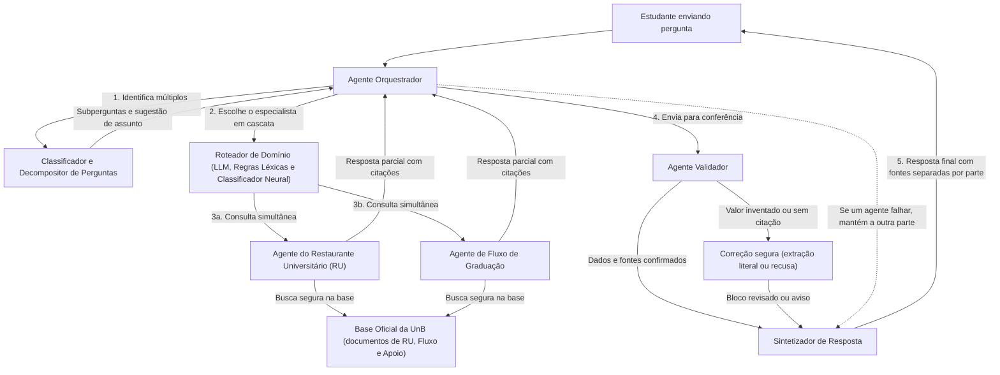

# Arquitetura dos Agentes

A arquitetura multiagente do **RUmo** organiza o atendimento em uma esteira colaborativa implementada nos módulos de agentes e de reescrita de consultas do projeto. O desenho reúne **quatro agentes principais** — Orquestrador, Agente do RU, Agente de Fluxo e Agente Validador — apoiados pelo componente Sintetizador e pelo módulo de análise e divisão de perguntas.

!!! info "Estado da implementação"
    A estrutura geral dos agentes, as interfaces entre componentes, a execução paralela, a auditoria factual e o fluxo de retorno ao sintetizador já estão implementados. Prompts especializados e eventuais ferramentas específicas de cada domínio dependem do fechamento das issues **#41**, **#42** e **#43** (`[a detalhar]`).

---

## Diagrama da arquitetura multiagente

A **Figura 1** mostra o fluxo verticalizado entre os quatro agentes, a consulta sincronizada à base documental da UnB e o retorno de correção quando o validador identifica alguma afirmação sem respaldo.

Figura 1. Arquitetura verticalizada dos quatro agentes do RUmo, consulta à base documental, validação factual e correção junto ao sintetizador.

---

## Conexões entre componentes

A comunicação interna é coordenada pelo **Orquestrador** com um único ciclo controlado de retorno entre o **Agente Validador** e o **Sintetizador**. A **Tabela 1** descreve o papel de cada ligação exibida no diagrama.

| Origem | Destino | O que trafega na conexão | Regra de funcionamento |
|---|---|---|---|
| Interface de entrada | Orquestrador | A pergunta do estudante e as opções de execução escolhidas | Recebe perguntas simples ou compostas e inicia o fluxo multiagente |
| Orquestrador | Classificador e Decompositor | O texto completo da pergunta original | Avalia se há mais de um assunto e divide a consulta em subperguntas independentes; se o modelo falhar, usa separação gramatical por conectivos |
| Orquestrador | Roteador de Domínio | Cada subpergunta e a sugestão inicial de assunto | Decide o especialista seguindo uma cascata de três níveis: sugestão da própria divisão, regras por palavras-chave e, em caso de indecisão, classificador neural de domínio |
| Orquestrador | Agente do RU e Agente de Fluxo | As subperguntas atribuídas a cada especialista | Os especialistas rodam ao mesmo tempo para reduzir o tempo total; leituras no índice documental são sincronizadas para evitar conflitos |
| Agente do RU e Agente de Fluxo | Orquestrador | A resposta redigida, os trechos consultados, o tempo gasto e eventuais erros | Cada parte traz sua própria lista de referências sem interferir na resposta do outro especialista |
| Orquestrador | Agente Validador | Cada resposta parcial produzida com sucesso pelos especialistas | Verifica objetivamente se todos os valores informados constam nos trechos e se há citação explícita; partes que falharam antes não passam por validação |
| Agente Validador | Sintetizador | A decisão de aprovação ou o pedido de devolução para correção | Quando reprova uma resposta, aciona geração segura estritamente extrativa a partir dos trechos recuperados ou aplica a frase padrão de recusa |
| Sintetizador | Estudante / Portal | As partes aprovadas reunidas e eventuais avisos de indisponibilidade | Preserva a numeração de fontes independente para cada bloco, atendendo à exigência contratual de integração com o portal único |

Tabela 1. Descrição das conexões e regras operacionais entre os componentes multiagente.

---

## Pontos de extensão previstos

A arquitetura atual já separa claramente as fronteiras de responsabilidade para receber os refinamentos das próximas issues sem quebrar os contratos entre os agentes:

1. **Especialização dos agentes de domínio (Agente do RU e Agente de Fluxo):** hoje compartilham o mesmo ciclo base de recuperação documental e geração, filtrando apenas os documentos do seu assunto e os documentos gerais de apoio. Prompts específicos, estratégias próprias de busca e ferramentas auxiliares ficam reservados como `[a detalhar na issue #41 / #42]`.
2. **Ampliação do Agente Validador:** hoje audita de forma determinística a presença de citações e a existência literal nos trechos de valores mencionados na resposta. Checagens semânticas adicionais baseadas em modelo linguístico ficam reservadas como `[a detalhar na issue #43]`.
3. **Execução paralela segura:** enquanto os leitores do banco vetorial são protegidos contra acesso simultâneo, as etapas de geração de resposta acontecem em paralelo, reduzindo a latência acumulada em perguntas compostas.

??? abstract "Histórico de revisão"
    | Versão | Data | Autor | Descrição | Revisor |
    |---|---|---|---|---|
    | 1.0 | 16/11/2026 | @GabrielMacielBR | Diagrama inicial da arquitetura multiagente e estruturas de dados | @keilogger |
    | 1.1 | 16/11/2026 | @GabrielMacielBR | Alinhamento aos 4 agentes do escopo, legenda padronizada e marcação explícita das pendências `#41`–`#43` | @maykonjuso |
    | 1.2 | 16/11/2026 | @GabrielMacielBR | Reescrita descritiva em linguagem natural no diagrama e tabelas | @maykonjuso |
