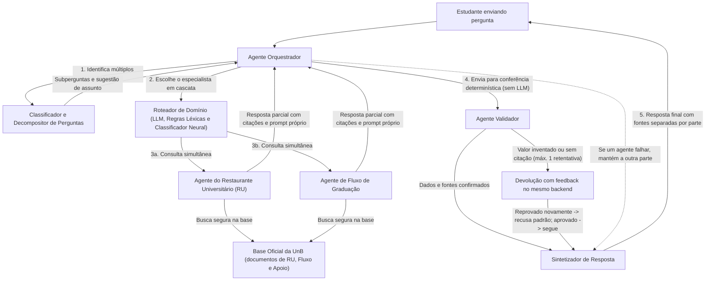

# Arquitetura dos Agentes

A arquitetura multiagente do **RUmo** organiza o atendimento em uma esteira colaborativa implementada nos módulos de agentes e de reescrita de consultas do projeto. O desenho reúne **quatro agentes principais** — Orquestrador, Agente do RU, Agente de Fluxo e Agente Validador — apoiados pelo componente Sintetizador e pelo módulo de análise e divisão de perguntas.

!!! info "Estado da implementação"
    A arquitetura abaixo reflete a versão atual implementada: contrato unificado por mensagens e trace (`#40`), especialistas de RU (`#41`) e Fluxo (`#42`) com prompts dedicados e guarda de domínio, e validador ativo (`#43`) puramente determinístico (sem LLM) com limite de 1 retentativa com feedback e recusa final.

---

## Diagrama da arquitetura multiagente

A **Figura 1** mostra o fluxo verticalizado entre os quatro agentes, a consulta sincronizada à base documental da UnB e o retorno de correção quando o validador identifica alguma afirmação sem respaldo.

Figura 1. Arquitetura verticalizada dos quatro agentes do RUmo, consulta à base documental, validação factual e correção junto ao sintetizador.

---

## Conexões entre componentes

A comunicação interna é coordenada pelo **Orquestrador** com um único ciclo controlado de retorno entre o **Agente Validador** e o **Sintetizador**. A **Tabela 1** descreve o papel de cada ligação exibida no diagrama.

| Origem | Destino | O que trafega na conexão | Regra de funcionamento |
|---|---|---|---|
| Interface de entrada | Orquestrador | A pergunta do estudante e as opções de execução escolhidas | Recebe perguntas simples ou compostas e inicia o fluxo multiagente |
| Orquestrador | Classificador e Decompositor | O texto completo da pergunta original | Avalia se há mais de um assunto (limiar `0,39` ou cruzamento explícito RU + Fluxo) e divide em subperguntas independentes; se o modelo falhar, usa separação gramatical por conectivos |
| Orquestrador | Roteador de Domínio | Cada subpergunta e a sugestão inicial de assunto | Decide o especialista seguindo uma cascata de três níveis: sugestão da própria divisão, regras por palavras-chave e, em caso de indecisão, classificador neural de domínio |
| Orquestrador | Agente do RU e Agente de Fluxo | Mensagem padronizada com subpergunta e contexto | Os especialistas validam a guarda de domínio (recusando perguntas exclusivas do outro eixo), consultam o índice com trava sincronizada e geram com prompt próprio em paralelo |
| Agente do RU e Agente de Fluxo | Orquestrador | Resposta padronizada com texto, fontes, confiança e alertas | Cada parte traz sua própria lista de referências sem interferir na resposta do outro especialista; recusas são higienizadas para não carregar citações espúrias |
| Orquestrador | Agente Validador | Mensagem contendo a resposta candidata e os trechos locais do agente | Audita de forma determinística (sem LLM) se valores numéricos/códigos constam nos trechos e se há citação `[n]`; partes que falharam antes são ignoradas na validação |
| Agente Validador | Sintetizador | Parecer `APROVADO` ou `REPROVADO` com os motivos da reprovação | Na reprovação, o Sintetizador devolve para **no máximo 1 retentativa com feedback** (no mesmo backend ou reexecutando o agente); se reprovar pela segunda vez, aplica a frase padrão de recusa |
| Sintetizador | Estudante / Portal | As partes aprovadas reunidas e eventuais avisos de indisponibilidade | Preserva a numeração de fontes independente para cada bloco e registra todo o histórico cronológico no Trace oficial |

Tabela 1. Descrição das conexões e regras operacionais entre os componentes multiagente.

---

## Pontos de extensão previstos

A arquitetura atual já separa claramente as fronteiras de responsabilidade para receber os refinamentos das próximas issues sem quebrar os contratos entre os agentes:

1. **Especialização consolidada dos agentes de domínio (Agente do RU e Agente de Fluxo):** operam sobre o mesmo contrato comum de mensagem e resposta, mas cada um possui instruções de sistema próprias, filtro estrito no seu eixo documental e guarda de domínio para recusar perguntas fora de escopo sem consultar índice nem modelo generativo.
2. **Validador determinístico sem custo de LLM:** o Agente Validador não depende de outro modelo de linguagem — evita latência extra e alucinação do próprio verificador ao checar objetivamente valores e citações contra os trechos locais, mantendo abertura para checagens semânticas futuras caso o projeto necessite.
3. **Execução paralela segura:** enquanto as leituras ao índice vetorial são sincronizadas por trava leve, as chamadas de geração (locais ou via API compatível com OpenAI/OpenRouter) acontecem em paralelo, reduzindo a latência total em perguntas compostas.

??? abstract "Histórico de revisão"
    | Versão | Data | Autor | Descrição | Revisor |
    |---|---|---|---|---|
    | 1.0 | 16/11/2026 | @GabrielMacielBR | Diagrama inicial da arquitetura multiagente e estruturas de dados | @keilogger |
    | 1.1 | 16/11/2026 | @GabrielMacielBR | Alinhamento aos 4 agentes do escopo, legenda padronizada e marcação explícita das pendências `#41`–`#43` | @maykonjuso |
    | 1.2 | 16/11/2026 | @GabrielMacielBR | Reescrita descritiva em linguagem natural no diagrama e tabelas | @maykonjuso |
    | 1.3 | 18/11/2026 | @GabrielMacielBR | Atualização para contrato unificado (`#40`), guarda e prompts por agente (`#41`/`#42`) e validador determinístico com 1 retentativa (`#43`) | — |
