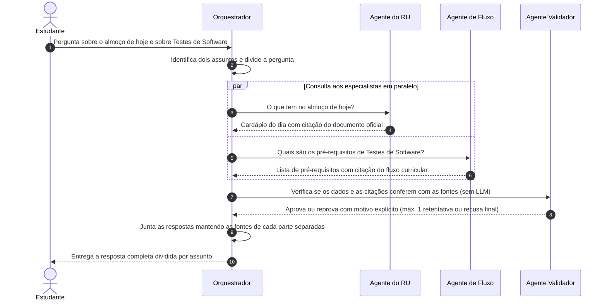

# Fluxo de Interação e Roteamento

Esta página mostra como os agentes colaboram do início ao fim diante de uma pergunta composta e apresenta o experimento comparativo que definiu a estratégia de classificação e roteamento do **Orquestrador**.

---

## Sequência de colaboração para pergunta composta

A **Figura 1** segue o modelo visual de [Divisão com o Grupo 09](../visao/escopo-grupos.md), reunindo os cinco papéis principais no fluxo em linguagem direta para facilitar a leitura contínua.

Figura 1. Diagrama de sequência de uma pergunta composta com execução paralela, validação factual e composição isolada.

A **Tabela 1** explica o que acontece em cada um dos dez passos da **Figura 1**, inclusive como o sistema reage quando ocorre alguma falha.

| Passo | Participantes | O que acontece neste passo | Tratamento de falha ou exceção |
|---|---|---|---|
| 1 | Estudante → Orquestrador | O estudante envia a pergunta completa em linguagem natural para o ponto de entrada do sistema. | Consultas vazias ou sem tema reconhecido seguem o fluxo padrão de recusa. |
| 2 | Orquestrador | Analisa se há mais de um assunto (limiar `0,39` ou cruzamento explícito RU + Fluxo), divide a pergunta em subperguntas e define qual especialista atende cada parte. | Se o modelo linguístico falhar na divisão, aplica separação por conectivos gramaticais; em dúvidas ambíguas, consulta o classificador neural de domínio. |
| 3–6 | Orquestrador ↔ Agente do RU / Agente de Fluxo | Os dois especialistas são consultados ao mesmo tempo via contrato padronizado de mensagens na base documental oficial da UnB e respondem com prompts próprios. | Se um especialista receber pergunta exclusiva do outro domínio, recusa imediatamente sem buscar no índice; se cair ou falhar, entrega a parte saudável com aviso. |
| 7–8 | Orquestrador ↔ Agente Validador | O validador audita deterministicamente (sem chamar LLM) se valores numéricos, códigos e afirmações constam nos trechos recuperados e se há citação `[n]` válida. | Se reprovar, devolve ao sintetizador para **no máximo 1 retentativa com feedback** no mesmo backend; se reprovar pela segunda vez, aplica recusa padrão sem exibir a resposta ruim. |
| 9 | Orquestrador | O sintetizador reúne os blocos validados preservando a numeração e a lista de fontes de cada parte de forma independente. | Mantém eventuais avisos de falha parcial ou correção vinculados apenas ao bloco afetado. |
| 10 | Orquestrador → Estudante | O estudante recebe a resposta final organizada por assunto, com referências separadas e histórico detalhado de execução quando solicitado. | Sinaliza explicitamente quando a entrega ocorreu em modo degradado por indisponibilidade parcial. |

Tabela 1. Descrição dos dez passos do fluxo de colaboração entre os agentes.

---

## Como o orquestrador classifica e roteia perguntas

Antes de acionar os especialistas, o orquestrador toma duas decisões complementares:

1. **Detectar e dividir perguntas compostas:** primeiro verifica se a dúvida mistura mais de um tópico usando o classificador neural calibrado em `0,39`; quando necessário, divide a consulta em subperguntas atômicas por meio de modelo linguístico (com alternativa gramatical por conectivos caso o modelo esteja indisponível).
2. **Escolher o especialista de cada subpergunta:** direciona cada parte entre **Restaurante Universitário** e **Fluxo de Graduação**. Para definir a melhor estratégia de roteamento, três abordagens foram avaliadas em experimento próprio:
   - **Regras por palavras-chave (Regex):** busca termos explícitos do domínio diretamente no texto da subpergunta;
   - **Roteamento conjunto no modelo de linguagem (LLM `qwen2.5:7b`):** o mesmo modelo que divide a pergunta já indica o assunto de cada parte na resposta, sem exigir uma nova chamada ao servidor;
   - **Classificador neural leve (`LiquidAI/d1-omni-600M`):** modelo local usado tanto para detectar perguntas compostas quanto para desambiguar o domínio quando faltam palavras-chave óbvias (com limiar de confiança `0,60`).

---

## Relatório comparativo das estratégias de roteamento

Para testar as estratégias fora de frases padronizadas, foi avaliado o conjunto `rag/avaliacao/perguntas/perguntas_roteamento_multiplas.jsonl` nas **8 primeiras perguntas múltiplas** (`17` subperguntas esperadas entre RU e Fluxo — listadas de `M01` a `M08` no [Apêndice consolidado](demonstracao.md#apendice-tabela-consolidada)). O script avaliador fica em `rag/avaliacao/scripts/avaliar_roteamento_agentes.py` e o detalhamento completo em `rag/avaliacao/resultados/relatorio_roteamento_agentes.md`.

A **Tabela 2** resume os resultados comparativos nas subperguntas canônicas (`17`), na detecção/divisão (`8` consultas), nas subperguntas naturais geradas pelo modelo (`17`) e na latência média.

| Estratégia avaliada | Canônicas (`17`) | Detecção / Divisão (`8`) | Naturais (`17`) | Latência média |
|---|---:|---|---:|---:|
| **Regras por palavras-chave (Regex)** | `17/17` (`100,0%`) | `—` | `13/17` (`76,5%`, `4` indecisões) | `0,03 ms` |
| **Classificador neural (`LiquidAI/d1-omni-600M`)** | `17/17` (`100,0%`) | Detecção composta (`0,39`): `7/8` (`87,5%`, `92,9 ms`) | `16/17` (`94,1%`, `0` indecisões) | `84,6 ms` |
| **LLM conjunto (`ollama:qwen2.5:7b`)** | `17/17` (`100,0%`) | Divisão + rotas: `8/8` (`100,0%`, `3.486,7 ms`) | `17/17` (`100,0%`) | `0 ms` extra (`630 ms` isolado) |
| **Divisão gramatical por conectivos (sem LLM)** | `—` | Divisão: `7/8` (`87,5%`, falha só na tripla) | `—` | `< 1 ms` |

Tabela 2. Síntese comparativa das estratégias de classificação, decomposição e roteamento de agentes.

Principais achados nas subperguntas geradas em linguagem cotidiana:

- **Ganho em linguagem coloquial (`4` casos):** perguntas sem termos literais de RU (como *"Onde vejo se a comida de hoje tem derivados de leite?"*, *"Quanto paga quem não recebe bolsa de alimentação?"*, *"Abre aos sábados para comer?"* e *"Quais documentos apresento na catraca para comer?"*) deixaram o Regex indeciso, disparando ambos os agentes, mas foram roteadas corretamente pelo `d1-omni-600M` com confiança entre `0,85` e `0,97` (e pelo LLM conjunto).
- **Única divergência do classificador neural (`1` caso):** em *"Quem tem direito a isenção na refeição?"*, o `d1-omni-600M` atribuiu Fluxo (`0,70`), enquanto as regras por palavras-chave (Nível 2) e o LLM conjunto (Nível 1) acertaram RU — justificando a cascata híbrida adotada.

!!! note "Decisão arquitetural adotada: cascata híbrida em três níveis"
    1. **Nível 1 — Sugestão do modelo de linguagem na divisão da pergunta:** sempre que a consulta passa pela decomposição, aproveita o domínio já retornado junto com as subperguntas (`17/17` acertos e zero latência extra);
    2. **Nível 2 — Regras rápidas por palavras-chave:** quando não há sugestão prévia e a frase traz termos inequívocos de RU ou Fluxo, roteia em `0.03 ms`;
    3. **Nível 3 — Classificador neural leve (`LiquidAI/d1-omni-600M`, limiar `0.60`):** entra apenas quando as regras não conseguem decidir em linguagem natural (como nos `4` casos coloquiais sem palavras-chave acima), elevando a acurácia de `76.5%` para `94.1%` ao custo médio de `84.6 ms`.

??? abstract "Histórico de revisão"
    | Versão | Data | Autor | Descrição | Revisor |
    |---|---|---|---|---|
    | 1.0 | 16/11/2026 | @GabrielMacielBR | Documentação inicial do roteamento híbrido e experimento comparativo | @keilogger |
    | 1.1 | 16/11/2026 | @GabrielMacielBR | Renomeação para `fluxo-de-interacao.md`, diagrama padronizado e tabelas verbatim do experimento | @maykonjuso |
    | 1.2 | 16/11/2026 | @GabrielMacielBR | Simplificação visual do diagrama de sequência e reescrita em linguagem natural descritiva nas tabelas sem códigos nem notações abstratas | @maykonjuso |
    | 1.3 | 18/11/2026 | @GabrielMacielBR | Atualização do diagrama e tabela de passos para refletir validador determinístico (sem LLM), guarda de domínio e limite de 1 retentativa com recusa final | — |
    | 1.4 | 20/11/2026 | @GabrielMacielBR | Consolidação das 4 tabelas experimentais em uma única Tabela 2 compacta para enxugar a leitura do corpo principal | — |
