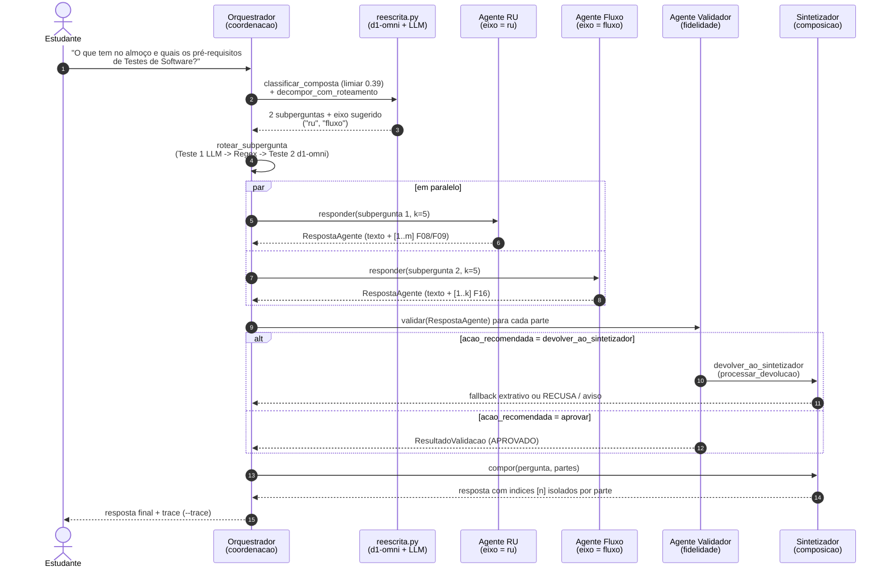

# Fluxo de Interação e Roteamento

Esta página descreve o fluxo colaborativo de ponta a ponta entre os agentes diante de uma pergunta composta e documenta o experimento comparativo que fundamentou a cascata de classificação e roteamento utilizada pelo **Orquestrador**.

---

## Sequência de colaboração para pergunta composta

A **Figura 1** segue o modelo visual de [Escopo entre Grupos](../visao/escopo-grupos.md) para ilustrar as mensagens trocadas desde a submissão da pergunta até a composição final, incluindo a execução paralela e o caminho de devolução do `AgenteValidador` para o `Sintetizador`.

Figura 1. Diagrama de sequência de uma pergunta composta com execução paralela, validação factual e devolução ao sintetizador.

A **Tabela 1** detalha cada interação representada na **Figura 1**.

| Passo | Origem → Destino | Conteúdo trocado | Comportamento em caso de exceção / falha |
|---|---|---|---|
| 1 | Estudante → `Orquestrador` | Pergunta em linguagem natural e parâmetros (`backend`, `k`, `--falhar-agente`) | Consulta vazia ou sem contexto cai nos fluxos padrão de recusa |
| 2–3 | `Orquestrador` ↔ `reescrita.py` | Probabilidade composta (`d1-omni`, limiar `0.39`) e lista de subperguntas com rótulo | Se LLM falhar ou estiver indisponível, ativa `_decompor_fallback` |
| 4 | `Orquestrador` (interno) | Chamada a `rotear_subpergunta(subpergunta, eixo_sugerido, usar_d1_fallback=True)` | Sem sinal específico, recorre ao `d1-omni` (`limiar_confianca = 0.60`) ou executa especialistas padrão |
| 5–8 | `Orquestrador` ↔ `AgenteRU` / `AgenteFluxo` | Subpergunta roteada, retorno de `RespostaAgente` (texto, fontes `[n]`, trechos e tempo) | Falha em um agente captura exceção e marca apenas aquela parte para degradação graciosa |
| 9–13 | `Orquestrador` → `AgenteValidador` ↔ `Sintetizador` | Auditoria de `valores_sem_fonte` e `resposta_sem_citacao` por parte aprovada | Reprovação dispara `processar_devolucao` (fallback extrativo ou `RECUSA` / aviso explícito) |
| 14–16 | `Orquestrador` ↔ `Sintetizador` → Estudante | Partes validadas mantêm `[1], [2], ...` independentes e trace opcional (`--trace`) | `degradado=True` sinaliza ao estudante e ao portal qual bloco falhou |

Tabela 1. Descrição detalhada das mensagens trocadas no fluxo de colaboração.

---

## Classificação e roteamento no orquestrador

O roteamento de perguntas simples e compostas combina duas decisões distintas:

1. **Classificação de composição e decomposição (`reescrita.py`):** decide se a pergunta tem múltiplos tópicos usando `LiquidAI/d1-omni-600M` (`LIMIAR_COMPOSTA = 0.39`) e a divide em subperguntas atômicas com `decompor_com_roteamento` (ou fallback sintático `_decompor_fallback`).
2. **Roteamento de domínio por subpergunta (`rotear_subpergunta` em `agentes.py`):** compara três estratégias testadas empiricamente no repositório:
   - **Baseline Regex:** palavras-chave léxicas por domínio;
   - **Teste 1 (`ollama:qwen2.5:7b` conjunto):** o próprio LLM da decomposição já retorna o eixo (`[ru]` ou `[fluxo]`) junto de cada subpergunta, com **zero chamadas adicionais**;
   - **Teste 2 (`LiquidAI/d1-omni-600M`):** modelo neural zero-shot (`classificar_dominio_d1`, `limiar_confianca = 0.60`) para desambiguar casos sem palavras-chave óbvias.

---

## Relatório comparativo: Regex vs. Teste 1 (LLM) vs. Teste 2 (`d1-omni-600M`)

Para comparar as estratégias sem viés de um único padrão frasal, foi criado o conjunto `rag/avaliacao/perguntas/perguntas_roteamento_multiplas.jsonl` com **8 perguntas múltiplas** (`M01`–`M08`) que somam **17 subperguntas esperadas** entre os eixos `ru` e `fluxo`. O script executor encontra-se em `rag/avaliacao/scripts/avaliar_roteamento_agentes.py` e os artefatos de saída em `rag/avaliacao/resultados/`.

### Dataset de avaliação (`M01`–`M08`)

A **Tabela 2** lista as 8 perguntas compostas e a decomposição/roteamento de referência.

| ID | Pergunta composta original | Subperguntas esperadas e eixo alvo |
|---|---|---|
| `M01` | "O que tem no almoço de quarta-feira e quais são os pré-requisitos de Testes de Software?" | `ru`: O que tem no almoço de quarta-feira no RU? · `fluxo`: Quais são os pré-requisitos de Testes de Software? |
| `M02` | "Qual a proteína servida hoje ao meio-dia no bandejão e o que preciso ter aprovado antes de pegar Cálculo 2?" | `ru`: Qual a proteína servida hoje no almoço do RU? · `fluxo`: Quais disciplinas preciso ter aprovado antes de cursar Cálculo 2? |
| `M03` | "Quem tem direito a isenção na refeição e até que horas servem o jantar no Gama?" | `ru`: Quem tem direito a isenção nas refeições do RU? · `ru`: Até que horas é servido o jantar no RU Gama? |
| `M04` | "Quantas horas de estágio são exigidas em Engenharia de Energia e como um aluno da graduação pede para cursar matéria isolada na pós?" | `fluxo`: Quantas horas de estágio obrigatório são exigidas em Engenharia de Energia? · `fluxo`: Como um estudante de graduação solicita cursar disciplina no mestrado (PPGEB)? |
| `M05` | "Onde vejo se a comida de hoje tem derivados de leite e qual o prazo máximo para desistir de uma turma no semestre sem reprovar?" | `ru`: Onde consultar se a comida de hoje no RU contém derivados de leite (alergênicos)? · `fluxo`: Qual o prazo máximo para desistir (trancar) uma turma no semestre sem reprovar? |
| `M06` | "Qual a carga horária mínima por período em Software e quanto paga quem não recebe bolsa de alimentação?" | `fluxo`: Qual a carga horária mínima por semestre em Engenharia de Software? · `ru`: Quanto paga nas refeições do RU quem não recebe auxílio alimentação? |
| `M07` | "Quanto custa o desjejum para Grupo II, quantos créditos exige Engenharia Aeroespacial e abre aos sábados para comer?" | `ru`: Quanto custa o café da manhã (desjejum) no RU para o Grupo II? · `fluxo`: Quantos créditos exige o curso de Engenharia Aeroespacial? · `ru`: O RU Gama abre aos sábados para refeições? |
| `M08` | "Sou calouro da ABI na FCTE: em qual etapa escolho minha engenharia específica e quais documentos apresento na catraca para comer?" | `fluxo`: Sou calouro da ABI na FCTE: em qual etapa escolho minha engenharia específica? · `ru`: Quais documentos o estudante apresenta na catraca para comer no RU? |

Tabela 2. Conjunto de perguntas múltiplas, decomposições e eixos esperados em <code>perguntas_roteamento_multiplas.jsonl</code>.

### Resultados nas 17 subperguntas canônicas

Quando os termos do domínio já aparecem explicitamente na subpergunta canônica, todos os métodos alcançam cobertura integral, diferindo apenas em latência, conforme mostra a **Tabela 3**.

| Método | Acertos exatos | Extras (ambíguos `['ru', 'fluxo']`) | Latência média por subpergunta | Observação |
|---|---:|---:|---:|---|
| **Baseline Regex** | `17/17` (`100.0%`) | `0` | `0.03 ms` | Custo zero quando palavras-chave canônicas estão presentes |
| **Teste 1 (`ollama:qwen2.5:7b` conjunto)** | `17/17` (`100.0%`) | `0` | `630.0 ms` isolado / `0 ms` extra na decomposição | O rótulo já vem embutido na saída de decomposição |
| **Teste 2 (`LiquidAI/d1-omni-600M`)** | `17/17` (`100.0%`) | `0` | `84.6 ms` | Modelo neural local ~`7.4x` mais rápido que chamada LLM isolada |

Tabela 3. Comparação de acurácia e latência sobre as 17 subperguntas canônicas esperadas.

### Estágio de classificação composta e decomposição (8 consultas)

A **Tabela 4** consolida o desempenho do Estágio 1 e do Estágio 2 sobre as 8 perguntas compostas.

| Etapa / Método | Resultado observado | Latência média por consulta | Comportamento |
|---|---|---:|---|
| **Estágio 1 (`d1-omni-600M >= 0.39`)** | `7/8` (`87.5%`) | `92.9 ms` | Errou apenas `M06` (`p = 0.374`, abaixo do limiar `0.39`) |
| **Teste 1 (`ollama:qwen2.5:7b` conjunto)** | `8/8` (`100.0%`) | `3486.7 ms` | Decomposição correta nas 8 consultas e `8/8` sequências exatas de eixos (`[ru]`/`[fluxo]`) |
| **Fallback sintático (`_decompor_fallback`)** | `7/8` (`87.5%`) | `< 1 ms` | Falhou em `M07` (pergunta com 3 subperguntas separadas por vírgula) |

Tabela 4. Desempenho da classificação composta e da decomposição conjunta nas 8 consultas múltiplas.

### Roteamento das subperguntas naturais geradas pelo LLM (17 subperguntas)

O teste mais representativo ocorre quando os roteadores recebem as subperguntas naturais exatamente como saem da decomposição pelo `qwen2.5:7b` (sem palavras explícitas como *"RU"*, *"almoço"* ou *"matrícula"*). A **Tabela 5** mostra o comportamento comparativo e os casos de divergência.

| Método / Caso analisado | Acertos exatos | Extras (`['ru', 'fluxo']`) / Detalhe observável |
|---|---|---|
| **Baseline Regex** | `13/17` (`76.5%`) | `4` ambiguidades em linguagem natural por ausência de termos léxicos exatos |
| **Teste 2 (`LiquidAI/d1-omni-600M`)** | `16/17` (`94.1%`) | `0` extras; superou Regex em linguagem natural com `1` único erro em `M03` |
| **Teste 1 (`qwen2.5:7b` conjunto)** | `17/17` (`100.0%`) | `0` extras; aproveita o contexto completo da pergunta composta durante a decomposição |
| Divergência `M03`: *"Quem tem direito a isenção na refeição?"* (esperado `ru`) | Regex: `['ru']` · T1: `['ru']` · T2: `['fluxo']` | Escores do `d1-omni-600M`: `ru = 0.3032`, `fluxo = 0.6968` |
| Divergência `M05`: *"Onde vejo se a comida de hoje tem derivados de leite?"* (esperado `ru`) | Regex: `['ru', 'fluxo']` · T1: `['ru']` · T2: `['ru']` | Regex sem match caiu nos dois agentes; `d1-omni-600M` acertou com `ru = 0.9091` (`fluxo = 0.0909`) |
| Divergência `M06`: *"Quanto paga quem não recebe bolsa de alimentação?"* (esperado `ru`) | Regex: `['ru', 'fluxo']` · T1: `['ru']` · T2: `['ru']` | `d1-omni-600M` classificou `ru = 0.8482` (`fluxo = 0.1518`) |
| Divergência `M07`: *"Abre aos sábados para comer?"* (esperado `ru`) | Regex: `['ru', 'fluxo']` · T1: `['ru']` · T2: `['ru']` | `d1-omni-600M` classificou `ru = 0.9673` (`fluxo = 0.0327`) |
| Divergência `M08`: *"Quais documentos apresento na catraca para comer?"* (esperado `ru`) | Regex: `['ru', 'fluxo']` · T1: `['ru']` · T2: `['ru']` | `d1-omni-600M` classificou `ru = 0.9285` (`fluxo = 0.0715`) |

Tabela 5. Desempenho sobre subperguntas naturais geradas pelo LLM e detalhamento dos cinco casos divergentes.

!!! note "Decisão arquitetural resultante: cascata híbrida em `rotear_subpergunta`"
    1. **Prioridade 1 — Teste 1 (`eixo_sugerido` do LLM conjunto):** aproveita o rótulo emitido em `decompor_com_roteamento` sem custo adicional de latência (`17/17` no experimento);
    2. **Prioridade 2 — Regex léxica determinística:** quando a pergunta não passa por decomposição LLM ou não traz eixo sugerido e possui sinal inequívoco de domínio (`0.03 ms`);
    3. **Prioridade 3 — Teste 2 (`LiquidAI/d1-omni-600M` com `limiar_confianca = 0.60`):** acionado apenas quando Regex retorna empate ou ausência de sinal em linguagem natural (`M05`–`M08`), elevando a acurácia de `76.5%` para `94.1%` com custo médio de `84.6 ms`.

??? abstract "Histórico de revisão"
    | Versão | Data | Autor | Descrição | Revisor |
    |---|---|---|---|---|
    | 1.0 | 16/11/2026 | @GabrielMacielBR | Documentação inicial do roteamento híbrido e experimento comparativo | @keilogger |
    | 1.1 | 16/11/2026 | @GabrielMacielBR | Renomeação para `fluxo-de-interacao.md`, numeração de tabelas, diagrama de sequência padronizado e tabelas verbatim do experimento | @maykonjuso |
