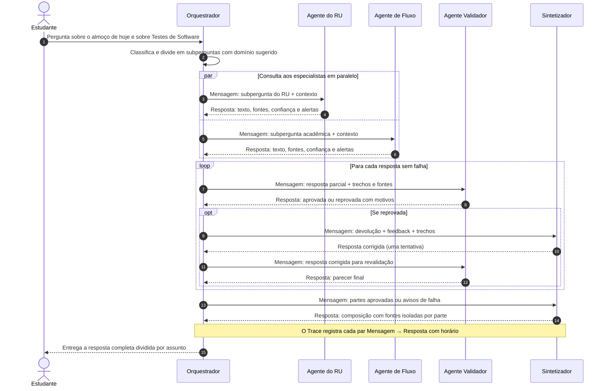

# Fluxo de Interação e Roteamento

Esta página mostra como os agentes colaboram diante de uma pergunta composta e resume o experimento que orientou a estratégia de classificação e roteamento do **Orquestrador**. Cada chamada entre agentes usa o contrato `Mensagem` → `Resposta`; o `Trace` registra as interações em ordem.

---

## Sequência de colaboração para pergunta composta

A **Figura 1** segue o modelo visual de [Divisão com o Grupo 09](../visao/escopo-grupos.md) e mostra as mensagens trocadas por uma pergunta que reúne RU e Fluxo.

Figura 1. Diagrama de sequência de uma pergunta composta com execução paralela, validação factual e composição isolada.

A **Tabela 1** explica o que acontece em cada um dos dez passos da **Figura 1**, inclusive como o sistema reage quando ocorre alguma falha.

| Passo | Participantes | O que acontece neste passo | Tratamento de falha ou exceção |
|---|---|---|---|
| 1 | Estudante → Orquestrador | O estudante envia a pergunta completa em linguagem natural para o ponto de entrada do sistema. | Consultas vazias ou sem tema reconhecido seguem o fluxo padrão de recusa. |
| 2 | Orquestrador | Combina a detecção de pergunta composta (limiar calibrado em `0,39`), a identificação de cruzamento RU + Fluxo e a sugestão de domínio para produzir as subperguntas. | Se a classificação do modelo falhar, usa os fallbacks implementados para ainda detectar cruzamentos claros ou dividir por conectivos. |
| 3–6 | Orquestrador ↔ Agente do RU / Agente de Fluxo | Os dois especialistas são consultados ao mesmo tempo na base documental oficial da UnB e devolvem suas respostas com citações próprias. | Se um especialista cair ou falhar, essa parte recebe um aviso explícito de indisponibilidade sem impedir a entrega da parte saudável. |
| 7–8 | Orquestrador ↔ Agente Validador | O validador confere se valores numéricos e afirmações constam nos trechos recuperados e se há citação de fonte válida. | Se encontrar dado sem fonte ou falta de citação, devolve o bloco ao sintetizador para extração literal segura dos trechos ou emissão de recusa padrão com aviso. |
| 9 | Orquestrador | O sintetizador reúne os blocos validados preservando a numeração e a lista de fontes de cada parte de forma independente. | Mantém eventuais avisos de falha parcial ou correção vinculados apenas ao bloco afetado. |
| 10 | Orquestrador → Estudante | O estudante recebe a resposta final organizada por assunto, com referências separadas e histórico detalhado de execução quando solicitado. | Sinaliza explicitamente quando a entrega ocorreu em modo degradado por indisponibilidade parcial. |

Tabela 1. Descrição dos dez passos do fluxo de colaboração entre os agentes.

---

## Como o orquestrador classifica e roteia perguntas

Antes de acionar os especialistas, o orquestrador toma duas decisões complementares:

1. **Detectar e dividir perguntas compostas:** combina a probabilidade do classificador neural (limiar `0,39`) com uma detecção explícita de cruzamento entre os termos de RU e Fluxo. Quando a pergunta é composta, a reescrita produz subperguntas e sugestões de domínio; há fallback gramatical caso o modelo falhe.
2. **Escolher o especialista de cada subpergunta:** direciona cada parte entre **Restaurante Universitário** e **Fluxo de Graduação**. Para definir a melhor estratégia de roteamento, três abordagens foram avaliadas em experimento próprio:
   - **Regras por palavras-chave (Regex):** busca termos explícitos do domínio diretamente no texto da subpergunta;
   - **Roteamento conjunto no modelo de linguagem (LLM `qwen2.5:7b`):** o mesmo modelo que divide a pergunta já indica o assunto de cada parte na resposta, sem exigir uma nova chamada ao servidor;
   - **Classificador neural leve (`LiquidAI/d1-omni-600M`):** modelo local usado tanto para detectar perguntas compostas quanto para desambiguar o domínio quando faltam palavras-chave óbvias (com limiar de confiança `0,60`).

---

## Relatório comparativo das estratégias de roteamento

Para testar as estratégias fora de frases padronizadas, foi criado o conjunto `rag/avaliacao/perguntas/perguntas_roteamento_multiplas.jsonl` com **8 perguntas múltiplas** envolvendo linguagem cotidiana, somando **17 subperguntas esperadas** entre Restaurante Universitário e Fluxo de Graduação. O script avaliador fica em `rag/avaliacao/scripts/avaliar_roteamento_agentes.py` e os registros completos em `rag/avaliacao/resultados/`.

### Conjunto de avaliação (8 perguntas múltiplas, 17 subperguntas)

A **Tabela 2** apresenta as oito perguntas compostas avaliadas, sua divisão esperada e o agente de destino correto de cada subpergunta.

| # | Pergunta composta avaliada | Subperguntas esperadas e agente de destino |
|---|---|---|
| 1 | "O que tem no almoço de quarta-feira e quais são os pré-requisitos de Testes de Software?" | **Restaurante Universitário:** O que tem no almoço de quarta-feira no RU? · **Fluxo de Graduação:** Quais são os pré-requisitos de Testes de Software? |
| 2 | "Qual a proteína servida hoje ao meio-dia no bandejão e o que preciso ter aprovado antes de pegar Cálculo 2?" | **Restaurante Universitário:** Qual a proteína servida hoje no almoço do RU? · **Fluxo de Graduação:** Quais disciplinas preciso ter aprovado antes de cursar Cálculo 2? |
| 3 | "Quem tem direito a isenção na refeição e até que horas servem o jantar no Gama?" | **Restaurante Universitário:** Quem tem direito a isenção nas refeições do RU? · **Restaurante Universitário:** Até que horas é servido o jantar no RU Gama? |
| 4 | "Quantas horas de estágio são exigidas em Engenharia de Energia e como um aluno da graduação pede para cursar matéria isolada na pós?" | **Fluxo de Graduação:** Quantas horas de estágio obrigatório são exigidas em Engenharia de Energia? · **Fluxo de Graduação:** Como um estudante de graduação solicita cursar disciplina no mestrado (PPGEB)? |
| 5 | "Onde vejo se a comida de hoje tem derivados de leite e qual o prazo máximo para desistir de uma turma no semestre sem reprovar?" | **Restaurante Universitário:** Onde consultar se a comida de hoje no RU contém derivados de leite (alergênicos)? · **Fluxo de Graduação:** Qual o prazo máximo para desistir (trancar) uma turma no semestre sem reprovar? |
| 6 | "Qual a carga horária mínima por período em Software e quanto paga quem não recebe bolsa de alimentação?" | **Fluxo de Graduação:** Qual a carga horária mínima por semestre em Engenharia de Software? · **Restaurante Universitário:** Quanto paga nas refeições do RU quem não recebe auxílio alimentação? |
| 7 | "Quanto custa o desjejum para Grupo II, quantos créditos exige Engenharia Aeroespacial e abre aos sábados para comer?" | **Restaurante Universitário:** Quanto custa o café da manhã (desjejum) no RU para o Grupo II? · **Fluxo de Graduação:** Quantos créditos exige o curso de Engenharia Aeroespacial? · **Restaurante Universitário:** O RU Gama abre aos sábados para refeições? |
| 8 | "Sou calouro da ABI na FCTE: em qual etapa escolho minha engenharia específica e quais documentos apresento na catraca para comer?" | **Fluxo de Graduação:** Sou calouro da ABI na FCTE: em qual etapa escolho minha engenharia específica? · **Restaurante Universitário:** Quais documentos o estudante apresenta na catraca para comer no RU? |

Tabela 2. Conjunto de 8 perguntas múltiplas e 17 subperguntas de referência do experimento.

### Desempenho nas 17 subperguntas canônicas

Quando os termos clássicos do domínio aparecem escritos explicitamente na subpergunta canônica, todas as estratégias acertam a totalidade dos casos, diferindo apenas no tempo de resposta, como resume a **Tabela 3**.

| Estratégia avaliada | Acertos exatos | Acionamentos extras (ambos os agentes) | Latência média por subpergunta | Observação |
|---|---:|---:|---:|---|
| **Regras por palavras-chave (Regex)** | `17/17` (`100.0%`) | `0` | `0.03 ms` | Custo praticamente nulo quando palavras-chave diretas estão presentes |
| **Roteamento conjunto no modelo de linguagem (`qwen2.5:7b`)** | `17/17` (`100.0%`) | `0` | `630.0 ms` isolado / `0 ms` extra na divisão | O assunto já vem indicado junto com a própria divisão da pergunta |
| **Classificador neural leve (`LiquidAI/d1-omni-600M`)** | `17/17` (`100.0%`) | `0` | `84.6 ms` | Executa localmente cerca de `7.4x` mais rápido que uma chamada isolada ao modelo de linguagem |

Tabela 3. Acurácia e latência nas 17 subperguntas canônicas explícitas.

### Desempenho na detecção de composição e na divisão das 8 consultas

A **Tabela 4** compara as etapas de detecção inicial e decomposição nas oito consultas múltiplas completas.

| Etapa avaliada | Taxa de acerto observada | Latência média por consulta | Comportamento observado |
|---|---|---:|---|
| **Classificador de pergunta composta (`d1-omni-600M`, limiar `0.39`)** | `7/8` (`87.5%`) | `92.9 ms` | Deixou passar apenas a pergunta sobre carga horária de Software e valor sem bolsa (`p = 0.374`, logo abaixo do limiar `0.39`) |
| **Divisão e roteamento conjuntos (`ollama:qwen2.5:7b`)** | `8/8` (`100.0%`) | `3486.7 ms` | Acertou a divisão nas 8 consultas e acertou todas as `8/8` sequências completas de agentes esperados |
| **Divisão por conectivos gramaticais (alternativa sem LLM)** | `7/8` (`87.5%`) | `< 1 ms` | Falhou apenas na pergunta tripla sobre desjejum, créditos de Engenharia Aeroespacial e funcionamento aos sábados, por conter três partes separadas por vírgula |

Tabela 4. Desempenho das etapas de identificação de perguntas compostas e decomposição nas 8 consultas múltiplas.

### Desempenho nas 17 subperguntas naturais geradas pelo modelo de linguagem

O cenário mais exigente ocorre quando os roteadores recebem as frases exatamente como saem da divisão em linguagem natural, muitas vezes sem palavras literais como *"RU"*, *"almoço"* ou *"matrícula"*. A **Tabela 5** reúne os totais comparativos e descreve todos os cinco casos em que os métodos divergiram.

| Estratégia ou caso específico de divergência | Resultado comparativo | Explicação observada |
|---|---|---|
| **Total — Regras por palavras-chave (Regex)** | `13/17` acertos exatos (`76.5%`) | Gerou `4` indecisões em que disparou os dois agentes por ausência de termos literais |
| **Total — Classificador neural leve (`LiquidAI/d1-omni-600M`)** | `16/17` acertos exatos (`94.1%`) | Nenhuma indecisão dupla; superou as regras léxicas em linguagem natural com apenas `1` erro |
| **Total — Roteamento conjunto no modelo de linguagem (`qwen2.5:7b`)** | `17/17` acertos exatos (`100.0%`) | Nenhum erro e nenhuma chamada dupla; aproveita o contexto inteiro da pergunta composta |
| **Caso 1:** *"Quem tem direito a isenção na refeição?"* (esperado: Restaurante Universitário) | **Regex:** Restaurante Universitário · **LLM conjunto:** Restaurante Universitário · **Neural (`d1-omni`):** Fluxo de Graduação | Único erro do classificador neural (`d1-omni`), que atribuiu probabilidade `0.3032` para Restaurante Universitário e `0.6968` para Fluxo |
| **Caso 2:** *"Onde vejo se a comida de hoje tem derivados de leite?"* (esperado: Restaurante Universitário) | **Regex:** Ambos os agentes por indecisão · **LLM conjunto:** Restaurante Universitário · **Neural (`d1-omni`):** Restaurante Universitário | Sem palavra literal, as regras dispararam os dois especialistas; o classificador neural acertou com `0.9091` contra `0.0909` |
| **Caso 3:** *"Quanto paga quem não recebe bolsa de alimentação?"* (esperado: Restaurante Universitário) | **Regex:** Ambos os agentes por indecisão · **LLM conjunto:** Restaurante Universitário · **Neural (`d1-omni`):** Restaurante Universitário | Classificador neural acertou com probabilidade `0.8482` para Restaurante Universitário (`0.1518` para Fluxo) |
| **Caso 4:** *"Abre aos sábados para comer?"* (esperado: Restaurante Universitário) | **Regex:** Ambos os agentes por indecisão · **LLM conjunto:** Restaurante Universitário · **Neural (`d1-omni`):** Restaurante Universitário | Classificador neural acertou com probabilidade `0.9673` para Restaurante Universitário (`0.0327` para Fluxo) |
| **Caso 5:** *"Quais documentos apresento na catraca para comer?"* (esperado: Restaurante Universitário) | **Regex:** Ambos os agentes por indecisão · **LLM conjunto:** Restaurante Universitário · **Neural (`d1-omni`):** Restaurante Universitário | Classificador neural acertou com probabilidade `0.9285` para Restaurante Universitário (`0.0715` para Fluxo) |

Tabela 5. Comparativo completo sobre subperguntas naturais geradas pelo modelo de linguagem e detalhamento das cinco divergências.

!!! note "Decisão arquitetural adotada: cascata híbrida em três níveis"
    1. **Nível 1 — Sugestão do modelo de linguagem na divisão da pergunta:** sempre que a consulta passa pela decomposição, aproveita o domínio já retornado junto com as subperguntas (`17/17` acertos e zero latência extra);
    2. **Nível 2 — Regras rápidas por palavras-chave:** quando não há sugestão prévia e a frase traz termos inequívocos de RU ou Fluxo, roteia em `0.03 ms`;
    3. **Nível 3 — Classificador neural leve (`LiquidAI/d1-omni-600M`, limiar `0.60`):** entra apenas quando as regras não conseguem decidir em linguagem natural (como nos Casos 2 a 5 acima), elevando a acurácia de `76.5%` para `94.1%` ao custo médio de `84.6 ms`.

??? abstract "Histórico de revisão"
    | Versão | Data | Autor | Descrição | Revisor |
    |---|---|---|---|---|
    | 1.0 | 16/11/2026 | @GabrielMacielBR | Documentação inicial do roteamento híbrido e experimento comparativo | @keilogger |
    | 1.1 | 16/11/2026 | @GabrielMacielBR | Renomeação para `fluxo-de-interacao.md`, diagrama padronizado e tabelas verbatim do experimento | @maykonjuso |
    | 1.2 | 16/11/2026 | @GabrielMacielBR | Simplificação visual do diagrama de sequência e reescrita em linguagem natural descritiva nas tabelas sem códigos nem notações abstratas | @maykonjuso |
    | 1.3 | 18/11/2026 | @keilogger | Inclusão do Sintetizador, do contrato Mensagem/Resposta e do trace na sequência de colaboração | — |
