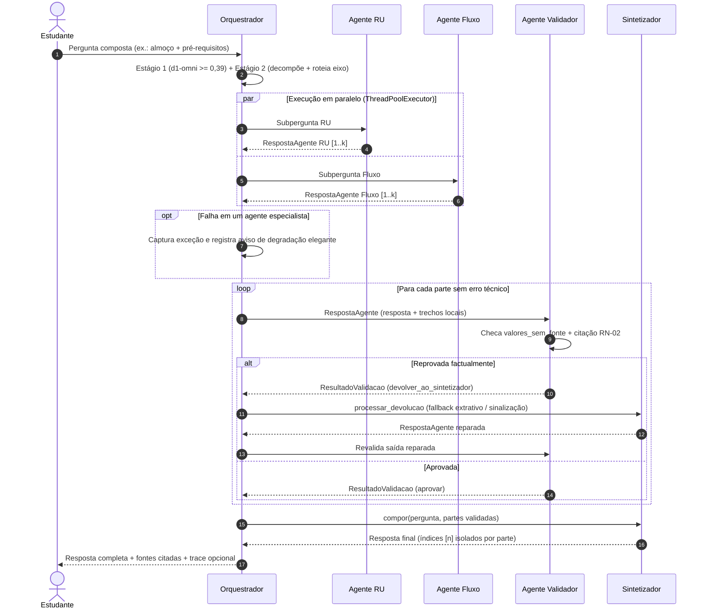

# Orquestração, fluxo de colaboração e roteamento

Esta página descreve o protocolo temporal de colaboração entre os agentes e apresenta o **relatório comparativo experimental** de classificação e roteamento (**Regex** × **Teste 1 LLM Conjunto** × **Teste 2 `LiquidAI/d1-omni-600M`**).

---

## 1. Fluxo de interação e colaboração entre os agentes

A **Figura 1** mostra a sequência completa de mensagens trocadas durante o atendimento de uma consulta composta, destacando o paralelismo entre especialistas, o ciclo de devolução do `Agente Validador` ao `Sintetizador` e a degradação elegante em caso de falha.

Figura 1. Diagrama de sequência da colaboração entre Orquestrador, agentes de domínio, Agente Validador e Sintetizador.

### Responsabilidades contratuais do Orquestrador

1. **Classificar e decompor:** reutiliza `reescrita.py` em dois estágios (classificador `LiquidAI/d1-omni-600M` calibrado em `0,39` + LLM decompositor), evitando chamadas caras quando a pergunta é simples.
2. **Rotear por domínio:** encaminha cada subpergunta apenas ao especialista pertinente (`ru`, `fluxo` ou ambos), reduzindo latência e poluição de contexto cruzado.
3. **Executar em paralelo com segurança:** usa `ThreadPoolExecutor` para sobrepor as chamadas de geração (que consomem ~7–9 s em LLM local), protegendo a consulta inicial ao ChromaDB/BM25 com `_LOCK_BUSCA` para evitar colisão do `RustBindingsAPI`.
4. **Compor sem misturar índices `[n]`:** preserva as numerações `[1]..[k]` e listas de fontes separadas por parte — requisito contratual da integração com o portal e com o Grupo 09.
5. **Degradar com elegância:** se qualquer especialista (ou o próprio validador) falhar ou cair, a resposta sobrevivente é entregue normalmente acompanhada de aviso explícito.

---

## 2. Relatório comparativo de classificação e roteamento (Teste 1 vs. Teste 2)

Na implementação inicial do `Orquestrador`, o roteamento de subperguntas dependia exclusivamente de expressões regulares (`_TERMOS_RU` e `_TERMOS_FLUXO`). Embora leve (`0,03 ms`), o regex falha quando o estudante usa formulações coloquiais ou implícitas sem palavras-chave óbvias (por exemplo, *"derivados de leite"* em vez de *"alergênicos do RU"* ou *"desistir de uma turma"* em vez de *"trancamento de disciplina"*).

Para decidir a estratégia de classificação do Orquestrador com base empírica, conduzimos um experimento (`rag/avaliacao/scripts/avaliar_roteamento_agentes.py`) comparando três métodos:

- **Baseline · Regex:** `agentes.rotear_subpergunta` atual por palavras-chave.
- **Teste 1 · LLM Conjunto (`ollama:qwen2.5:7b`):** o LLM no Estágio 2 decompõe a pergunta e já rotula o campo `"eixo"` (`"ru"`, `"fluxo"` ou `"ambos"`) no mesmo JSON de resposta.
- **Teste 2 · System-1 (`LiquidAI/d1-omni-600M`):** o modelo discriminativo do Estágio 1 classifica zero-shot cada subpergunta entre `"ru"` e `"fluxo"`, caindo em `"ambos"` quando a confiança máxima é inferior a `0,60`.

### 2.1. Conjunto de teste de perguntas múltiplas

A **Tabela 1** lista as **8 perguntas múltiplas** (`M01`–`M08`, totalizando **17 subperguntas esperadas**) criadas em `rag/avaliacao/perguntas/perguntas_roteamento_multiplas.jsonl` para cobrir casos explícitos, múltiplos temas do mesmo domínio, consulta tripla e formulações implícitas sem termos literais do regex.

| ID | Tipo de desafio | Pergunta composta original | Subperguntas e eixos esperados |
|---|---|---|---|
| **M01** | RU + Fluxo explícito | *"O que tem no almoço de quarta-feira e quais são os pré-requisitos de Testes de Software?"* | 1. Almoço de quarta-feira (`ru`) 2. Pré-requisitos de Testes de Software (`fluxo`) |
| **M02** | Coloquial ("bandejão", "pegar") | *"Qual a proteína servida hoje ao meio-dia no bandejão e o que preciso ter aprovado antes de pegar Cálculo 2?"* | 1. Proteína hoje no almoço (`ru`) 2. Aprovações antes de Cálculo 2 (`fluxo`) |
| **M03** | Mesmo domínio (`ru` + `ru`) | *"Quem tem direito a isenção na refeição e até que horas servem o jantar no Gama?"* | 1. Direito a isenção no RU (`ru`) 2. Horário do jantar no Gama (`ru`) |
| **M04** | Mesmo domínio (`fluxo` + `fluxo`) | *"Quantas horas de estágio são exigidas em Engenharia de Energia e como um aluno da graduação pede para cursar matéria isolada na pós?"* | 1. Horas de estágio em Energia (`fluxo`) 2. Matéria isolada no mestrado (`fluxo`) |
| **M05** | Implícito (sem termos-chave) | *"Onde vejo se a comida de hoje tem derivados de leite e qual o prazo máximo para desistir de uma turma no semestre sem reprovar?"* | 1. Derivados de leite na comida (`ru`) 2. Prazo para desistir de turma (`fluxo`) |
| **M06** | Fluxo + RU ("bolsa de alimentação") | *"Qual a carga horária mínima por período em Software e quanto paga quem não recebe bolsa de alimentação?"* | 1. Carga horária mínima em Software (`fluxo`) 2. Preço sem auxílio alimentação (`ru`) |
| **M07** | Consulta tripla (`ru` + `fluxo` + `ru`) | *"Quanto custa o desjejum para Grupo II, quantos créditos exige Engenharia Aeroespacial e abre aos sábados para comer?"* | 1. Preço desjejum Grupo II (`ru`) 2. Créditos Aeroespacial (`fluxo`) 3. Abre aos sábados (`ru`) |
| **M08** | Contexto compartilhado (ABI + catraca) | *"Sou calouro da ABI na FCTE: em qual etapa escolho minha engenharia específica e quais documentos apresento na catraca para comer?"* | 1. Etapa de escolha na ABI (`fluxo`) 2. Documentos na catraca para comer (`ru`) |

Tabela 1. Dataset experimental de perguntas múltiplas (rag/avaliacao/perguntas/perguntas_roteamento_multiplas.jsonl).

### 2.2. Resultados na classificação composta e decomposição (8 perguntas)

A **Tabela 2** resume o desempenho na etapa de detecção de multiplicidade e geração das subperguntas (dados brutos em `rag/avaliacao/resultados/resultado_roteamento_agentes.json`).

| Etapa / Método | Resultado nas 8 múltiplas | Latência média | Observação |
|---|---:|---:|---|
| **Estágio 1 (`d1-omni-600M` ≥ 0,39)** | **7/8** detectadas (`87,5%`) | **92,9 ms** | Falhou apenas em `M06` (`p = 0,374`, logo abaixo de `0,39`) |
| **Teste 1 (`ollama:qwen2.5:7b` conjunto)** | **8/8** nº exato (`100,0%`) · **8/8** rotas exatas | **3.486,7 ms** | Quebrou corretamente até a tripla `M07` e rotulou 100% dos eixos |
| **Fallback sintático (`_decompor_fallback`)** | **7/8** nº exato (`87,5%`) | < 1 ms | Falhou apenas na tripla `M07` (vírgula antes do 2º item) |

Tabela 2. Desempenho na triagem e decomposição das 8 perguntas múltiplas.

### 2.3. Resultados de roteamento por subpergunta (17 subperguntas)

O experimento revelou uma diferença crucial ao comparar a avaliação em **subperguntas canônicas** (enunciados padronizados contendo `"no RU"` ou `"(trancar)"`) versus as **subperguntas naturais** extraídas diretamente das perguntas compostas pelo LLM, resumida na **Tabela 3**.

| Método | 17 canônicas (com termos explícitos) | 17 naturais decompostas (linguagem real) | Chamadas extras (`ambos`) nas naturais | Latência média |
|---|---:|---:|---:|---:|
| **Baseline · Regex** | **17/17** (`100,0%`) | **13/17** (`76,5%`) | 4 | **0,03 ms** |
| **Teste 2 · `LiquidAI/d1-omni-600M`** | **17/17** (`100,0%`) | **16/17** (`94,1%`) | 0 | **84,6 ms** |
| **Teste 1 · `ollama:qwen2.5:7b`** | **17/17** (`100,0%`) | **17/17** (`100,0%`) | 0 | **0 ms extra** *(na decomposição)* / **630,0 ms** *(isolado)* |

Tabela 3. Comparação de acurácia exata e custo entre Regex, Teste 1 e Teste 2.

### 2.4. Análise das divergências e saída da decomposição conjunta

A **Tabela 4** exibe exatamente os **5 casos de divergência** registrados sobre as 17 subperguntas reais extraídas pelo `qwen2.5:7b` no Teste 1.

| Caso | Subpergunta real extraída pelo LLM | Esperado | Regex | Teste 1 (`qwen2.5:7b`) | Teste 2 (`d1-omni-600M`) |
|---|---|---:|---|---|---|
| **M03.1** | *"Quem tem direito a isenção na refeição?"* | `ru` | `['ru']` | `['ru']` | `['fluxo']` *(RU=0,30 · Fluxo=0,70)* |
| **M05.1** | *"Onde vejo se a comida de hoje tem derivados de leite?"* | `ru` | `['ru', 'fluxo']` | `['ru']` | `['ru']` *(RU=0,91 · Fluxo=0,09)* |
| **M06.2** | *"Quanto paga quem não recebe bolsa de alimentação?"* | `ru` | `['ru', 'fluxo']` | `['ru']` | `['ru']` *(RU=0,85 · Fluxo=0,15)* |
| **M07.3** | *"Abre aos sábados para comer?"* | `ru` | `['ru', 'fluxo']` | `['ru']` | `['ru']` *(RU=0,97 · Fluxo=0,03)* |
| **M08.2** | *"Quais documentos apresento na catraca para comer?"* | `ru` | `['ru', 'fluxo']` | `['ru']` | `['ru']` *(RU=0,93 · Fluxo=0,07)* |

Tabela 4. Divergências observadas no roteamento das subperguntas naturais decompostas.

??? note "Decomposições conjuntas geradas pelo Teste 1 (M01–M08)"
    - **M01** (`d1-omni` p=0,465): `[ru]` *"O que tem no almoço de quarta-feira?"*; `[fluxo]` *"Quais são os pré-requisitos de Testes de Software?"*
    - **M02** (`d1-omni` p=0,496): `[ru]` *"Qual a proteína servida hoje ao meio-dia no bandejão?"*; `[fluxo]` *"O que preciso ter aprovado antes de pegar Cálculo 2?"*
    - **M03** (`d1-omni` p=0,445): `[ru]` *"Quem tem direito a isenção na refeição?"*; `[ru]` *"Até que horas servem o jantar no Gama?"*
    - **M04** (`d1-omni` p=0,623): `[fluxo]` *"Quantas horas de estágio são exigidas em Engenharia de Energia?"*; `[fluxo]` *"Como um aluno da graduação pede para cursar matéria isolada na pós-graduação?"*
    - **M05** (`d1-omni` p=0,550): `[ru]` *"Onde vejo se a comida de hoje tem derivados de leite?"*; `[fluxo]` *"Qual é o prazo máximo para desistir de uma turma no semestre sem reprovar?"*
    - **M06** (`d1-omni` p=0,374): `[fluxo]` *"Qual a carga horária mínima por período em Software?"*; `[ru]` *"Quanto paga quem não recebe bolsa de alimentação?"*
    - **M07** (`d1-omni` p=0,636): `[ru]` *"Quanto custa o desjejum para Grupo II?"*; `[fluxo]` *"Quantos créditos exige Engenharia Aeroespacial?"*; `[ru]` *"Abre aos sábados para comer?"*
    - **M08** (`d1-omni` p=0,514): `[fluxo]` *"Em qual etapa escolho minha engenharia específica?"*; `[ru]` *"Quais documentos apresento na catraca para comer?"*

### 2.5. Decisão arquitetural adotada

Os resultados mostram complementaridade direta entre as três técnicas, levando à **estratégia híbrida em cascata** adotada no código:

1. **Em consultas compostas (Estágio 2 ativo):** o LLM decompositor já retorna o campo `eixo` junto com cada subpergunta no mesmo JSON (**Teste 1**, `100%` de acurácia sem chamada adicional).
2. **Em consultas simples ou fallback:** o **Regex rápido (`0,03 ms`)** resolve imediatamente casos explícitos (como `M03.1`, onde até o `d1-omni` confundiu `"isenção"` com contexto acadêmico).
3. **Quando o Regex fica em dúvida (`0` termos casados):** aciona-se o **`LiquidAI/d1-omni-600M` (Teste 2, `~85 ms`)**, que acertou 100% das formulações coloquiais sem palavras-chave (`M05`, `M06`, `M07`, `M08`), evitando acionar dois especialistas em paralelo sem necessidade.

---

??? abstract "Histórico de revisão"

    | Data | Versão | Descrição | Autor |
    | :---: | :---: | --- | --- |
    | 16/11/2026 | 1.0 | Diagrama de sequência multiagentes, regras contratuais do Orquestrador e relatório comparativo Regex × Teste 1 × Teste 2 | Grupo 04 |
