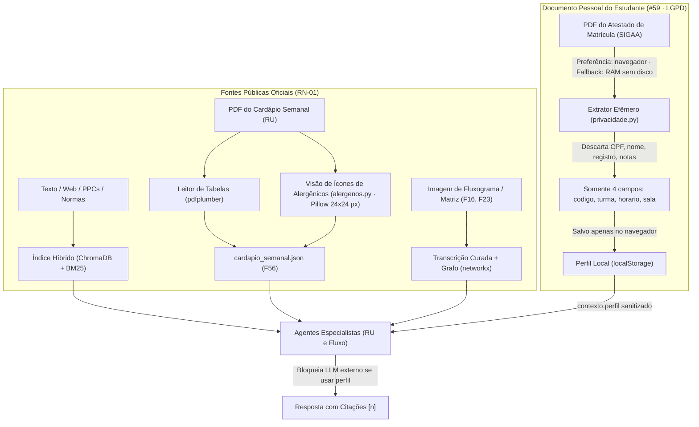

# Modalidades suportadas

O **RUmo** opera sobre três modalidades principais — **Texto**, **PDF** e **Imagem** — combinando extração determinística de documentos e visão computacional clássica com a esteira multiagente da [Entrega 4](../entrega-4/arquitetura-agentes.md). A fronteira entre **base pública oficial** e **documento pessoal do estudante** é rígida: fontes oficiais alimentam o índice e os JSONs estruturados; documentos pessoais nunca entram no RAG nem são gravados no servidor.

---

## Arquitetura de entrada multimodal

A **Figura 1** resume como cada modalidade entra no sistema, qual componente realiza a extração e até onde os dados podem trafegar.

Figura 1. Fluxo multimodal do RUmo separando fontes oficiais (esquerda/topo) e dados pessoais efêmeros (base/direita).

---

## Matriz das modalidades suportadas

A **Tabela 1** detalha cada modalidade disponível, o mecanismo utilizado, os artefatos produzidos e as garantias aplicadas.

| Modalidade | Uso no sistema | Extração e processamento | Destino / Persistência | Regras e garantias |
|---|---|---|---|---|
| **Texto** | Perguntas em linguagem natural, normas acadêmicas, resoluções, editais DDS e PPCs (`F01`–`F58`) | Limpeza textual (`extracao.py`), chunking por seção (`chunking.py`), BM25 + embeddings `BAAI/bge-m3` e grafo determinístico (`grafo_curricular.py`) | `chunks.jsonl`, ChromaDB e `grafo_curricular.json` | Citação obrigatória `[n]` (`RN-02`) e recusa sem invenção (`RN-03`) |
| **PDF institucional** | Cardápios semanais do RU Gama, calendários acadêmicos, regimentos e PPCs | `pypdf` e `pdfplumber` extraindo texto e células tabulares estruturadas (`coleta/cardapio.py`) | `chunks.jsonl` (`F01`–`F58`) e `cardapio_semanal.json` (`F56`) | Validação estrutural com `jsonschema`; calendários carregam `vigencia` |
| **Imagem em PDF oficial** | Ícones visuais dos 10 alergênicos oficiais da ANVISA no cardápio semanal do RU Gama | `alergenos.py` renderiza a página em `300 dpi` (`Pillow`), recorta ícones da legenda no rodapé e compara cada ícone segmentado da tabela em `24×24 px` por distância quadrática média (`DISTANCIA_MAXIMA = 0,06`, `MARGEM_MINIMA = 1,25`), associando à opção de prato vizinha | Etiqueta `[Alergênicos: ...]` convertida em lista `alergenicos` por opção no `cardapio_semanal.json` | Erro `0` em 306 opções comparáveis auditadas; ambiguidade vira `"a conferir na distribuição"` (nunca estima) |
| **Imagem de fluxograma / matriz** | Grades de Engenharia de Software (`F16`) e Engenharia de Energia (`F23`) publicadas apenas como figura | Transcrição manual curada em Markdown preservando setas cheias vs. tracejadas, convertida para `networkx.DiGraph` (`grafo_curricular.py`) | `dados/curados/*.md` e `grafo_curricular.json` | Arestas tracejadas mantêm aviso explícito *"confirme no SIGAA"*; consultas por grafo são 100% algorítmicas |
| **PDF pessoal do estudante (`#59`)** | Comprovante / Atestado de Matrícula do SIGAA para consultas *"Minha Semana"* (`minha_agenda`) | Leitura preferencial client-side no portal integrador; fallback em RAM no backend via `io.BytesIO` (`privacidade.py`, limite `5 MB`) com decodificador determinístico de código SIGAA (`35T23` → `14:00-15:50`) | **Nunca persistido no servidor.** Somente `codigo`, `turma`, `horario` e `sala` ficam no navegador do estudante | Histórico Escolar recusado; PII descartado; bloqueio automático de envio a LLM externo (`openai`/`openrouter`) |

Tabela 1. Modalidades suportadas pelo RUmo, componentes responsáveis e limites operacionais.

---

## Modalidades não suportadas nesta fase

Conforme a delimitação do escopo do projeto e as prioridades até a Semana 5, **Áudio**, **Vídeo** e **OCR genérico de fotos livres (ex.: foto de prato na bandeja via VLM)** não integram esta versão em produção (o antigo `RF07` — foto do prato/cardápio — permanece fora da implementação ativa em favor do processamento estruturado de PDFs e ícones do RU e da preparação LGPD do `#59`). Essas lacunas são registradas explicitamente em [Limitações e casos de falha](limitacoes-e-falhas.md).

---

??? abstract "Histórico de revisão"

    | Data | Versão | Descrição | Autor |
    | :---: | :---: | --- | --- |
    | 25/11/2026 | 1.0 | Especificação das modalidades suportadas (Texto, PDF oficial/pessoal e Imagem/Ícones/Fluxogramas) | Grupo 04 |
