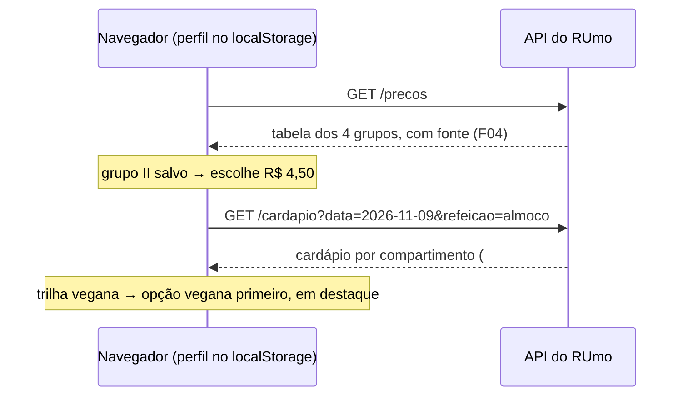

# Perfil leve no navegador

Perguntado o preço, o RUmo devolvia a tabela dos quatro grupos e deixava a conta para a
pessoa. Com um perfil de quatro campos, guardado no próprio navegador, ele devolve o número
dela e diz de qual grupo veio (issue #66, RF01, RF02).

| Campo | Exemplo | Muda o quê |
|---|---|---|
| Trilha alimentar | vegetariano estrito | o cardápio mostra a sua opção primeiro, em destaque |
| Grupo de subsídio | Grupo II | "quanto custa o almoço?" responde R$ 4,50 e diz o grupo |
| Curso | Engenharia de Software | guardado para o fluxo (#61, #65) |
| Semestre | 5º | guardado para o grafo (#61) |

## Onde o perfil fica, e por que ele não sai de lá

O perfil fica no `localStorage`, na chave `rumo.perfil.v1`. Não existe conta de usuário no
mapa público, nenhum dado pessoal precisa trafegar (RNF06) e a pessoa apaga tudo com um
botão.

A personalização acontece **no navegador**. O servidor só entrega dados iguais para todo
mundo, e o módulo escolhe o que é da pessoa:



O corpo do `POST /perguntar` é montado por uma lista fechada de campos (`pergunta`,
`contexto.campus`, `contexto.data`). O curso, que a API até aceitaria, também fica de fora:
quando o fluxo (#61) precisar dele, a decisão de enviar será tomada naquela issue, à vista da
pessoa.

## Como é preenchido

Não há formulário de cadastro. Na primeira vez que a pessoa pergunta preço, o Milton responde
a tabela como hoje e oferece "Quer que eu lembre seu grupo?", com os quatro grupos e um "Não,
obrigado". Quem recusa não é perguntado de novo (a recusa também fica só no navegador).

O perfil fica **sempre visível e editável** numa faixa no topo, com botão de apagar. É a
resposta ao risco da issue: perfil errado gera resposta errada com cara de certa. Por isso a
resposta personalizada sempre diz o grupo usado e cita a fonte:

> Almoço: R$ 4,50 — valor do Grupo II, o grupo salvo no seu perfil. [F04, p. 1]

Sem perfil, tudo funciona como antes.

## O que foi entregue

| Arquivo | Papel |
|---|---|
| `rag/web/rumo-perfil.js` | módulo ES sem dependências: guardar/apagar o perfil, resposta de preço, ordenação do cardápio, cliente da API que nunca envia o perfil, faixa do perfil e oferta do grupo |
| `rag/web/demo-perfil.html` | demonstração no estilo do chat do Milton, com o registro de tudo o que foi enviado ao servidor |
| `rag/rumo_rag/coleta/precos.py` | tabela de preços por grupo extraída dos chunks do F04, com doc_id, página e chunk de cada valor |
| `rag/rumo_rag/api.py` | rotas `GET /precos`, `GET /cardapio` e `/web/` (arquivos estáticos) |

`GET /precos` e `GET /cardapio` não usam LLM nem recebem nada da pessoa, por isso não pedem o
token de `/perguntar`.

### Integração com o Milton (portal do Grupo 09)

O chat do Milton fica no portal do Grupo 09 (FcteMapping). Para usar o perfil, basta importar
o módulo servido pela API:

```js
import * as perfil from "https://<rumo-api>/web/rumo-perfil.js";

const api = perfil.criarCliente({ base: "https://<rumo-api>", token });
const minha = perfil.respostaDePreco(perfil.carregar(), await api.precos(), pergunta);
if (minha) mostrar(minha.texto);                       // resposta da pessoa
else mostrar((await api.perguntar(pergunta)).resposta); // resposta genérica, como hoje
```

## Como verificar

```bash
cd rag
uvicorn rumo_rag.api:app --port 8001
# abra http://localhost:8001/web/demo-perfil.html
```

1. Pergunte "quanto custa o almoço?": vem a tabela e a oferta. Escolha **Grupo II** e pergunte
   de novo: "Almoço: R$ 4,50 — valor do Grupo II…"
2. Em **Editar**, escolha a trilha **Vegetariano estrito**: no cardápio, a opção vegana sobe e
   fica destacada
3. **Apagar perfil**: a resposta volta a ser a tabela, e o cardápio volta à ordem original
4. O quadro "O que foi enviado ao servidor" mostra cada requisição. O perfil não aparece em
   nenhuma

Testes automáticos dos quatro critérios:

```bash
cd rag
node --test web/rumo-perfil.test.mjs               # módulo do navegador (Node 18+)
python -m unittest testes.test_perfil_api -v       # tabela de preços e rotas
```

---

??? abstract "Histórico de revisão"

    | Data | Versão | Descrição | Autor |
    | :---: | :---: | --- | --- |
    | 18/11/2026 | 1.0 | Perfil leve no navegador: armazenamento local, preço por grupo, destaque da trilha e rotas de dados (#66) | Kyara Esteves |
