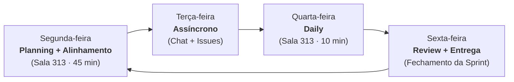

# Processo de trabalho

Processo de desenvolvimento e governança do **Grupo 04** para o Challenge 2 (Residência em IA · UnB/FCTE).

**Épico relacionado:** #2 · Definição do processo e fluxo de trabalho do grupo.

---

## 1. Contexto e princípios

O grupo concluiu as duas primeiras semanas do Challenge 2 (Entregas 1 e 2) sem um combinado formal escrito sobre o fluxo de trabalho. Com **5 semanas restantes das 7 semanas totais** do projeto, o processo precisa ser **extremamente leve e pragmático**: qualquer cerimônia ou burocracia que consuma tempo útil sem gerar valor de software ou documentação foi eliminada.

O princípio central do time é: **o que não couber numa semana não serve**. Se uma demanda for grande demais para o ciclo semanal, ela é obrigatoriamente fatiada antes de entrar na sprint.

---

## 2. Cadência da Sprint

As sprints do Grupo 04 têm duração fixa de **1 semana (7 dias corridos)**, sincronizadas diretamente com o calendário acadêmico da Residência (Semanas 3 a 7 do [Roadmap](../visao/roadmap.md)), cujas entregas ocorrem pontualmente às **sextas-feiras**:

- **Início da Sprint:** Segunda-feira, com a realização do Sprint Planning na Sala 313 e abertura das branches de trabalho.
- **Fechamento da Sprint:** **Sexta-feira**, casando com a entrega semanal no Teams e publicação na GitPage.
- **Meta da Sprint (*Sprint Goal*):** Cada sprint possui um objetivo único e demonstrável, diretamente vinculado ao entregável da semana previsto no cronograma oficial.

---

## 3. Rituais semanais

Para manter a cadência sem sobrecarregar a equipe, os rituais foram desenhados considerando a presença física do grupo na Residência às **segundas e quartas-feiras** (Sala 313). A **Figura 1** ilustra o ciclo semanal de rituais do Grupo 04, demonstrando o fluxo contínuo desde o planejamento na segunda-feira até a entrega e revisão na sexta-feira.

Figura 1. Ciclo semanal de rituais do Grupo 04 com fechamento de sprint às sextas-feiras.

### Dailies presenciais (Segundas e Quartas na Sala 313)

Como a equipe já está reunida fisicamente na Sala 313 da FCTE às **segundas e quartas-feiras**, adota-se uma **daily presencial curta de alinhamento** nesses dois dias. Nos demais dias (terça, quinta e sexta), a equipe opera de maneira puramente assíncrona, preservando o foco e evitando o atrito de sincronização remota.

#### Roteiro da daily presencial (máximo 10 minutos, em pé)

A daily ocorre no início do período presencial na Sala 313. Cada integrante dispõe de no máximo **2 minutos** para responder objetivamente a três perguntas:

1. **O que entreguei/avancei** desde o último encontro? *(ex: "Finalizei a extração das 36 fontes oficiais e subi o PR #15.")*
2. **O que pretendo fechar** até o próximo marco? *(ex: "Vou implementar os pesos no BM25 e rodar o script de avaliação.")*
3. **Existe algum impedimento ou bloqueio?** *(ex: "Estou com dúvida no formato do JSON de contrato com o Grupo 09.")*

!!! tip "Regra de ouro da daily: sem resolução técnica na roda"
    A daily serve exclusivamente para **sincronizar status e identificar bloqueios**. Discussões longas de implementação, depuração ou decisões de arquitetura não devem ocorrer durante a daily: os envolvidos marcam um pareamento imediatamente após o término da reunião.

#### Registro para ausentes

Caso um integrante não possa comparecer presencialmente na Sala 313:

- **Check-in assíncrono:** O integrante ausente deve postar as respostas às 3 perguntas no canal de bate-papo da equipe até o horário previsto para a daily.
- **Resumo no repositório:** O Scrum Master (Gabriel Maciel) ou o colega responsável pelo componente afetado anota os bloqueios ou acordos firmados na issue correspondente, garantindo transparência total.

### Sprint Planning (Planejamento)

- **Quando:** Segundas-feiras, presencialmente na Sala 313, logo após o alinhamento inicial.
- **Duração máxima:** 30 a 45 minutos.
- **Pauta:**
    1. Definir o *Sprint Goal* da semana com base no cronograma oficial.
    2. Selecionar e revisar as issues do backlog para a sprint.
    3. Estimar o esforço das tarefas na escala **P / M / G**.
    4. Distribuir a responsabilidade primária aos [donos de componente](equipe.md).

### Sprint Review e Retrospectiva

- **Quando:** **Sextas-feiras**, durante o fechamento da sprint e envio da entrega semanal.
- **Duração máxima:** 20 a 30 minutos.
- **Pauta:**
    - **Review (15 min):** Demonstração do incremento funcionando (protótipo RAG respondendo, páginas do MkDocs renderizadas e testes de avaliação passando).
    - **Retrospectiva (15 min):** Levantamento rápido de 3 tópicos: o que funcionou bem, o que atrasou ou gerou retrabalho, e um ajuste concreto de processo para a próxima semana.

---

## 4. Comunicação e rastreabilidade

Para equilibrar agilidade e registro histórico, a comunicação é estruturada em múltiplos canais. A **Tabela 1** resume a matriz de canais de comunicação adotados pelo grupo, detalhando o propósito e as regras de uso de cada um.

| Canal | Propósito | Regras de uso |
|---|---|---|
| **Chat da equipe** (WhatsApp / Discord) | Comunicação rápida, operacional e emergencial | Alinhamento de horários presenciais, dúvidas rápidas, aviso de bloqueios urgentes e check-in de quem não pôde ir à daily. Não substitui decisões técnicas na issue. |
| **Sala 313 (FCTE)** | Trabalho colaborativo e pareamento presencial | Espaço para trabalho conjunto nos dias de residência (segundas e quartas), realização das dailies curtas e alinhamento direto com o Grupo 09. |
| **GitHub Issues** | Registro formal de trabalho e decisões técnicas | Toda tarefa, discussão de arquitetura e medição técnica reside aqui. |
| **GitHub Pull Requests** | Revisão de código e documentação | Canal de code review por pares antes de qualquer merge na branch `main`. |

Tabela 1. Matriz de canais de comunicação.

### Regra inegociável: "Se não está na issue, não aconteceu"

Conversas de corredor ou mensagens soltas no chat se perdem facilmente. Por isso, **obrigatoriamente deve ir para a issue do GitHub**:

- **Decisões arquiteturais:** Escolha ou substituição de bibliotecas, modelos (ex: alteração de bge-m3 ou Qwen), dimensões de chunk e limiares de fusão.
- **Impedimentos técnicos:** Problemas que travam o avanço de um componente e dependem de outros membros ou mentores.
- **Evidências e medições:** Tabelas de resultados de avaliação (Hit@1, Hit@5, MRR, fidelidade, alucinação) e tempos de execução.
- **Acordos de reunião:** Resumo das decisões tomadas na Sala 313 ou nas mentorias.
- **Vínculo com PRs:** Todo Pull Request deve fechar pelo menos uma issue (`Closes #...`).

---

## 5. Estimativa de esforço: P / M / G

Em um horizonte curto de 5 semanas, técnicas numéricas minuciosas como Planning Poker não se pagam. O grupo utiliza estimativa relativa em tamanhos de camiseta (**P / M / G**). A **Tabela 2** detalha os critérios de estimativa por tamanho de camiseta, acompanhados de exemplos típicos no desenvolvimento do RUmo e da respectiva ação esperada caso o escopo estoure.

| Tamanho | Esforço estimado | Exemplo típico no RUmo | Ação se estourar |
|:---:|:---:|---|---|
| **P** | Algumas horas até 1 dia | Corrigir link quebrado, adicionar nova fonte ao `catalogo.yaml`, ajustar prompt de recusa ou estilização CSS. | Concluir no mesmo dia. |
| **M** | 1 a 2 dias | Implementar busca BM25 com pesos customizados, criar página de documentação com diagramas, adicionar teste automatizado. | Se travar por mais de 2 dias, pedir ajuda ao dono do componente ou simplificar. |
| **G** | 3 a 4 dias (máx. 1 semana) | Pipeline completo de ingestão e chunking, implementação do orquestrador de multiagentes, script de benchmarking end-to-end. | Limite máximo para uma issue individual. |
| **> G** | Superior a 1 semana | Implementar todo o sistema multimodal com interface gráfica em uma única entrega. | **Proibido:** Deve ser fatiado obrigatoriamente no Planning em tarefas menores P e M. |

Tabela 2. Critérios de estimativa por tamanho de camiseta (P / M / G).

---

## 6. Mentoria com o mentor Jefferson

As reuniões com o mentor do Challenge 2, **Jefferson Viana Fonseca Abreu**, são momentos-chave para validação das entregas e direcionamento estratégico.

- **Periodicidade:** Semanal, conforme calendário da residência.
- **Condução e pauta:** O Scrum Master (Gabriel Maciel) e o Product Owner (Maykon Soares) consolidam os tópicos da pauta, com colaboração obrigatória de quem tiver itens técnicos a validar.
- **Preparação:** A pauta é levantada previamente (com até 24h de antecedência) em issue específica no GitHub, reunindo:
    1. Demonstração objetiva do entregável da semana.
    2. Dúvidas técnicas de arquitetura ou integração com o Grupo 09.
    3. Validação dos limites de escopo e regras de negócio.
- **Pós-mentoria:** As deliberações e orientações do mentor são documentadas na respectiva issue e incorporadas ao backlog da sprint seguinte.

---

## 7. Fluxo de Engenharia e Definition of Done (DoD)

Para garantir integridade técnica e evitar quebras no protótipo ou na GitPage, o time segue um fluxo de trabalho estruturado:

### Política de Branches e Commits

- É **estritamente proibido realizar commits diretos na branch `main`**.
- Todo trabalho é desenvolvido em branches nomeadas pelo padrão:
    - `feat/<slug>` — novas funcionalidades no código do protótipo.
    - `fix/<slug>` — correção de bugs ou falhas de recuperação/geração.
    - `docs/<slug>` — novas páginas ou revisões na documentação MkDocs.
    - `chore/<slug>` — tarefas de infraestrutura, dependências e automação.
- Commits redigidos em português, no modo imperativo, indicando o escopo quando pertinente (ex: `feat(indice): calibra peso BM25 para datas de cardápio`).

### Critérios de Aceite para Merge (Definition of Done)

Para assegurar conformidade contínua, o repositório conta com um template padronizado de Pull Request (`.github/pull_request_template.md`), preenchido automaticamente na abertura de qualquer PR. Os critérios formais e a matriz completa de entrada e saída estão formalizados em [Critérios de Prontidão (DoR) e Conclusão (DoD)](dor-dod.md). Um Pull Request só pode ser integrado à branch `main` se atender integralmente ao checklist de Definition of Done (DoD):

1. [x] **Requisito demonstrável:** O comportamento do RF/RNF correspondente está implementado e validado.
2. [x] **Regras inegociáveis de negócio:** Citação explícita de fonte oficial (RF03) e recusa clara caso a resposta não esteja na base (RF04). Nenhum envio não autorizado de dados externos (RNF02).
3. [x] **Aferição de métricas:** Qualquer alteração em extração, chunking, embeddings, pesos de busca ou prompt exige rodar `python -m rumo_rag avaliar` e atualizar os números na documentação no mesmo PR.
4. [x] **Documentação íntegra:** O comando `mkdocs build --strict` executa com sucesso localmente, sem warnings ou links quebrados.
5. [x] **Histórico de revisão:** A página modificada contém uma nova entrada na tabela de histórico de revisão.
6. [x] **Revisão por pares:** Aprovação de pelo menos um colega de equipe (preferencialmente o responsável pelo componente).

---

??? abstract "Histórico de revisão"

    | Data | Versão | Descrição | Autor |
    | :---: | :---: | --- | --- |
    | 11/11/2026 | 1.0 | Formalização do processo de trabalho do Grupo 04 (Épico #2): sprints semanais, estimativa P/M/G e regras de DoD | Grupo 04 |
    | 11/11/2026 | 1.1 | Ajuste da cadência para entregas às sextas-feiras e inclusão de referências explícitas no texto para a Figura 1, Tabela 1 e Tabela 2 | Grupo 04 |
    | 11/11/2026 | 1.2 | Inclusão das dailies presenciais curtas (segundas e quartas na Sala 313), roteiro de 3 perguntas e política para ausentes | Grupo 04 |
