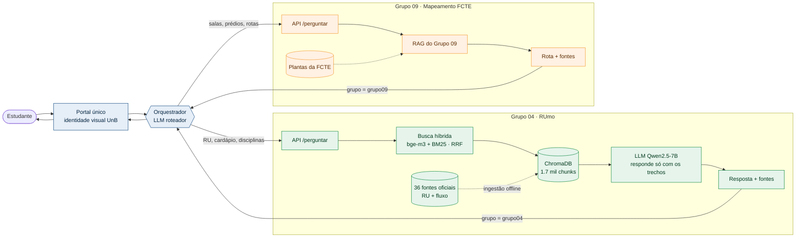

---
hide:
  - navigation
  - toc
---

# Como o RUmo funciona e conversa com o Grupo 09

Escolha um cenário e clique em **▶ Reproduzir** (ou avance com **▶|**). Cada passo destaca quem está agindo e mostra os dados trocados.

Figura 1. Diagrama interativo. Verde: sistema do Grupo 04. Laranja: sistema do Grupo 09 (proposta de contrato; a implementação interna é do Grupo 09). Azul: camada comum aos dois grupos. Use "Tela cheia" para apresentar.

## Visão geral em uma imagem

A mesma arquitetura, sem animação, para leitura rápida ou impressão.

Figura 2. Arquitetura dos dois sistemas e da camada comum.

## O que acontece em cada parte

| Parte | Responsável | O que faz |
|---|---|---|
| Portal único | Grupos 04 e 09 | Recebe a pergunta e mostra a resposta com selos de fonte, nas cores e fontes da UnB |
| Orquestrador | Grupos 04 e 09 | Classifica a pergunta, divide quando ela mistura assuntos e chama um ou os dois sistemas |
| API do RUmo | Grupo 04 | `POST /perguntar` no contrato comum ([ver contrato](escopo-grupos.md#contrato-de-api-proposto)) |
| Busca híbrida + ChromaDB | Grupo 04 | Recupera os trechos mais relevantes das 36 fontes ([detalhes](../entrega-2/arquitetura.md)) |
| LLM gerador | Grupo 04 | Escreve a resposta só com os trechos e cita cada um; sem base, recusa |
| API e RAG do Grupo 09 | Grupo 09 | Respondem sobre salas, prédios e rotas no campus |

Tabela 1. Responsabilidades por componente.

