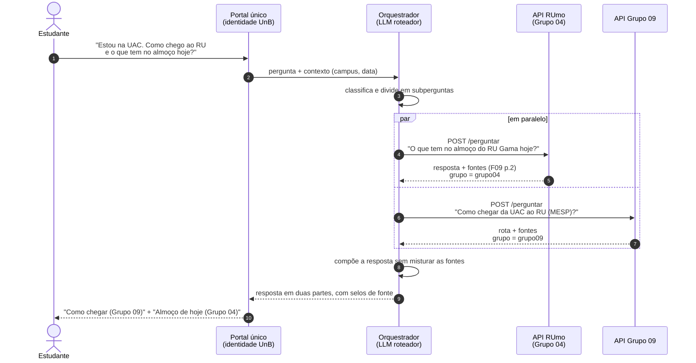

---
hide:
  - navigation
  - toc
---

# Divisão com o Grupo 09

Os Grupos 04 e 09 começaram com ideias que se encostam: o Grupo 09 já vinha mapeando o campus Gama (salas, prédios, acessos) e o Grupo 04 tinha uma proposta voltada à alimentação. Na reunião com o mentor Jefferson (registrada em vídeo), ficou definido o seguinte.

## O que foi combinado

!!! success "Decisões da reunião com o mentor"
    1. **São dois grupos, dois sistemas e duas entregas.** Cada grupo entrega tudo o que o cronograma pede, de forma completa e independente.
    2. **A integração é um extra.** Os sistemas podem conversar e ser apresentados lado a lado, mas o mentor deixou claro que a integração não pode atrapalhar as entregas.
    3. **Mesma porta de entrada, mecanismos diferentes.** A ideia aceita é uma interface comum que chama os dois sistemas; cada grupo mantém o próprio RAG e as próprias fontes.
    4. **Mesma identidade visual.** Os dois grupos usam as mesmas cores e fontes (identidade da UnB), para que a integração final pareça um produto só.
    5. **Apresentações próximas.** No dia da apresentação, os dois grupos podem ser alocados em sequência, para mostrar o extra da conversa entre os sistemas.

## Quem cuida de quê

| | Grupo 04 · RUmo | Grupo 09 |
|---|---|---|
| Tema | Restaurante Universitário e fluxo de disciplinas | Mapeamento da FCTE (salas, prédios, acessos) |
| Base de conhecimento | Resoluções e páginas do RU, cardápios, editais DDS, PPCs, fluxogramas, calendário, normas acadêmicas | Plantas e mapeamento dos prédios do campus Gama |
| Pergunta típica | "O que tem no almoço de quarta?", "O que preciso cursar antes de Testes de Software?" | "Onde fica a sala I-10?", "Como chego ao MESP?" |
| Entregáveis | Completos, nesta GitPage | Completos, na documentação do Grupo 09 |

<p class="legenda">Tabela 1. Responsabilidades de cada grupo.</p>

## Como os dois sistemas conversam

O diagrama animado mostra o caminho de uma pergunta, passo a passo, com os dados trocados em cada etapa. Escolha o cenário **"2 · Pergunta que usa os dois grupos"** e clique em ▶ Reproduzir.

<div class="rm-fluxo" data-fluxo data-cenario="2"></div>

<p class="legenda">Figura 1. Diagrama interativo da integração. A parte do Grupo 09 mostra a proposta de contrato; a implementação interna é do Grupo 09.</p>

A mesma conversa em forma de diagrama de sequência:



<p class="legenda">Figura 2. Sequência de uma pergunta que precisa dos dois sistemas.</p>

## Contrato de API proposto

Para que o orquestrador trate os dois sistemas do mesmo jeito, propomos ao Grupo 09 um contrato único. Cada grupo implementa `POST /perguntar` no próprio serviço.

=== "Requisição"

    ```json
    {
      "pergunta": "O que tem no almoço do RU Gama hoje?",
      "contexto": {
        "campus": "gama",
        "data": "2026-11-11",
        "curso": "software"
      },
      "max_trechos": 5
    }
    ```

=== "Resposta"

    ```json
    {
      "grupo": "grupo04",
      "resposta": "No almoço de quarta-feira, 11/11/2026, ... [1]",
      "encontrou_base": true,
      "fontes": [
        {
          "n": 1,
          "doc_id": "F09",
          "titulo": "Cardápio semanal do RU Gama — 09/11 a 15/11/2026",
          "orgao": "UnB · Diretoria do RU",
          "pagina": 2,
          "url": "https://ru.unb.br/wp-content/uploads/2026/11/Gama-Semana-04-09-11-a-15-11.pdf"
        }
      ],
      "tempo_ms": 5400
    }
    ```

=== "Sem base"

    ```json
    {
      "grupo": "grupo04",
      "resposta": "Não encontrei essa informação nas fontes da base.",
      "encontrou_base": false,
      "fontes": []
    }
    ```

| Campo | Para que serve |
|---|---|
| `grupo` | O orquestrador e o portal sabem de qual sistema veio cada parte da resposta |
| `fontes` | Rastreabilidade: cada citação `[n]` aponta para documento, página e URL |
| `encontrou_base` | Permite ao orquestrador não "costurar" respostas vazias e avisar o estudante |
| `contexto` | Data e campus resolvem "hoje" e "aqui" sem que cada grupo adivinhe |

<p class="legenda">Tabela 2. Campos do contrato e motivo de cada um.</p>

## Regras para a integração não atrapalhar as entregas

- O RUmo funciona **sozinho** pela linha de comando e pela própria API. A integração só acrescenta uma camada por cima.
- A integração entra no roadmap na **Semana 6** (integração completa). Até lá, cada grupo só precisa respeitar o contrato.
- Bases, índices e prompts **não são compartilhados**. Cada grupo é dono das próprias fontes e responde pelos próprios resultados.
- Se o outro sistema estiver fora do ar, o orquestrador responde com a parte disponível e avisa o que faltou.
